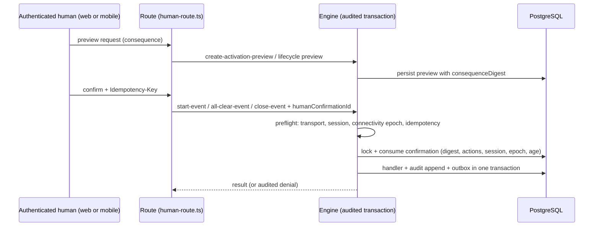
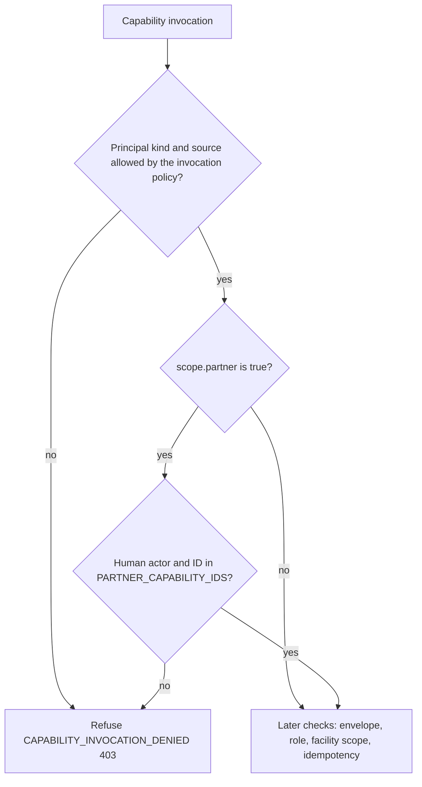

# Capability catalog, engine, and human-only enforcement

**Consult this page** when adding or changing any action (web, mobile, REST, MCP, worker, scheduled job), touching authorization, idempotency, audit, or anything near the four human-only actions.

## The model

1. **Declare once** in `packages/contracts/src/capability-catalog.ts`. `canonicalCapability()` fixes a capability's `id`, `operation` (`query`/`mutation`), `safetyEffect`, `invocationPolicy` (which `InvocationSource`s—`web`, `mobile`, `agent-rest`, `mcp`, `worker`, `scheduled-job`, `webhook`—and actor kinds `human`/`agent`/`system` may call it), `auditPolicy`, and input/output Zod schemas. Queries cannot carry a mutation effect; mutations must audit every outcome; any non-`none` safety effect gets the `central` human-action policy. Routes, tools and workers cannot redeclare these.
2. **Derived views** (`capability-derived-registry.ts`, `installCapabilityViews`) produce mutation/query/agent-grantable ID sets. The PostgreSQL enums for mutation IDs and agent grants mirror them (`mutationOrderAfter`/`agentGrantOrderAfter` give stable insertion order; see [data model](../domain/data-model.md)).
3. **Register a server handler** (`ServerCapabilityRegistration` in `packages/server/lib/capabilities/*.ts`, e.g. `startEventRegistration` in `events.ts`): `resolveFacilityId`, optional `resolveSafety` (supplies real/drill kind, roster population and `consequenceDigest`), `canonicalizeIdempotencyInput`, and the transactional `handler`.
4. **Adapters** (Next route handlers under `packages/server/app`, the agent gateway, MCP) authenticate, parse bounded input, and delegate. Human routes use `packages/server/lib/http/human-route.ts` (`executeHumanRoute`, `readBoundedJson`, `parseMutationMetadata`, `IDEMPOTENCY_KEY_HEADER`) and `resolveHumanCapabilityInvocation` in `engine.ts`, which turns an authenticated session into a server-owned `TrustedCapabilityInvocation` (web gets a CSRF-verified explicit-submit transport; mobile an explicit-submit transport). Business logic stays in `packages/server/lib`, not in `app/`.

## Three execution tiers

| Tier | Symbol | Owns | Who may call |
| --- | --- | --- | --- |
| 1 | `executeAuditedCapabilityTransaction` | authorization, idempotency claim/replay, domain transaction, append-only audit, human-confirmation consumption | every mutation |
| 2 | `executeAuthorizedCapabilityQuery` | authorization + audit for read-only IDs | queries |
| 3 | `invokeAuthorizedCapabilityHandler` (contracts) | nothing durable: no transaction, idempotency, audit | only source-tested boundaries that own their own durable protocol |

Tier-3 production importers are pinned by an allowlist in `packages/server/lib/capabilities/execution-boundary.test.ts` (`LOWER_TIER_PRODUCTION_ALLOWLIST`): the engine, delivery-state route runtime, roster-sync runtime, SES webhook runtime, notification dispatcher/reconcile/SMS-policy, SMS runtime store, and `scripts/operations/sync-access-membership.ts`. Session replay and OIDC completion have their own allowlists (`SESSION_REPLAY_ENGINE_ALLOWLIST`, `REPOSITORY_AUDITED_OIDC_ALLOWLIST`). OIDC completion is the sole pre-session path (no actor or facility yet): `executeRepositoryAuditedOidcCompletion` accepts only `complete-oidc-sign-in`, used by the browser callback, mobile exchange and app-review sign-in routes ([identity](../domain/identity-and-access.md)). **To add a lower-tier consumer, route it through the audited engine, or deliberately update the allowlist test and `docs/ARCHITECTURE.md` together.**

## Human-only actions and confirmation

`HUMAN_ONLY_ACTION_IDS` in `packages/contracts/src/human-only.ts` is `start-real-incident`, `send-real-notification`, `all-clear`, `close-real-event`. Additions need a safety-policy change, not a local fork.

Caption: a protected mutation only commits when a still-valid confirmation matching the exact consequence digest is consumed in the same transaction as the domain write and audit.

Invariants (see `engine.ts` confirmation checks and tests `rejects missing, mismatched, expired, and consumed confirmations before the handler`, `rechecks confirmation expiry against the authoritative transaction clock after lock waits`, `consumes confirmation and atomically records protected success audit evidence`, `rejects agent and system attempts at a staff-protected action and audits the human-only boundary`):

- Confirmation must match capability ID, confirming user, session, connectivity epoch, `consequenceDigest`, and `actionIds`; lifetime `HUMAN_CONFIRMATION_MAX_AGE_SECONDS` (5 min) is re-checked against the transaction clock after lock waits.
- Synthetic (drill/test, `rosterPopulation` not `staff`) activations record `synthetic-training` authorization and need no human confirmation; real staff activations record `human-confirmed`.
- Idempotency: same key + different canonical input is rejected; replay returns the stored result without re-running the handler, is audited under the fresh request ID, and **re-authorizes facility scope** before returning.
- Agents reach protected actions only through aliases mapped in `packages/server/lib/agents/gateway.ts` (`protectedActionCapability`); those are refused and audited as `HUMAN_ONLY_REQUIRED` ([agent API](../integrations/agent-api-and-mcp.md)).
- Authorization is deny-by-default and scoped by role and `FacilityScope` (`district` or `facilities`); client visibility is never a control.

## Partner sessions and the allowlist

A partner session is a human principal whose server-resolved scope carries `partner: true`; partner sign-in sets it ([partner web sign-in](../domain/partner-sign-in.md)). `assertInvocationAllowed` in `packages/server/lib/capabilities/engine.ts` refuses such an invocation unless the actor is human and the capability ID is in `PARTNER_CAPABILITY_IDS` (`packages/contracts/src/partner-capabilities.ts`). It runs in `preflightCapabilityInvocation` and in the audited paths, before the mutation envelope and the role and facility checks.

Caption: the partner allowlist only narrows. The check is skipped for any scope without `partner: true`, and a partner invocation that passes it still faces every ordinary check after it.

- **The refusal is generic.** A partner gets the same `CAPABILITY_INVOCATION_DENIED` (403, "This authenticated principal cannot invoke the capability.") as any other refused principal, so it never names the role.
- **Interfaces hide what the engine would refuse** with `partnerAllowlistPermits(scope, capabilityId)` (contracts, not an authorization). Consumers: `NavDestination.capabilityId` and `navigationDestinationsFor` in `packages/server/app/nav/primary-nav-model.ts`; the events list in `app/(app)/page.tsx`; the event room's summary export link in `app/(app)/events/[id]/page.tsx`; the Records and start gates in `app/(app)/records/_lib/session.ts` and `app/(app)/start/_lib/session.ts`, which redirect a partner to `/`; and `viewerManagesLifecycle` in `syncEventRoomRegistration` (`lib/capabilities/event-room.ts`).
- **Admin pages stay renderable.** `withAdminRefusal` in `packages/server/lib/capabilities/admin.ts` turns the engine's denial into an `AdminCapabilityError` with status 403 inside `executeAdminQueryCapability` and `executeAdminMutationCapability`, so an admin page shows its non-administrator view instead of a server error.
- **Partner facility scope** is resolved separately by `partnerFacilityScope` in `lib/auth/partner-admission.ts`: every non-isolated facility, never an isolated one. Event-room reads of an isolated facility's drill are refused for a partner (see the test table below).

**Extend the allowlist** only by adding a registered capability ID to `PARTNER_CAPABILITY_IDS` and updating the exact-allowlist test in the same change, as `docs/ARCHITECTURE.md` requires. A new navigation destination must declare its `capabilityId` (the type requires it).

Focused tests, by behavior:

| Behavior | Test (find by name) |
| --- | --- |
| Every capability and human transport is refused off the allowlist for a partner, staff are unchanged | `packages/server/lib/capabilities/engine.test.ts`: `refuses every capability off the partner allowlist on every human transport` |
| The allowlist is exactly what the interfaces show | `packages/contracts/src/partner-capabilities.test.ts`: `interfaces hide exactly what the allowlist refuses a partner` |
| Partner navigation shows only allowlisted destinations | `packages/server/app/nav/primary-nav-model.test.ts`: `a partner sees only destinations whose capability the partner allowlist admits` |
| Partner event room: no lifecycle control, no summary export | `packages/server/app/(app)/events/[id]/event-room.test.tsx`: `offers a partner no lifecycle control and no summary export`; `packages/server/lib/capabilities/event-room.database.test.ts`: `tells a partner the event is theirs to follow, not to end` |
| Partner read of an isolated facility's drill is refused on web and mobile | `packages/server/lib/capabilities/event-room.database.test.ts` (needs `TEST_DATABASE_URL`): `a drill at an isolated facility is invisible to a partner` |
| Admin page renders its refusal, not a 500 | `packages/server/app/(admin)/access/partner-capabilities.database.test.ts` (needs `TEST_DATABASE_URL`): `a partner session gets the admin refusal its page renders, not a server error` |

Validation: `bun test packages/contracts/src/partner-capabilities.test.ts packages/server/app/nav/primary-nav-model.test.ts packages/server/lib/capabilities/engine.test.ts`. The browser flow `packages/server/e2e/partner-event-participation.flow.ts` exercises the partner surface in a browser and is conditional: run it only for changes to navigation, the events list, the event room, or the admin route guards.

## Audit

The security audit is a hash-chained, append-only ledger (`packages/server/lib/audit`: `canonical.ts` canonical JSON + hash, `writer.ts` `SecurityAuditWriter`, `service.ts` query/verify capabilities, `verification-job.ts`, anchors). Distinct from the operational event journal. Tables in [data model](../domain/data-model.md); verification and admin page in [media, records and audit](../domain/media-records-and-audit.md). Tests: `hash-chain.test.ts`, `service.test.ts`, `checkpoint.integration.test.ts`.

## Change recipes

**Add a capability.** (1) Schemas in the relevant contracts file; (2) `canonicalCapability(...)` entry in `capability-catalog.ts` with the narrowest `invocationPolicy`; (3) if agent-callable, add to `AGENT_KEY_GRANTABLE_CAPABILITY_IDS` (`agent-key-grants.ts`, must be a subset of the persisted grant enum) and the dispatcher switch in `packages/server/lib/agents/dispatcher.ts`; (4) DB enum migration if the ID joins persisted mutation/grant enums (new migration only; never edit applied ones); (5) server registration + handler, wired into the runtime factory; (6) route in `app/` or reuse the generic agent route; (7) expose to consumers (MCP `manifest.ts` `MCP_TOOL_IDS`, mobile `lib`, OpenAPI via `agents/openapi.ts`). Tests: `contracts.test.ts`, `capability-derived-views.test.ts`, `human-only-agent-surface.test.ts`, `agents/human-only.test.ts`, `agent-key-grants.test.ts`, `schema-enums.test.ts`. Escalate if the capability can start/notify/all-clear/close a real event: that is the product owner's decision.

**Consumer-boundary check.** Unit tests of a handler do not prove the shipped surface: confirm the ID resolves through the route (`packages/server/app/...`), the agent dispatcher if grantable, and `packages/mcp/src/manifest.ts` if exposed. Narrow: `bun test packages/server/lib/capabilities packages/contracts` plus `bun run --cwd packages/server typecheck`. Full `bun run check` is conditional on cross-package or migration changes.

**Not generated:** no generated mirrors of the catalog exist besides the DB enum migrations (hand-authored SQL under `packages/server/drizzle/migrations`, checked by `migration-chain.test.ts`).

Related: [event lifecycle](../domain/event-lifecycle-and-activation.md) (the main protected consumers), [architecture overview](overview.md).
