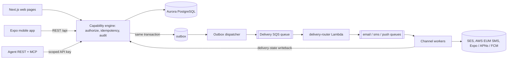

# PSD EOC architecture overview

PSD EOC is an open-source emergency notification and operations platform for school districts: staff activate an incident or drill, the platform notifies staff over push, email and SMS, staff collaborate in a live event room, and everything is retained as an append-only record. It **notifies and documents; it never contacts emergency services** (call 911 first). Any district runs it on its own AWS account and Google Workspace, so nothing district-specific may be a literal in source (see [configuration and readiness](../operations/configuration-and-readiness.md)).

## Workspaces and what each owns

Bun workspaces (`package.json`: `packages/*`, `workers`, `infra`, `infra/gcp`, `infra/lambda/*`, `scripts`, `scripts/ops*`). Ownership table follows `docs/ARCHITECTURE.md`, verified against the tree.

| Workspace | Owns | Must not own | Wiki page |
| --- | --- | --- | --- |
| `packages/contracts` | Zod schemas, capability catalog, human-only registry, agent-key grant allowlist, worker batch/attempt contracts | DB or provider code | [capability engine](capability-engine.md) |
| `packages/server` | Next.js 15 web (`app/`), REST, capability engine and repositories (`lib/`), Drizzle schema and migrations (`db/`, `drizzle/`), outbox | Parallel domain types; provider sends from UI routes | [event lifecycle](../domain/event-lifecycle-and-activation.md), [data model](../domain/data-model.md) |
| `packages/mobile` | Expo SDK 57 app for iOS and Android | Business-rule forks, offline real actions | [mobile app](../integrations/mobile-app.md) |
| `packages/mcp` | MCP adapter (stdio and Streamable HTTP) over the agent REST API | DB/provider access, human-only actions | [agent API and MCP](../integrations/agent-api-and-mcp.md) |
| `workers` | Email, SMS and push channel workers plus shared at-least-once processing | Activation authority, recipient reconstruction | [channel workers](../integrations/channel-workers.md) |
| `infra` | AWS CDK stack, Lambdas (`infra/lambda/*`), monitoring, GCP Terraform (`infra/gcp`), AWS Terraform roots for the partner responder pool (`infra/terraform/stateful`) and the CI state bootstrap (`infra/terraform/state-bootstrap`), plus the Terraform CI workflow (`.github/workflows/terraform.yml`) | Tenant identity in source | [infrastructure](../operations/infrastructure.md) |
| `scripts` | Test gate, doc/config verifiers, operator tooling (`scripts/ops`) | Unattended live-provider writes | [verification](../testing/verification-and-testing.md) |

## Runtime flow in one picture

Caption: every mutation enters through the one capability engine; workers can only append delivery evidence back through a narrow internal route.

Details: [notification pipeline](../domain/notification-pipeline.md), [event lifecycle](../domain/event-lifecycle-and-activation.md).

## Rules that shape every change

Source of truth is `AGENTS.md` (the product owner's session instruction outranks it, except for the four human-only items).

- **Four human-only actions** (`start-real-incident`, `send-real-notification`, `all-clear`, `close-real-event`) in `packages/contracts/src/human-only.ts`; server enforcement stays intact. Mocks and synthetic targets are fine.
- **Staff data only**: no student, guardian, schedule or reunification data.
- **Real vs. drill never blurs** in contracts, storage, UI, templates, channel payloads.
- **Append-only**: event journals, security audit, delivery attempts/evidence; corrections supersede. Applied migrations are never edited; no down migrations.
- **Deny by default**, server-side, scoped by role (`staff`/`admin`) and facility.
- **Provider acceptance ≠ delivery ≠ human receipt**; ambiguity stays `unknown`.
- **Contracts first, one capability layer, no side-door mutation path.**
- **Deployment follows psd-dev-standards 08**: the CDK stack deploys only by a human's local `cdk deploy`, and no workflow deploys it. Terraform applies only from CI behind the GitHub `production` environment approval; that pipeline is built but has not run against any account ([infrastructure](../operations/infrastructure.md#deploy-model-and-ordering), [Terraform state bootstrap and CI](../operations/terraform-ci-pipeline.md)).
- **iOS and Android stay in sync**; verify both (`bun packages/mobile/e2e/run.ts ios|android`).
- Bun only (`bun install/run/test`), never npm/npx/node.

## Change navigation

- Start with the page for the area, then `packages/contracts/src` for the schema.
- A new cross-package capability touches: contracts schema and `capability-catalog.ts` → server registration/handler → route in `packages/server/app` → consumers (mobile `src/lib`, MCP `manifest.ts`, workers). See [capability engine](capability-engine.md) for the full surface.
- Narrow check: `bun run --cwd packages/server typecheck` (or the workspace touched); the only complete gate is `bun run check` (conditional, see [verification](../testing/verification-and-testing.md)).
