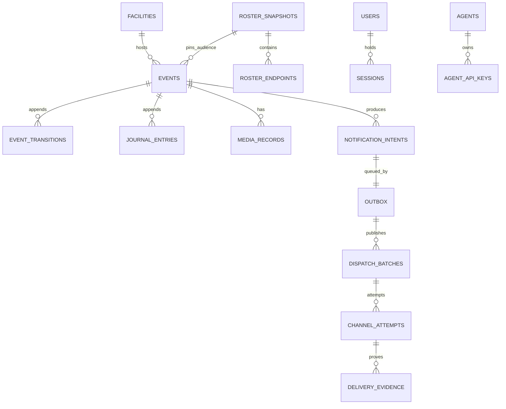

# Database schema, migrations, and append-only rules

Storage is PostgreSQL (Aurora in production) accessed with Drizzle ORM. `db/client.ts` `createDatabaseClient(readDatabaseConfig())` supports two drivers selected by `DATABASE_DRIVER`: `postgres` (local/tests, `postgres` npm package with a repo patch in `patches/`) and `aws-data-api` (RDS Data API, used by some operational paths). `databaseExecuteRows` normalizes raw-SQL results across both. Table definitions are in `packages/server/db/schema/*.ts` and re-exported from `db/schema.ts`; relations in `db/relations.ts`.

## Schema groups

| File | Main tables | Role |
| --- | --- | --- |
| `schema/events.ts` | `events`, `eventTransitions`, `activationPreviews`, `activationPreviewPartners` (the partners a live preview pinned, see [partner audience](partner-audience.md)), `preparedActivations`, `preparedActivationConsumptions`, `lifecycleConsequencePreviews`, `journalEntries`, `mediaUploadIntents`, `mediaRecords` | Event lifecycle and room ([lifecycle](event-lifecycle-and-activation.md), [media](media-records-and-audit.md)) |
| `schema/delivery.ts` | `notificationIntents`, `notificationIntentChannels`, `outbox`, `dispatchBatches`, `partnerEndpoints` (partner counterpart of a roster endpoint; no writer yet), `channelAttempts`, `channelAttemptExecutions`, provider-IO ledgers (`expoPushProviderIo`, `smsProviderIo`, `sesEmailProviderIo`), receipt/retry schedules, `deliveryEvidence`, `endpointStatusRecords`, `smsOptOutRecords` | Notification pipeline ([pipeline](notification-pipeline.md)) |
| `schema/roster.ts` | `rosterSourceConfigurations(+Facilities/+Groups)`, `rosterSnapshots(+Facilities/+Sources)`, `rosterSyncResults`, `rosterSyncGroupFailures`, `rosterRecipients`, `rosterEndpoints` | Immutable audiences ([roster](roster-and-audience.md)) |
| `schema/identity.ts` | `users`, `userRoles`, `admittedAccounts`, `userFacilityScopes`, `deviceEnrollments`, `sessions`, token issuance/rotation/replay/revocation, `connectivityEpochs`, `devicePushTokenRegistrations/Unregistrations`, `idempotencyRecords`, `humanConfirmationRecords`, `agents`, `agentApiKeys(+Facilities/Grants/Revocations)`, `staffSmsConsents`, `partnerAlertSettings` | Auth, devices, capability idempotency, agent keys ([identity](identity-and-access.md), [agent API](../integrations/agent-api-and-mcp.md)); `partnerAlertSettings` is the append-only table of [partner alert settings](partner-alert-settings.md) |
| `schema/configuration.ts` | `facilities`, `threats`, `neighborhoodVersions`, `neighborhoodFacilities`, `groupSources`, `groupMembers` | Tenant configuration rows |
| `schema/event-types.ts` | `eventTypes`, `eventTypeVersions`, `eventTypeTemplates`, `eventTypeVersionDrafts`, `eventTypeDraftTemplates`, `channelConfigurations` | Versioned notification wording and channel switches |
| `schema/audit.ts` | `securityAuditEntries`, `securityAuditChainAnchors` | Hash-chained audit |

Caption: core relationships (foreign keys in `schema/events.ts` and `schema/delivery.ts`; `outbox.intent_id` is unique via `outbox_intent_uq`; several links such as event and roster snapshot are composite and enforced with unique constraints rather than only simple FKs).

## Migrations

- Drizzle SQL files live in `packages/server/drizzle/migrations` (currently 0000–0064, journal in `meta/`). Migrations `0063` (the `partner` population, partner endpoints, and the generated `event_roster_population` column) and `0064` (partner counts and the pinned preview partner set) are the partner notification path described in [partner audience](partner-audience.md). Generate with `bun run --cwd packages/server db:generate`; apply with `db:migrate` (`drizzle/migrate.ts` `migrateDatabase`). Migration 0000 creates cluster roles with `IF NOT EXISTS`; the test runner pre-creates them to avoid a parallel-shard race ([verification](../testing/verification-and-testing.md)).
- **Never edit an applied migration**; `scripts/check-applied-migrations.ts <base> <head>` fails a change that rewrites or deletes one or alters an existing journal entry. Add a new migration instead. `migration-chain.test.ts` guards chain integrity; `migration-0049.integration.test.ts` and `capability-value-retirement.integration.test.ts` show patterns for data-rewriting and enum-retirement migrations.
- Enum and capability lists in the database mirror the contracts catalog. Adding a capability or agent grant requires a migration extending the persisted enums (`mutationOrderAfter` / `agentGrantOrderAfter` in the catalog control insertion order) and passing `schema-enums.test.ts`. See [engine](../architecture/capability-engine.md#change-recipes).
- `drizzle/migrate.ts` applies migrations only. District configuration (access group, facilities, campuses, threats, synthetic groups) is applied by the deployment bootstrap (`packages/server/scripts/operations/bootstrap.ts`, holding an advisory lock) and `db/bootstrap-*.ts`; `db/seed.ts` seeds synthetic data for local/test use. Seeds must be idempotent by semantic existence for append-only tables (`docs/learnings/database/`).
- Roles: the app connects as a restricted application role (`scripts/operations/application-role.ts`); schema triggers/constraints enforce immutability for roster snapshots and similar tables (`roster-immutability.integration.test.ts`).

## Rules for changes

- Every record is retained, and the written policy prohibits any automated disposition of them (policy in `docs/ARCHITECTURE.md` records-retention section, enforced as text by `verify:docs`). Corrections are superseding rows with provenance.
- Prefer extending an existing table/file over creating parallel structures; keep contracts schemas the source of truth and map rows to contracts with `*Schema.parse` in stores.
- Tests that need a database are named `*.database.test.ts` or `*.integration.test.ts` and read `TEST_DATABASE_URL`; they run in the full gate only. Start the synthetic DB with `bun run test:db:start`.
- Narrow check after a schema change: the three `bun test` files in `validation_commands`, then the owning store's `*.database.test.ts`.
- Append-only tables that the application role writes follow one pattern: a trigger rejects update and delete (the partner-admission guard, reused by `0062_partner_alert_settings.sql` and `0064_partner_audience.sql`), the application role gets `SELECT` plus column-level `INSERT` grants, and the table owner is also refused. `packages/server/app/(admin)/partner-alerts/capabilities.database.test.ts` tests this for [partner alert settings](partner-alert-settings.md#focused-tests).
