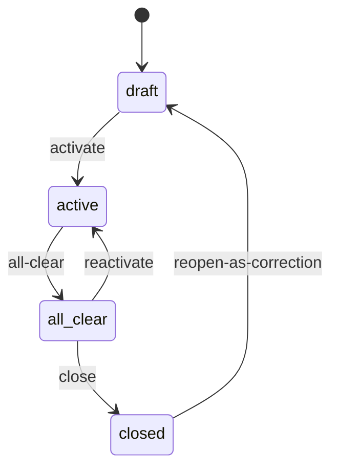
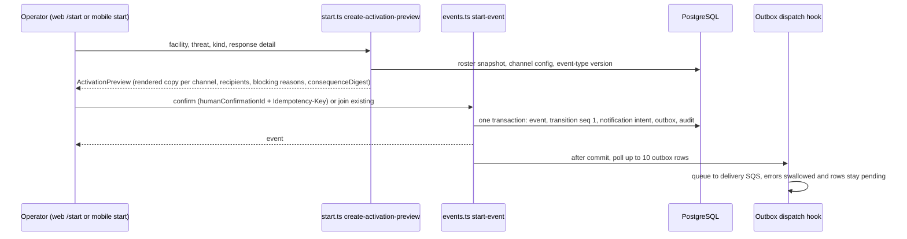

# Event lifecycle, activation flow, and event room

**Consult this page** for anything that starts, joins, clears, closes, reopens or reactivates an event, the start wizard (web `/start`, mobile `start`), or the live room/journal.

## State machine

`packages/server/lib/events/state-machine.ts` (`EVENT_STATUS_TRANSITIONS`, `canTransitionEventStatus`, `transitionEventStatus`, typed denial `EventStateTransitionError` / code `EVENT_TRANSITION_NOT_ALLOWED`):

Caption: `all_clear` stands for the status string `all-clear`; each edge is a distinct audited capability (`start-event`, `all-clear-event`, `reactivate-event`, `close-event`, `reopen-as-correction`).

Event kinds are `incident` (template mode `real`), `drill` and `test` (both mode `drill`); `EVENT_CLASSIFICATION_PRESENTATIONS` in `packages/contracts/src/event.ts` gives the fixed label, icon and color per kind ("REAL INCIDENT", "DRILL — TRAINING ONLY", "TEST — NOT A REAL INCIDENT") so web, mobile and templates cannot blur real and drill. Each transition row (`EventTransitionSchema`, sequence-numbered) records actor, source, request ID, confirmation ID and `consequenceDigest`; `activationAuthorization` on the event is `human-confirmed` (staff roster) or `synthetic-training` ([capability engine](../architecture/capability-engine.md)).

## Activation flow

Caption: preview is a persisted, digest-bound artifact; the committed transaction owns the notification intent and outbox row.

- **Preview** (`start.ts` `createActivationPreviewRegistration`, `buildActivationPreview` in `start-preview.ts`): resolves the pinned immutable `RosterSnapshot`, audience, channel configuration and published event-type version, renders copy ([notification pipeline](notification-pipeline.md)), and can refuse with reason codes (`NO_RECIPIENTS`, `NO_<CHANNEL>_ENDPOINTS`) that `lib/events/blocking-reasons.ts` turns into administrator-facing sentences.
- **Active-event decision**: `StartEventInput.activeEventDecision` carries `activeEventIdsSeen`, and `JoinOrStartDecision` forces an operator to choose join-existing vs. start-new, so two people cannot silently start duplicates. `canonicalStartInput` sorts the seen IDs for idempotency.
- **Prepared activations** (`prepare-activation`, `drizzle-prepared-activation-store.ts`, `agents/prepared-activation.ts`): an agent may prepare an activation; a human must still review and confirm it; consumption is recorded (`PreparedActivationConsumption`).
- **Post-commit dispatch**: `createOutboxDispatchHook` in `events.ts` polls up to `POST_COMMIT_OUTBOX_DISPATCH_LIMIT` (10) rows after any result containing a `notificationIntent`; any failure is swallowed so an operator who has been told the incident is active never sees it fail. A stranded row is picked up by the next activation or sweep ([pipeline](notification-pipeline.md)).
- **Later transitions and queued sends**: an activation batch can still be queued when the event is cleared, closed or reactivated. The email store still sends the begin email in that case because the activation authorization still matches, while the SMS store requires the event to remain active. The per-purpose rules and the 2026-10-15 ShakeOut reason are in [send-time currency](notification-pipeline.md#send-time-currency).
- **Lifecycle consequence previews** (`create-lifecycle-consequence-preview`, in `journal.ts`) give all-clear/close/reactivate/reopen the same preview → digest → confirm shape.
- Routes: web `app/(app)/start/api/{preview,activate,join}`, mobile `app/api/mobile/start/{facilities,threats,preview,activate}`, REST `app/api/events*`.

## Event room and journal

`event-room.ts` (`sync-event-room`) returns the header plus an ordered, cursor-paged projection of journal entries; clients (web `app/(app)/events/[id]/event-room-*.ts[x]`, mobile `features/event-room`) sync by cursor. The journal is append-only: `appendJournalEntryRegistration` rejects entries with `supersedes`; `correctJournalEntryRegistration` and `redactJournalEntryRegistration` create superseding entries that keep earlier history (`projectJournalEntryForRead` presents redactions without destroying the source). Entry kinds: text, location, photo, system. Photos go through the [media pipeline](media-records-and-audit.md). Author display names are resolved at read time (`journal-author-names.ts`), including agent labels.

## Change guidance

- New transition or status: edit contracts (`EventStatusSchema`, `EventTransitionKindSchema`), `EVENT_STATUS_TRANSITIONS`, the capability registration, UI affordances and a DB enum migration; keep the `satisfies Record<EventTransitionKind, ...>` exhaustive.
- Anything that can alter what a real recipient receives needs a real-vs-drill test (AGENTS.md: "Prove it in tests").
- Focused tests: `events.test.ts` (transitions, post-commit dispatch seam via `createEventCapabilityRuntimeOverStore`, no DB), `event-room.database.test.ts`, `journal.database.test.ts` (need `TEST_DATABASE_URL`, see [verification](../testing/verification-and-testing.md)). Browser flows: `bun run test:e2e:issue-344` etc. (conditional: UI/flow changes).
- Escalate: any change to what is human-only, to confirmation lifetime, or to how drill/real are rendered.
