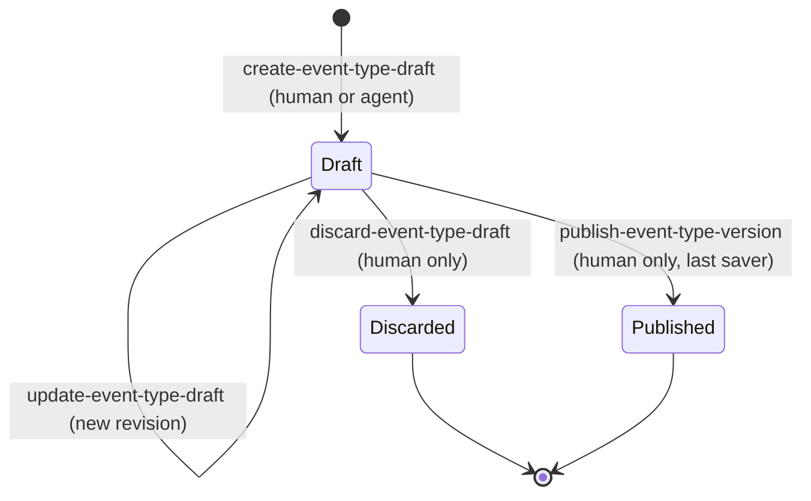

# Event types, message templates, drafts, and rendering

An **event type** is what operators call a *response* (lockdown, evacuation, …). Each has immutable, versioned **template sets** per `(mode, purpose)` — real vs. drill, and `activation` / `all-clear` / `reactivation` — containing push, email and SMS copy. When [an event starts](event-lifecycle-and-activation.md), the preview binds an `eventTypeVersion`; the [notification pipeline](notification-pipeline.md) renders it per recipient batch. Real/drill separation lives here as in everything else ([architecture overview](../architecture/overview.md)). Event types also carry a `family_key` (for example `lockdown`) that groups the real and drill identities of one response; administrators name response families, not individual types, when they choose which responses alert partners ([partner alert settings](partner-alert-settings.md)).

**Consult this page when** changing template variables or rendering, SMS length handling, the draft/publish workflow, the Responses admin page, or default wording.

## Contracts (`packages/contracts/src/event-type.ts`)

- Vocabulary: `EventKindSchema` (`incident|drill|test`), `TemplateModeSchema` (`real|drill`; `test` events render in drill mode), `NotificationChannelSchema` (`push|email|sms`), `NotificationPurposeSchema`.
- `TemplateVariableSchema`: `site`, `eventType`, `threat`, `startTime`, `initiator` (all purposes) plus `updatedBy`, `updatedAt` (all-clear/reactivation only; `ACTIVATION_TEMPLATE_VARIABLES` / `LIFECYCLE_TEMPLATE_VARIABLES`). Tokens are the exact `{{name}}` syntax in `TemplateTokenSchema`. New variables need a contracts revision so every channel stays consistent.
- `MessageTemplateSetSchema` (`PushMessageTemplate`, `EmailMessageTemplate`, `SmsMessageTemplate`), `MessageTemplateCatalogSchema`, `EventTypeVersionSchema` (with publication authorization evidence), `EventTypeVersionDraftSchema` (revisions are 64-hex digests), `RenderedMessageSchema`, `ChannelConsequencePreviewSchema`.

## Rendering (`packages/server/lib/notify/render.ts`)

`renderTemplateSet` / `renderMessageTemplate` substitute trusted structured values and escape per channel. Key rules:

- The renderer prepends the **classification marker** and lifecycle state; wording cannot contain or imitate the reserved `INCIDENT`/`DRILL` markers — a homoglyph skeleton check (`RESERVED_MARKER_SKELETONS`, confusable-character tables) rejects look-alikes.
- Field limits: push title 120 / body 500, email subject 200 / body 10 000. SMS is bounded by AWS limits (`SMS_GSM_MAX_SEPTETS` 1 530, `SMS_UCS2_MAX_CODE_UNITS` 630); `measureSmsLength` models GSM-7 vs UCS-2, because one non-GSM character (e.g. an em dash) shrinks a segment from 160 to 70 characters — default wording uses ASCII hyphens for that reason. The renderer truncates the least important tail when names push SMS over a part.
- `assertApprovedEventTypeName` and `formatNotificationStartTime` normalize names/times; the display time zone comes from configuration ([configuration](../operations/configuration-and-readiness.md)).
- `lib/capabilities/notification-wording.ts` (`loadMessageTemplateSet`) loads the stored set for an event's version and resolves actor display names; `lib/notify/default-templates.ts` supplies the starting wording for every response type before an administrator edits it.

## Draft → review → publish

Caption: a draft's lifecycle; published versions are immutable and discarded drafts stay on record.

1. Humans and agents may create/revise unpublished drafts; each revision is an append-only idempotency fact (`DrizzleEventTypeStore` in `lib/capabilities/event-types.ts`, tables `eventTypeVersionDrafts`, `eventTypeDraftTemplates`).
2. `publish-event-type-version` binds a **new immutable version** to one exact draft revision and is not agent-grantable (see [agent API and MCP](../integrations/agent-api-and-mcp.md)). Only the actor who last saved the draft may publish, so "Approve and publish" in the UI first re-saves the reviewed wording under the reviewer, then publishes.
3. The Responses admin page (`app/(admin)/event-types/manage/`, `draft-review.tsx`, `filters.ts`) lists every unpublished draft via `list-event-type-drafts` with the author resolved (for an agent: agent name plus key label and prefix), renders the three channel previews and compares field by field with the base version. `discard-event-type-draft` (migration 0058) closes a draft; updating a discarded draft yields `409` for agents. Both review capabilities are human-only on web/mobile.
4. `preview-event-type-rendering` (`EVENT_TYPE_PREVIEW_VARIABLES` sample values) lets editors and agents see rendered output without sending anything.
5. `packages/server/scripts/operations/publish-message-templates.ts` is an operator script that publishes the default wording as a superseding version of every response type whose current version differs (idempotent), recorded under a required, enabled administrator's user id as author and approver; it exists because a system actor may publish only the reviewed initial seed. Check it before changing default wording.

## Data

`eventTypes`, `eventTypeVersions`, `eventTypeTemplates`, `eventTypeVersionDrafts`, `eventTypeDraftTemplates`, `channelConfigurations` (per-channel enablement, which also gates [channel workers](../integrations/channel-workers.md)) — see [data model](data-model.md). Migrations are append-only; the draft-discard fact arrived as `0058_event_type_draft_discard.sql`.

## Change recipes

- **Add a template variable**: add to `TemplateVariableSchema` and `TemplateTokenSchema` (and the activation/lifecycle lists) in contracts → supply the value in `render.ts`/`notification-wording.ts` and `EVENT_TYPE_PREVIEW_VARIABLES` → update defaults and the admin editor's help text if any → tests in `default-templates.test.ts`, `notification-wording.test.ts`, render-related tests, and contracts tests. Check every channel's limits.
- **Change default wording**: `default-templates.ts` only affects types without an administrator version; confirm the SMS stays within one 160-character part for ordinary names (test in `default-templates.test.ts`).
- **Change draft/publish rules**: keep same-actor publish, exact-revision binding, and human-only gating; update `capability-catalog.ts` policies and `agent-key-grants.ts` together if an agent surface moves ([capability engine](../architecture/capability-engine.md)). Tests: `lib/agents/event-types*.test.ts`, `contracts/src/event-type-review.test.ts`, `(admin)/event-types/event-types.database.test.ts` (needs DB).
- Never edit an applied migration; add a new one for schema changes.
