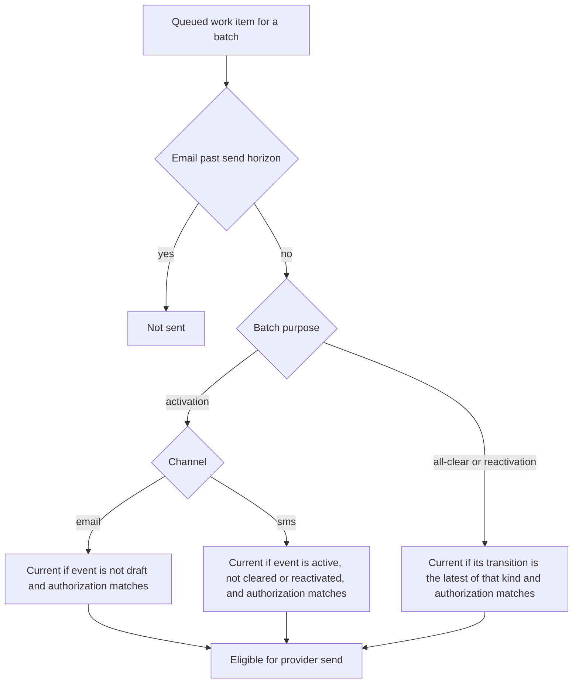

# Notification pipeline: intent, outbox, dispatch, delivery truth

**Consult this page** when changing message rendering, outbox/dispatch behavior, queue payloads, delivery-state writeback, reconciliation, SMS opt-out policy, or anything that reports delivery status.

```mermaid
sequenceDiagram
  participant EV as start-event / lifecycle (engine txn)
  participant OB as outbox table
  participant DP as dispatchOutbox (App Runner)
  participant DQ as delivery SQS queue
  participant RT as delivery-router Lambda
  participant CQ as email / sms / push queues
  participant W as channel worker
  participant API as POST /api/internal/delivery-state
  EV->>OB: notification intent + outbox row (same txn as event + audit)
  DP->>OB: claim with lease (poll limit 100)
  DP->>DQ: one SendMessageBatch of destination-free DispatchBatch bodies
  DQ->>RT: batch per message
  RT->>CQ: forward bytes unchanged by channel
  CQ->>W: at-least-once delivery
  W->>API: reserve attempt, then append delivery evidence
  Note over W,API: retry = new attempt id; DLQ after cap
```

Caption: authorization happens once in the engine; everything downstream is untrusted-by-default plumbing that only appends evidence.

## Stages and owners

1. **Intent and outbox** are written in the activation transaction ([lifecycle](event-lifecycle-and-activation.md)). Tables: `notification_intents`, `notification_intent_channels`, `outbox`, `dispatch_batches` (`packages/server/db/schema/delivery.ts`). `OutboxStatus`: `pending → processing → published | failed`.
2. **Rendering** (`lib/notify/render.ts`, `default-templates.ts`, `capabilities/notification-wording.ts`): event-type version templates per channel, `[INCIDENT]`/`[DRILL]` markers, SMS length limits (`SMS_GSM_MAX_SEPTETS`, `SMS_UCS2_MAX_CODE_UNITS`). Rendering happens at preview/authorization time; workers must send the exact rendered message and never re-render. Template management: [event types](event-types-and-templates.md).
3. **Audience**: `lib/roster/resolve.ts` and `lib/notify/event-audience.ts`, `event-recipients.ts` resolve recipients from the pinned immutable roster snapshot ([roster](roster-and-audience.md)). Email additionally goes through `resolveEmailEndpoints` with an endpoint-policy lock (`MAX_EMAIL_ENDPOINTS` 12,000). A live incident also carries a partner slice ([partner alert settings](partner-alert-settings.md)): a second intent and outbox in the same confirmed request, addressed to the admissions its activation preview pinned (`lib/partners/audience.ts`). Its email batch plans one address per pinned partner; push and text plan none and reach the partner's own live registrations and consent, found when the batch is sent (`lib/partners/delivery.ts`). Each runtime store routes a partner batch there instead of the roster; an admission ended or expired since activation, a handed-on device, a withdrawn consent, or a suppressed partner address is not sent to. Partner alert email uses the partner SES configuration set, whose events reach the same signed callback; partner account mail on that set carries no alert tags and is acknowledged without a record.
4. **Dispatch** (`lib/notify/dispatcher.ts`, capability `dispatch-outbox`): `dispatchOutbox` claims rows under a lease (`DEFAULT_OUTBOX_LEASE_MILLISECONDS` 30 s), writes all channels' batches in one SQS `SendMessageBatch` signed with container-role credentials (`createAwsContainerRoleCredentialProvider`, `signSqsSendMessageBatchRequest`, config via `DELIVERY_QUEUE_URL`), and records sanitized failure codes (`OutboxDispatcherErrorCode`). Retryable failures back off 500 ms → 30 s and fail after `MAX_OUTBOX_DISPATCH_ATTEMPTS` (5); `QueueFailureOutcome` (`not-sent`/`partial`/`unknown`) decides safe retry. Triggered post-commit by activation (10 rows) and by sweeps; `docs/runbooks/alarm-outbox-stuck.md` covers stuck rows.
5. **Router** (`infra/lambda/delivery-router/index.mjs`): one delivery queue → per-channel queues so one outcome covers the whole fan-out; body ≤ 256 KiB, forwarded verbatim, per-message `batchItemFailures`. Reads `<CHANNEL>_QUEUE_URL` per invocation so a missing variable retries into the DLQ.
6. **Workers** process and write back: see [channel workers](../integrations/channel-workers.md). The writeback route `app/api/internal/delivery-state/route.ts` composes `ChannelAttempt` + `RecordDeliveryEvidenceInput` contracts and exposes no event mutation; sibling internal routes: `attempt-execution`, `email-runtime`, `aws-eum-sms-runtime`, `expo-push-runtime`, `devices/internal/push-*`.
7. **Reconcile** (`lib/notify/reconcile.ts`, capability `reconcile-delivery-attempts`): turns stale/ambiguous attempts into truthful `expired`/`unknown` evidence; never resends.
8. **SMS policy** (`lib/notify/sms-policy.ts`, `sms-runtime-store.ts`): opt-out records, provider-verified opt-in, `record-sms-opt-out`; consent UI is in [mobile](../integrations/mobile-app.md) and web `/text-alerts`.

## Delivery truth model

`DeliveryTruthStateSchema`: `accepted`, `recorded` (pre-attempt facts on the intent) and, per attempt, `attempted`, `provider-accepted`, `delivered`, `failed`, `expired`, `unknown` (`AttemptDeliveryTruthStateSchema`). `provider-accepted` is never `delivered`; `delivered` needs the contract's provider delivery proof; `unknown` is a first-class visible state. Evidence is append-only; `deliveryEvidence`, `endpointStatusRecords`, `smsOptOutRecords` are separate facts. Learning note: `docs/learnings/workflow/2026-08-26-reproject-delivery-truth-at-every-ingress.md`.

## Send-time currency

A batch is written during activation but sent later, so its event may have moved on by the time a worker reaches it. `batchHasCurrentLifecycle` in `packages/server/lib/notify/batch-lifecycle.ts` decides whether a batch still describes the event's lifecycle. The email store calls it in `workItemIsEligible` (`email-runtime-store.ts`) and the SMS store calls it in `sms-runtime-store.ts`; a false result means the item is not sent (the store reports it as suppressed).



Caption: the email horizon check (`EMAIL_SEND_HORIZON_MILLISECONDS`, 15 minutes after the batch's `createdAt`) runs before the per-purpose rules; the horizon applies only to the email store.

- **Email activation** stays current after the event is cleared, closed or reactivated, as long as the event's `activationAuthorization` still matches the batch. The database trigger `psd_eoc_guard_event_mutation` rejects changes to that column.
- **SMS activation** keeps the active-only rule: the event must be `active` with no `allClearAt` or `reactivatedAt` and the same authorization.
- **All-clear and reactivation batches** stay current while their referenced transition is the event's latest of that kind, under the same request and authorization. An all-clear stays current after the event is closed, because the close carries no message of its own.

Why the email rule is relaxed: during the 2026-10-15 ShakeOut drill the email worker ran up to seven minutes behind, and nine of fourteen drills ended before it reached their activation batch. The previous active-only rule suppressed those begin emails, while the begin text, begin push and all-clear email still arrived. The rule is documented in the source comment on `batchHasCurrentLifecycle`. Lifecycle changes that affect queued work are owned by [event lifecycle](event-lifecycle-and-activation.md); the email worker that drains the queue is described in [channel workers](../integrations/channel-workers.md#channels).

Focused checks: `batch-lifecycle.integration.test.ts` (test "an email activation stays current after the event is cleared, closed or reactivated; SMS does not") and `email-runtime-store.integration.test.ts` (test "still sends an activation the worker reaches after the event was ended"). Both need the synthetic database.

## Invariants and gotchas

- Queue bodies carry no destinations (no token, address, or phone) and repeat real/drill classification.
- `invokeAuthorizedCapabilityHandler` is used here only at allowlisted boundaries ([capability engine](../architecture/capability-engine.md)).
- Pausing a channel does not suppress already-queued work; workers recheck channel enablement immediately before provider I/O (`docs/learnings/security/2026-08-25-pause-does-not-suppress-queued-work.md`).
- Metrics: the `metrics-collector` Lambda counts attempt states from a read-only transaction ([infrastructure](../operations/infrastructure.md)).

## Change guidance

- Changing `DispatchBatchSchema` or evidence contracts: contracts first, then `serializeDispatchQueueEntries`, `workers/shared/batch-message.ts`/`attempt.ts`, router, and each channel worker; run `bun test packages/server/lib/notify workers`. DB-backed tests (`*.integration.test.ts`, `*.database.test.ts`) need the synthetic database ([verification](../testing/verification-and-testing.md)).
- Never point write-capable flows at SES/SMS/Expo/InformaCast without the product owner's session approval; use mock adapters.
- Operations: `docs/runbooks/alarm-sqs-*.md`, `alarm-dlq-*.md`, `alarm-outbox-stuck.md`, and the [readiness register](../operations/configuration-and-readiness.md).
