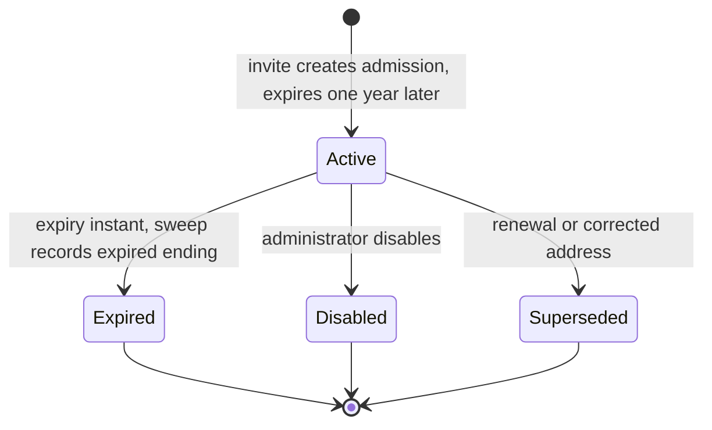
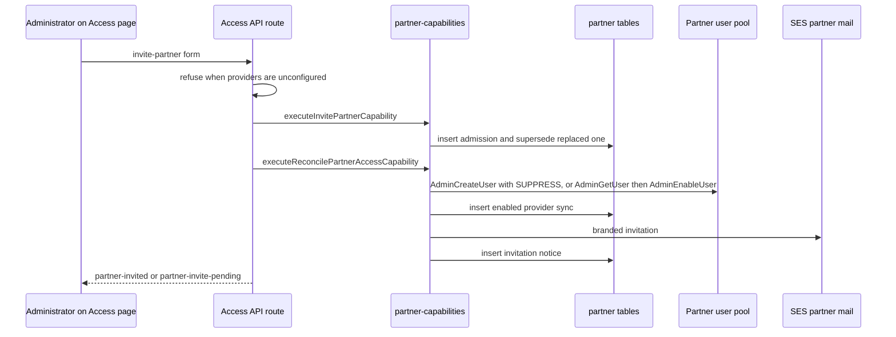

# Partner access: admissions, provider sync, and expiry sweep

**Consult this page** when changing how a non-district responder (for example a fire or police responder) gets, keeps, loses, or renews access, the Access page's Partners section, the partner identity provider calls, partner mail, or the daily sweep.

Partner access is a second identity kind beside district staff. Staff sign in with Google and get roles from Google Groups ([identity and access](identity-and-access.md)). A partner signs in through a separate partner identity provider and is admitted only by an administrator's partner admission. The partner has no Google identity, no group, and no staff role. `docs/ARCHITECTURE.md` (section "Partner access") states the policy; this page records how the source implements it.

## Concepts

- **Partner identity.** A `users` row keyed by issuer and subject. Staff rows use the Google issuer and keep `google_subject`; a partner row has a non-Google issuer and a null `google_subject` (`packages/server/db/schema/identity.ts`, migration `0059_partner_identity_and_admissions.sql`). The `partner` role is held alone: `isExclusiveRoleSet` in `packages/contracts/src/shared.ts`, a `UserSchema` refinement, and the `psd_eoc_guard_partner_role_exclusive` trigger all enforce it. `StaffRoleSchema` excludes `partner`, so no access group can grant it.
- **Admission.** An append-only `partner_admissions` row (`PartnerAdmissionSchema` in `packages/contracts/src/partner-admission.ts`). `expires_at` is a generated column, one UTC calendar year after `admitted_at`; `partnerAdmissionExpiresAt` mirrors that rule so contracts can check a record. A renewal or a corrected address is a new admission whose `supersedes_admission_id` names the old one.
- **Ending.** `partner_admission_endings` holds at most one row per admission, with reason `disabled`, `expired`, or `superseded`. Only the system ends an admission as `expired` (no actor). An administrator's `disabled` and `superseded` always name the actor (`PartnerAdmissionEndingSchema`, enforced by a check in the table).
- **Status.** `partnerAdmissionStatus` returns the ending reason when one exists, otherwise `expired` as soon as `now` reaches `expiresAt`, otherwise `active`. Expiry therefore refuses access at the instant of the date, before the sweep writes an ending.
- **Provider state.** `partner_provider_syncs` records each provider step the app confirmed (`enabled` or `disabled`). `partner_notices` records each email sent (`invitation` or `expiry-notice`; one expiry notice per admission, enforced by a partial unique index). `partner_access_reviews` records one inactivity review per quarter.

## Lifecycle



Caption: admission status as derived by `partnerAdmissionStatus`. Re-inviting a disabled or expired partner creates a new admission that is only linked as history; it never reopens the ended record. The Access page shows an `active` admission as `invited` until the partner has signed in after it was granted.

## Invite, correct, renew, and re-invite

Administrators act on the Access page's Partners section. Every partner change is a web-only, human-only capability (`invite-partner`, `disable-partner`, `reconcile-partner-access`, `list-partners` in `packages/contracts/src/capability-catalog.ts`, all under the web-administration invocation policy). None is offered to agents or MCP. The web route `packages/server/app/(admin)/access/api/route.ts` maps form intents to the wrappers in `packages/server/app/(admin)/access/partner-capabilities.ts`.

`invitePartner` (`packages/server/lib/partners/access.ts`) runs in one transaction under a per-address advisory lock (`lockPartnerAddress`). It refuses an address in the staff domain, an address that a Google staff identity already uses, and an address that already has an unended admission. A corrected address or renewal names the admission it replaces, which is ended `superseded` in the same transaction. Provider and email work comes after the admission commits, so a provider or mail failure leaves a visible pending step rather than undoing the admission.



Caption: an invitation is complete only when the provider step and the invitation step both confirm. `reconcilePartnerAccess` records each confirmed step, so a retry from the partner list converges instead of duplicating an account or an email.

`disablePartner` ends the admission as `disabled` with the actor's id, then `endPartnerAppAccess` cuts the partner out of the app at once: it revokes every live session, appends push-token unregistrations for their devices, and withdraws the user's staff SMS consents. The provider account is disabled by reconciliation (`CognitoPartnerDirectory.ensureDisabled` signs the user out everywhere, then disables; a missing account is treated as already disabled).

Re-inviting an ended partner calls `invitePartner` with no replacement id. That creates a new admission and re-enables the same provider account. Renewal is the same path with the current admission named, so the old expiry date ends nothing.

## Provider state on the Access page

`projectPartnerAccess` derives each row from the latest records, not from a stored status:

- `status`: `invited` (active admission, no sign-in since it was granted), `active`, `disabled`, `expired`, or `superseded`.
- `providerPendingStep`: `enable` when an active admission has no confirmed `enabled` sync; `disable` when an ended admission has no confirmed `disabled` sync and no other active admission uses the same address; null when the provider matches.
- `invitationSentAt` and `lastSignInAt`. A sign-in is the newest server session for that non-Google identity.

The provider stub used in tests is `syntheticPartnerProviders`, selected only by the synthetic pool id `SYNTHETIC`, which a deployed stack cannot carry (`resolvePartnerProviders` in `packages/server/lib/partners/providers.ts`). With the pool unconfigured (`UNCONFIGURED` or absent), `resolvePartnerProviders` returns null, the Access page omits partner controls, and the invite route refuses before writing.

## Sessions and access decisions

Partner access is decided per request, never by a group. `decidePartnerAccess` (`packages/server/lib/auth/partner-admission.ts`) finds the address's unended admission and refuses with `NO_PARTNER_ADMISSION`, `PARTNER_ADMISSION_ENDED`, or `PARTNER_ADMISSION_EXPIRED`. `DrizzleSessionStore` in `packages/server/lib/auth/sessions.ts` chooses this path whenever `isPartnerIdentityIssuer` is true for the user's issuer, and `partnerAccessAsAccessDecision` restates the result as `roles: ['partner']`, no group sources, and `facilityScope: null`.

A partner session records `authorization.kind = 'partner-admission'` with the admission id and `admissionExpiresAt` (`PartnerAdmissionSessionAuthorizationSchema` in `packages/contracts/src/identity.ts`). It carries no Google membership windows. `authorizeStoredSession` refuses a partner session at or after its expiry, and `sessionAuthorizationUsableUntil` gives the mobile client the same deadline, so a cached partner session stops being usable at expiry. A renewal keeps an open session working because the next read finds the new admission current.

## Daily sweep

`runPartnerAccessSweep` (`packages/server/lib/partners/sweep.ts`) runs once a day from `packages/server/scripts/operations/sweep-partner-access.ts`. The stack schedules it as the ECS Fargate task `PartnerSweepTaskDefinition` with the EventBridge rule `psd-eoc-partner-access-sweep-daily` at `cron(0 14 * * ? *)`, enabled only when `ShouldUsePartnerUserPool` holds (`infra/src/stack/psd-eoc-stack.ts`). Each step is idempotent and commits per admission:

1. Ends every admission past its expiry as `expired` (no actor) and cuts the partner out of the app.
2. Reconciles every ended admission whose provider step is still `disable`, completing disables that the provider did not confirm.
3. Sends exactly one `expiry-notice` to each active or invited partner whose admission expires within `PARTNER_EXPIRY_NOTICE_DAYS` (14). The notice row and the send share a transaction under a unique index, and a failed send leaves no row, so the next run retries it.
4. Once per quarter (`reviewQuarter`, unique on `partner_access_reviews.quarter`), mails administrators the inactivity review: current partners who were never signed in, and those with no sign-in for `PARTNER_INACTIVITY_DAYS` (90). The review never disables anyone.

The script exits with status 1 when any provider change or notice is still pending, so the task alarm shows it. With partner access unconfigured it logs `partner-access-sweep-skipped` and opens no database connection.

## Partner mail

Partner mail is the one provider email the web runtime sends itself. `SesPartnerMailer` (`packages/server/lib/partners/providers.ts`) builds the body with `buildAccountEmailContent` from `workers/email/email-message.ts`, which uses the alert email's branded shell but no real/drill banner. It calls SES with `FromAddress` from `PSD_EOC_SES_FROM_ADDRESS` and the `partner-account` email tag. The stack does not set a configuration set for these tasks, so partner mail never enters alert delivery evidence. Replies go to the administrator access group addresses (`administratorGroupAddresses`). Alerts still reach people only through the [channel workers](../integrations/channel-workers.md).

## Known gaps

- **No partner sign-in route ships yet.** `packages/server/e2e/run.ts` says partner sign-in "is a later change", and the only partner session writer is the test helper `packages/server/lib/testing/partner-session.ts`. The stack grants `AdminInitiateAuth`, `AdminRespondToAuthChallenge`, and WebAuthn registration to the web task, but no repository code calls them. `docs/ARCHITECTURE.md` describes the intended sign-in, and [identity and access](identity-and-access.md) still says the partner configuration is unread.
- **Live state is not recorded here.** Whether partner access is configured or verified on a deployment is a readiness claim owned by `docs/INTEGRATIONS.md`; see [configuration and readiness](../operations/configuration-and-readiness.md).

## Change navigation

- **Where to start:** the admission rules in `packages/contracts/src/partner-admission.ts`, then `packages/server/lib/partners/access.ts` for writes and `packages/server/lib/auth/partner-admission.ts` for the per-request decision.
- **Invariants to keep:** a partner is never granted through a group (`StaffRoleSchema`, the `group_sources` role check); an admission and its ending are never updated; expiry is computed by the database and checked by `partnerAdmissionExpiresAt`; a sign-in or session never outlives the admission; the sweep only disables provider accounts for ended admissions (its provider loop calls only `reconcilePartnerAccess` on `disable` steps); partner mail uses the deployment sender only.
- **Provider calls and IAM must match.** `CognitoPartnerDirectory` calls `AdminCreateUser`, `AdminGetUser`, `AdminEnableUser`, `AdminUserGlobalSignOut`, and `AdminDisableUser`. The web task's policy in `infra/src/stack/psd-eoc-stack.ts` grants those five. The sweep task grants only `AdminDisableUser` and `AdminUserGlobalSignOut`, because it never enables an account. Changing a provider call means changing both grants and the stack test.
- **Adding a partner capability** follows the same surface as any admin mutation: catalog entry in `capability-catalog.ts`, handler in `partner-capabilities.ts`, id in `ADMIN_MUTATION_IDS` (`packages/server/lib/capabilities/admin.ts`), the persisted enum in `db/schema/enums.ts`, and a migration extending `mutation_capability` (migration `0060` shows the pattern). See [capability engine](../architecture/capability-engine.md#change-recipes).
- **Changing expiry or notice timing** touches three places that must agree: the generated column in migration `0059`, `partnerAdmissionExpiresAt`, and `PARTNER_EXPIRY_NOTICE_DAYS` in `sweep.ts`.

## Focused tests

| Behavior to check | Test file | Find by name |
| --- | --- | --- |
| Expiry arithmetic, status instants, ending and supersession rules | `packages/contracts/src/partner-admission.test.ts` | `is the same UTC time one calendar year later`, `is active until the expiry instant and expired from it on`, `disable and supersession always name an administrator` |
| Partner session shape and staff session compatibility | `packages/contracts/src/partner-admission.test.ts` | `a partner session carries its admission and no membership windows` |
| Group never admits a partner; session decided by admission; expiry refuses before the sweep | `packages/server/lib/auth/partner-admission.database.test.ts` | `a group can never admit a partner`, `an expired admission refuses a session before any sweep ends it`, `a renewal keeps an open partner session working` |
| Invite, re-invite, correction, disable, and pending provider steps | `packages/server/app/(admin)/access/partner-capabilities.database.test.ts` | `an invitation is pending until the provider and the email both confirm`, `a provider failure leaves visible drift that a retry completes`, `a corrected address replaces the admission`, `disable ends the admission, cuts the partner out at once` |
| Sweep expiry, one notice, retry after failure, quarterly review, append-only | `packages/server/lib/partners/sweep.database.test.ts` | `sends exactly one notice 14 days before expiry`, `a failed notice is retried by the next run`, `sends the review to administrators once per quarter`, `admission rows are only ever appended by the sweep` |
| Provider adapter: create, re-enable, sign-out before disable, safe errors, pool selection | `packages/server/lib/partners/providers.test.ts` | `re-enables an existing disabled account instead of failing`, `signs the account out everywhere, then disables it`, `is off when the pool is unconfigured or absent` |
| Script exits quietly when unconfigured | `packages/server/scripts/operations/sweep-partner-access.test.ts` | `does nothing, and opens no database, when partner access is unconfigured` |
| Access page controls match state | `packages/server/app/(admin)/access/access-admin-view.test.tsx` | `offers no partner controls when partner access is not configured`, `offers resend, disable and correction only for current admissions` |
| Infrastructure grants and schedule | `infra/test/stack/psd-eoc-stack.test.ts` | `gives the partner-access sweep only disable, sign-out, and partner mail, gated on the condition`, `confines an unconfigured deployment to the gated grants, the service env, and the disabled sweep` |
| Browser flow (synthetic IdP and mailer) | `packages/server/e2e/partner-access.flow.ts` | Playwright test names `admin invites partner`, `admin disables partner`, `expired partner is refused`, `admin renews partner` |

## Validation

Narrow and quiet, no database needed:

```bash
bun test packages/contracts/src/partner-admission.test.ts packages/server/lib/partners/providers.test.ts packages/server/scripts/operations/sweep-partner-access.test.ts
```

Database-backed suites need the synthetic database (`bun run test:db:start`, see [verification](../testing/verification-and-testing.md)):

```bash
bun test packages/server/lib/partners/sweep.database.test.ts packages/server/app/(admin)/access/partner-capabilities.database.test.ts packages/server/lib/auth/partner-admission.database.test.ts
```

Escalate when a change crosses a boundary: stack or IAM changes add `bun test infra/test/stack/psd-eoc-stack.test.ts`; schema or migration changes add `bun test packages/server/drizzle/migration-chain.test.ts` and `bun scripts/check-applied-migrations.ts origin/main HEAD`. The Playwright flow (`bun run test:e2e:issue-340`, which runs `packages/server/e2e/run.ts`) needs a built server and Chromium, so run it only for changes to the Access page or the admin routes.

## Scope boundaries

- Inactivity is reviewed, never acted on. Do not add an automatic disable outside expiry or an administrator's decision.
- No partner data goes into staff tables, group sources, or staff roles, and no partner email goes through the alert configuration set.
- Provider readiness and live verification belong in `docs/INTEGRATIONS.md`, not in this page.

<!-- openwiki: broken internal link [../operations/infrastructure.md#partner-access-optional] heading anchor "partner-access-optional" does not exist in "../operations/infrastructure.md". Fix the href or restore the target, then delete this comment. -->
Related: [identity and access](identity-and-access.md) (staff sign-in and sessions), [infrastructure](../operations/infrastructure.md#partner-access-optional) (pool, sweep task, and grants), [data model](data-model.md) (partner tables and append-only triggers), [channel workers](../integrations/channel-workers.md) (the alert email shell the partner mailer reuses), [mobile app](../integrations/mobile-app.md) (cached session deadline).
