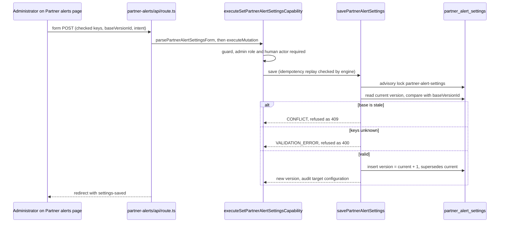

# Partner alert settings: which real events alert partners

**Consult this page** when changing which response families or threats alert or are excluded for partners, the Partner alerts admin page, the saved-version table, or any code that reads the effective settings for partner recipients.

Partner responders are admitted by [partner access](partner-access.md) and sign in through [partner web sign-in](partner-sign-in.md). Which real events alert them is a separate setting that a district administrator owns on the Partner alerts page. The setting names stable keys only: response families by `event_types.family_key` and threats by `threats.key`. `docs/ARCHITECTURE.md` (section "Partner access") states the policy; this page records how the source implements it.

## What is set

- **Responses that alert partners** (`responseFamilyKeys`): a real event whose response family is listed alerts partners. An empty list turns partner alerts off entirely.
- **Threats that never alert partners** (`excludedThreatKeys`): an event with an excluded threat does not alert partners, whatever its response.
- **Defaults.** Until an administrator saves a version, `DEFAULT_PARTNER_ALERT_SETTINGS` applies: `lockdown` and `modified-lockdown`, with no threat excluded (`packages/contracts/src/partner-alert-settings.ts`).
- **Not settings.** Drills never alert partners, so there is no drill setting. Channels are not a setting either: a partner is emailed at the admitted address, and reached by push or text only after enrolling a device or consenting, as staff are.
- **Access.** Both capabilities, `get-partner-alert-settings` and `set-partner-alert-settings`, use the web-administration invocation policy (`packages/contracts/src/capability-catalog.ts`). Neither is in `PARTNER_CAPABILITY_IDS`, so a partner session is refused, and neither is agent-grantable. The contracts test `both capabilities are web-only administration and never a partner’s` pins this.

## Stored as append-only versions

Each save inserts one row in `partner_alert_settings` (`packages/server/db/schema/identity.ts`, migration `0062_partner_alert_settings.sql`). A row holds both lists, a `version` number (1, 2, …), `supersedes_version_id` naming the version it replaced (null only for version 1), and `created_by_user_id`. The highest version is current. With no row, the defaults apply. Database rules back the contracts: versions and successors are unique, version 1 is the only one that replaces nothing, a row never replaces itself, both lists are bounded (100 response keys, 200 threat keys) and refuse null entries. A trigger reuses the partner-admission append-only guard, so no update or delete succeeds, even for the table owner. The application role is granted `SELECT` and column-level `INSERT` only.

Lists are stored sorted, so equal settings read back the same way.

## Save flow

`savePartnerAlertSettings` (`packages/server/lib/partners/alert-settings.ts`) runs inside the audited capability engine:



Caption: the base-version check is what stops two administrators from silently overwriting each other; the advisory lock makes the check and the insert one step. A response key is accepted only if a real event type has that family; a threat key only if the threat exists, retired or not.

Idempotent retries replay the stored version by its id (`resultReference`, `loadReplay`), so a retried form post writes no second version.

## What the page shows

`loadPartnerAlertSettingsState` returns the current version (null before the first save), the settings in effect, the response choices and the threat choices in one read:

- **Response choices** are every family with a real event type, named by its latest real version and ordered by display order. A saved family with no published real version stays listed and checked, named by its key, so saving never silently drops it. A default this district has no real version of is not offered, because a save would refuse it.
- **Threat choices** include retired threats. A retired threat is listed only while it is excluded, so saving the page does not silently remove the exclusion.
- The page (`partner-alerts/page.tsx`) is administrator-only. A non-administrator gets the refusal view, because `withAdminRefusal` turns the engine's 403 into a view (see [capability engine](../architecture/capability-engine.md#partner-sessions-and-the-allowlist)). The page posts to `/partner-alerts/api`, the status message is one allowlisted key (`settings-saved`), and the admin navigation entry is `Partner alerts` in `packages/server/app/nav/primary-nav-model.ts`.

## Routing status: read when a live incident is planned

`resolvePartnerAudience` in `packages/server/lib/partners/audience.ts` reads the effective settings when an activation preview is created, and pins the selected admissions beside the preview (`activation_preview_partners`). Partners are never part of staff rosters: staff rosters are built from Google groups and skip partners (`packages/server/lib/roster/groups-sync.ts`). Delivery to the pinned partners is described in [notification pipeline](notification-pipeline.md).

A saved setting therefore changes who the next live incident's preview pins. It never changes an event already started: that event's all-clear and reactivation reach the set its activation pinned.

## Change navigation

- **Where to start:** the schema shape in `packages/contracts/src/partner-alert-settings.ts`, then the store in `packages/server/lib/partners/alert-settings.ts` (writes in `savePartnerAlertSettings`, reads in `loadEffectivePartnerAlertSettings` and `loadPartnerAlertSettingsState`), then the capability registration in `packages/server/app/(admin)/partner-alerts/capabilities.ts`.
- **Invariants to keep:** settings are keyed, never named; a save names the version it replaces and is refused if that is no longer current; no row is ever edited or removed; the partner allowlist never gains these IDs; partner alerts never gain a drill or channel setting.
- **Adding a capability or a column** follows the recipe in [capability engine](../architecture/capability-engine.md#change-recipes). A new persisted enum entry needs a new migration, and the pattern to copy is `0062`. A change to a list bound must change the contract, the database check, and the migration together.
- **Changing the defaults** changes `DEFAULT_PARTNER_ALERT_RESPONSE_FAMILY_KEYS`, which the contracts test pins. Existing saved versions are unaffected.
- **Partner alert routing** is `packages/server/lib/partners/audience.ts` (who a live incident pins) and `packages/server/lib/partners/delivery.ts` (where each is reached at send time).

## Focused tests

| Behavior to check | Test file | Find by name |
| --- | --- | --- |
| Defaults, key-only lists, no duplicates, empty list valid, version chain rules, current version in effect | `packages/contracts/src/partner-alert-settings.test.ts` | `defaults to Lockdown and Modified Lockdown with no threat excluded`, `a save names keys, never display names, each at most once`, `no responses at all is a valid save: it turns partner alerts off`, `only the first version replaces nothing, and none replaces itself`, `the settings in effect are the current version once one exists` |
| Web-only human administration, never partner | `packages/contracts/src/partner-alert-settings.test.ts` | `both capabilities are web-only administration and never a partner’s` |
| Partner allowlist excludes both IDs | `packages/contracts/src/partner-capabilities.test.ts` | `interfaces hide exactly what the allowlist refuses a partner` (`NEVER_PARTNER` list) |
| Defaults before any save; response and threat choices; retired threat | `packages/server/app/(admin)/partner-alerts/capabilities.database.test.ts` | `before any save, partners are alerted for Lockdown and Modified Lockdown only` |
| Save as a new version naming its administrator and predecessor; stored sorted | same file | `each save is a new version naming its administrator and the version it replaced` |
| Empty response list turns alerts off | same file | `no responses at all is a saved setting that turns partner alerts off` |
| Stale page refused, no overwrite | same file | `a save from a stale page is refused instead of overwriting a newer one` |
| Unknown response or threat refused | same file | `refuses a response or threat this deployment does not have` |
| Retried save replays the same version | same file | `a retried save replays the same version instead of writing another` |
| Staff and partner sessions refused | same file | `only an administrator may read or change them`, `a partner session can neither read nor change them` |
| Application role can append and read, never change; owner cannot change or remove | same file | `the application role can append and read versions but never change one`, `the table owner cannot change or remove a version either` |
| Database bounds lists and refuses null keys | same file | `the database bounds the lists and refuses null keys` |
| Page states, checked choices, retired and unpublished keys, refusal view, allowlisted status | `packages/server/app/(admin)/partner-alerts/partner-alerts-view.test.tsx` | `shows the saved version and keeps a retired threat that is still excluded`, `a saved response with no published version stays checked and can be removed`, `a non-administrator sees the refusal and no settings`, `status messages are allowlisted` |
| Navigation entry for administrators only | `packages/server/app/nav/primary-nav-model.test.ts` | `matches authenticated, admin, and district-admin server authorization tiers` |
| Browser flow: defaults, save, second version | `packages/server/e2e/partner-alert-settings.flow.ts` | `admin edits partner alert settings` |

## Validation

Quiet and narrow, no database:

```bash
bun test packages/contracts/src/partner-alert-settings.test.ts packages/server/app/nav/primary-nav-model.test.ts
```

The store and capability tests need the synthetic database (`bun run test:db:start`, see [verification and testing](../testing/verification-and-testing.md)):

```bash
bun test "packages/server/app/(admin)/partner-alerts/capabilities.database.test.ts"
```

Run the browser flow only when the Partner alerts page or its route changes. It runs through `packages/server/e2e/run.ts`, needs a built server and Chromium, and writes evidence only when `PSD_EOC_E2E_UPDATE_EVIDENCE=true`. Schema or migration changes add the checks in [data model](data-model.md).

## Related

[Partner access](partner-access.md) (who is admitted), [partner web sign-in](partner-sign-in.md) (what a partner session may run), [event types and templates](event-types-and-templates.md) (the response families these keys name), [identity and access](identity-and-access.md) (administrator roles), [data model](data-model.md) (the table and its append-only rules), and the audience and dispatch pages this setting feeds: [roster and audience](roster-and-audience.md) and [notification pipeline](notification-pipeline.md).

