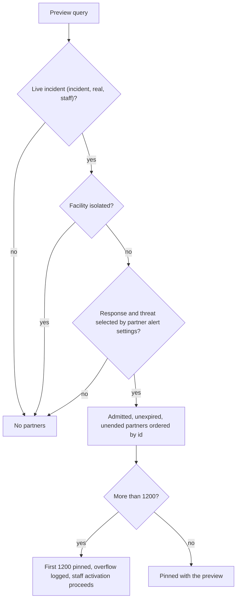

# Partner audience: planning, pinning, and the partner notification slice

**Consult this page** when changing which admitted partners a live incident alerts, the partner notification slice written beside a staff send, the partner population in contracts or the database, or how partner batches are delivered at send time.

Partners are first responders admitted one by one outside the district ([partner access](partner-access.md)). They are never rostered. This page covers how a live incident reaches them: which settings decide it ([partner alert settings](partner-alert-settings.md)), where the set is pinned ([event lifecycle](event-lifecycle-and-activation.md)), and how it becomes queued notification records ([notification pipeline](notification-pipeline.md)).

## Population model

`RosterPopulationSchema` (`packages/contracts/src/roster.ts`) now has three values: `staff`, `synthetic`, and `partner`. `RosteredPopulationSchema` excludes `partner`, and every table that resolves through a published roster uses the rostered type. `partner` is legal only where a notification record names a slice of a live incident:

- `NotificationTargetingSchema` (`packages/contracts/src/event.ts`) adds one targeting shape: `incident`, `real`, `partner`. An event itself never targets partners.
- The database refuses `partner` in `roster_source_configurations` (check `roster_source_configurations_rostered_population`), so no roster table can hold one. Events, previews, and transitions keep their legal populations and refuse it.
- `eventPopulationForNotification` maps a partner slice to its event's population, `staff`. `notification_intents.event_roster_population` is the generated column that binds a partner intent to the staff snapshot (migration `0063`).

## Planning: who an activation would alert

`createActivationPreviewRecord` (`packages/server/lib/capabilities/start.ts`) calls `resolvePartnerAudience` (`packages/server/lib/partners/audience.ts`) with the preview's own clock. The function returns no partner unless every condition holds:



Caption: the function reads the response family from `event_types`, the threat key from `threats` (an unknown threat alerts nobody), and the effective settings through `loadEffectivePartnerAlertSettings`. Partners are never facility-scoped: an admission covers every non-isolated site.

`resolvePartnerAudience` never returns more than `PARTNER_AUDIENCE_MAX_RECIPIENTS` (1,200) ids: an overflow is logged as `partner-audience-truncated` and dropped, and the returned ids are sorted. A large partner list therefore never blocks the staff activation it rides on. `buildActivationPreview` (`packages/server/lib/capabilities/start-preview.ts`) counts the pinned set as `partnerRecipientCount`, and refuses a duplicate admission, a count above the bound (a defensive check), or any count for a preview that does not reach partners (`PARTNER_AUDIENCE_INVALID`). The count is part of the signed consequence digest like staff recipients. `recordActivationPreviewPartners` then writes one `activation_preview_partners` row per admission in the same transaction.

## Confirmed send: the partner slice

When a human confirms the preview, `startEventRegistration` (`packages/server/lib/capabilities/events.ts`) builds the staff notification and then `partnerSlice` builds the partner one. The slice is a second `NotificationIntent` and `OutboxRecord` in the same human-confirmed request. It reuses the staff intent's event, request, authorization, purpose, and rendered messages, so a partner reads what staff read under the same marker. It differs in three ways: a new id, `rosterPopulation: 'partner'`, and a planned count only on the email channel (`endpointCount` equals `partnerRecipientCount`; push and SMS are 0, because a partner reaches them only through endpoints resolved at send time).

`persistLifecycleBundle` writes the slice after the staff intent and refuses it with a conflict unless the population is `partner` and the event, request, and purpose match the staff intent. The database keeps one intent per population per request (`notification_intents_request_population_uq`), and the partner intent carries the same human authorization requirement as staff.

All-clear and reactivation do not re-resolve partners. `journal.ts` copies `partnerRecipientCount` from the activation preview into each lifecycle consequence preview, and `notifyingLifecycleResult` builds the same kind of slice from it. Closing and reopening create no slice (`partnerNotification: null`). A correction record plans no slice of its own.

`loadEventPartnerAudience` (`packages/server/lib/partners/audience.ts`) reads the pinned admission ids for an event through its immutable activation authorization. Partner delivery reads the pinned set at send time; all-clear previews use the copied count.

## Delivery: reaching the pinned partners at send time

`packages/server/lib/partners/delivery.ts` resolves a partner batch; each runtime store routes a batch whose population is `partner` there instead of through a roster snapshot (`isRosteredDispatchBatch` decides the route).

| Channel | Endpoint | Planned count | Source |
| --- | --- | --- | --- |
| Email | The address each pinned admission was admitted under, sent under the partner SES configuration set | One per pinned partner; must equal the plan | `resolvePartnerEmailEndpoints` |
| Push | The partner's own live device registrations, one per device | 0 (more than planned is allowed, as for staff) | `resolvePartnerPushEndpoints` |
| SMS | The partner's own active consent, newest per partner | 0 (exact-count equality applies to staff batches only) | `resolvePartnerSmsEndpoints` |

Each endpoint is recorded once as a `partner_endpoints` row, and every attempt binds to it through `partner_endpoint_id`. Nobody is sent to whose admission ended or expired after activation, whose account is disabled, whose device was revoked, unregistered or re-enrolled, whose consent was withdrawn, or whose address is suppressed; they stay in the paging list so later pages do not shift. Push eligibility re-checks the admission and device ownership on the database clock: `/api/devices/internal/push-endpoint-eligibility` answers a partner endpoint through `loadDrizzlePartnerPushEndpointSendEligibility` (`packages/server/lib/capabilities/devices.ts`) instead of null, and a latest partner endpoint status (an invalidation) overrides it. A partner's invalidated push token is retired and cannot be re-registered as live.

Partner alerts are sent under the partner SES set (`SES_PARTNER_CONFIGURATION_SET_NAME`), so their SES facts reach the signed callback. `workers/email/ses-events.ts` accepts a correlated event from either set and reports which one as `configurationSetName`. Account mail on the partner set (invitations, expiry notices, access reviews) carries no alert tags and raises `UNTRACKED_MAIL`, which the callback acknowledges with 204 and records nothing for. The callback also requires an event's set to match its attempt's population, so a partner bounce, complaint or reject records an endpoint status for the partner endpoint only, and a staff address is never suppressed by it. Partner suppression reads partner facts only. See [partner access](partner-access.md#partner-mail) for account mail and [notification pipeline](notification-pipeline.md) for the callback.

## Status and known gaps

- **Settings are read at planning** and decide the pinned set; the confirmed send, all-clear and reactivation reach exactly that set.
- **More than 1,200 admitted partners** pins the first 1,200 in admission order and logs the overflow; it never blocks the staff activation.
- **Partner STOP is recorded locally (#637).** A partner's STOP is written against their partner endpoint as a disabled `SMS_OPTED_OUT` lifecycle fact, when the provider refuses a send to the number or when the scheduled reconciliation finds it on the provider's opt-out list. Opt-outs are read by number across staff and partner facts (`loadSmsPhoneOptOuts` with `includePartnerEndpoints`), so the next partner text batch leaves the partner out without a provider call, and a provider-verified START restores them. Two partners sharing one number opt out together. The partner access page shows this as the Text alerts column ([partner access](partner-access.md#provider-state-on-the-access-page)).
- **Summary PDF** labels a partner intent `(partners)` in its notification-intent heading (`packages/server/lib/capabilities/records/pdf.ts`); partner push and text attempts are left out of the plan comparison, like late-enrolled staff devices ([media, records and audit](media-records-and-audit.md)).

## Change navigation

- **Where to start:** the population and targeting schemas in `packages/contracts/src/roster.ts` and `event.ts`; then the planning query `resolvePartnerAudience`; then `partnerSlice` in `events.ts`.
- **Invariants to keep:** a partner never enters a roster snapshot, a recipient list, or an event population; a partner intent is always a live-incident slice sharing its staff request; a preview's count and pinned rows match; the pinned set is never re-resolved for all-clear or reactivation; drills and tests never reach partners.
- **Change the population or targeting shape:** contracts first, then the database check and generated columns in `db/schema/events.ts` and `delivery.ts`, with a new migration. Never edit `0063` or `0064`. The migration header states the rule that every comparison with `'partner'` is text, because a new enum value cannot be used in the same transaction.
- **Change partner delivery:** edit `lib/partners/delivery.ts` and keep the send-time liveness checks. The database requires a partner push or SMS endpoint to belong to the admitted person. Partner SES routing is in `workers/email/ses-events.ts` (set match, `UNTRACKED_MAIL`) and `app/api/webhooks/ses/runtime.ts`; a change there must keep account mail out of the alert evidence path. Escalate: this changes who receives a real alert, so it needs a real-versus-drill test and a human review.
- **Change who is alerted:** edit the settings path in [partner alert settings](partner-alert-settings.md) and `partnerAlertSettingsMatch`; keep `resolvePartnerAudience` the only planning reader.

## Focused tests

| Behavior | Test file | Find by name |
| --- | --- | --- |
| Live lockdown reaches every admitted, unexpired, unended partner | `packages/server/lib/partners/audience.database.test.ts` | `a live lockdown reaches every admitted, unexpired, unended partner` |
| Drills, tests, isolated sites, and unselected responses reach no partner | same | `drills, tests, isolated sites, and unselected responses reach no partner` |
| Excluded threat, or settings naming only a retired response | same | `an excluded threat, or settings naming only a retired response, reach no partner` |
| Preview counts and pins its partners | same | `a lockdown preview counts its partners, signs the count, and pins who they are` |
| Confirmed request records the slice; all-clear reaches the same set | same | `the confirmed request records the partner slice, and its all-clear reaches exactly that set` |
| Database refuses partners on a drill preview; pinned set append-only | same | `the database refuses partners on a drill preview and keeps the pinned set append-only` |
| Application role can pin and read the set | same | `the production application role can pin and read a preview partner set` |
| Slice as a second intent, same request and messages; no slice when none reached; all-clear; drill cannot carry partners; correction plans none | `packages/server/lib/capabilities/events.test.ts` (describe `partner slice of a live incident (#597)`) | `records the partner slice as a second intent in the same human-confirmed request`, `records no partner slice when the preview reaches no partner`, `an all-clear reaches the same partners under the shared lifecycle authorization`, `a drill preview cannot carry partners`, `a correction record plans no partner slice of its own` |
| Partner target to provider fact per channel; bounce suppresses partner mail only; liveness | `packages/server/lib/partners/delivery.database.test.ts` | `a live lockdown queues a partner slice for every channel`, `email reaches each admitted partner under the partner set, and a bounce suppresses partner mail only`, `text reaches a partner at their own consented number until they withdraw`, `push reaches a partner’s own live device, and eligibility follows the admission` |
| Database: slice beside staff in one request; one intent per population; attempts and endpoint status bind only their own endpoint; partner never in roster or event; append-only | `packages/server/drizzle/migration-0063.integration.test.ts` | `a live incident records a partner slice beside its staff intent in one request`, `one request still holds only one intent per population`, `a partner attempt binds only a partner endpoint of its admission`, `partner never enters the roster or an event`, `partner endpoints are append-only` |
| Browser: lockdown lists partner recipients; drill shows none | `packages/server/e2e/partner-audience.flow.ts` | `lockdown activation lists partner recipients` |

## Validation

Quiet and narrow, no database:

```bash
bun test packages/server/lib/capabilities/events.test.ts packages/server/lib/notify/email-runtime-store.test.ts
```

Send-time delivery and the SES callback, no database:

```bash
bun test workers/email/ses-events.test.ts workers/email/ses-adapter.test.ts
```

Database-backed checks need the synthetic database (`bun run test:db:start`, see [verification and testing](../testing/verification-and-testing.md)):

```bash
bun test packages/server/lib/partners/audience.database.test.ts
bun test packages/server/lib/partners/delivery.database.test.ts
bun test packages/server/drizzle/migration-0063.integration.test.ts
```

Schema or migration changes add `bun test packages/server/drizzle/migration-chain.test.ts` and `bun scripts/check-applied-migrations.ts origin/main HEAD` ([data model](data-model.md)). Run the browser flow only when the confirmation screen changes; it is conditional and needs Chromium through `packages/server/e2e/run.ts`.

## Related

[Partner access](partner-access.md) (who is admitted), [partner alert settings](partner-alert-settings.md) (which real events alert partners), [event lifecycle and activation](event-lifecycle-and-activation.md) (the preview, confirm, and lifecycle paths that carry the slice), [notification pipeline](notification-pipeline.md) (dispatch and the refusals), [roster and audience](roster-and-audience.md) (the staff population that partners are kept out of), and [data model](data-model.md) (the tables and append-only rules).

