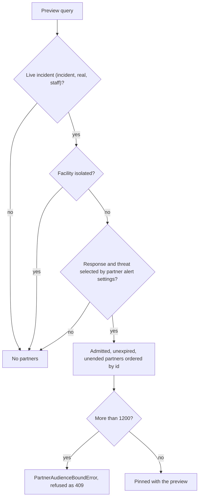

# Partner audience: planning, pinning, and the partner notification slice

**Consult this page** when changing which admitted partners a live incident alerts, the partner notification slice written beside a staff send, the partner population in contracts or the database, or the point where partner delivery is refused.

Partners are first responders admitted one by one outside the district ([partner access](partner-access.md)). They are never rostered. This page covers how a live incident reaches them: which settings decide it ([partner alert settings](partner-alert-settings.md)), where the set is pinned ([event lifecycle](event-lifecycle-and-activation.md)), and how it becomes queued notification records ([notification pipeline](notification-pipeline.md)).

## Population model

`RosterPopulationSchema` (`packages/contracts/src/roster.ts`) now has three values: `staff`, `synthetic`, and `partner`. `RosteredPopulationSchema` excludes `partner`, and every table that resolves through a published roster uses the rostered type. `partner` is legal only where a notification record names a slice of a live incident:

- `NotificationTargetingSchema` (`packages/contracts/src/event.ts`) adds one targeting shape: `incident`, `real`, `partner`. An event itself never targets partners.
- The database refuses `partner` in `roster_source_configurations` (check `roster_source_configurations_rostered_population`), so no roster table can hold one. Events, previews, and transitions keep their legal populations and refuse it.
- `eventPopulationForNotification` maps a partner slice to its event's population, `staff`. `notification_intents.event_roster_population` is the generated column that binds a partner intent to the staff snapshot (migration `0063`).

## Planning: who an activation would alert

`createActivationPreviewRecord` (`packages/server/lib/capabilities/start.ts`) calls `resolvePartnerAudience` (`packages/server/lib/partners/audience.ts`) with the preview's own clock. The function returns no partner unless every condition holds:



Caption: the function reads the response family from `event_types`, the threat key from `threats` (an unknown threat alerts nobody), and the effective settings through `loadEffectivePartnerAlertSettings`. Partners are never facility-scoped: an admission covers every non-isolated site.

`buildActivationPreview` (`packages/server/lib/capabilities/start-preview.ts`) counts the pinned set as `partnerRecipientCount`, and refuses a duplicate admission, a count above `PARTNER_AUDIENCE_MAX_RECIPIENTS` (1,200), or any count for a preview that does not reach partners (`PARTNER_AUDIENCE_INVALID`). The count is part of the signed consequence digest like staff recipients. `recordActivationPreviewPartners` then writes one `activation_preview_partners` row per admission in the same transaction.

## Confirmed send: the partner slice

When a human confirms the preview, `startEventRegistration` (`packages/server/lib/capabilities/events.ts`) builds the staff notification and then `partnerSlice` builds the partner one. The slice is a second `NotificationIntent` and `OutboxRecord` in the same human-confirmed request. It reuses the staff intent's event, request, authorization, purpose, and rendered messages, so a partner reads what staff read under the same marker. It differs in three ways: a new id, `rosterPopulation: 'partner'`, and a planned count only on the email channel (`endpointCount` equals `partnerRecipientCount`; push and SMS are 0, because a partner reaches them only through endpoints resolved at send time).

`persistLifecycleBundle` writes the slice after the staff intent and refuses it with a conflict unless the population is `partner` and the event, request, and purpose match the staff intent. The database keeps one intent per population per request (`notification_intents_request_population_uq`), and the partner intent carries the same human authorization requirement as staff.

All-clear and reactivation do not re-resolve partners. `journal.ts` copies `partnerRecipientCount` from the activation preview into each lifecycle consequence preview, and `notifyingLifecycleResult` builds the same kind of slice from it. Closing and reopening create no slice (`partnerNotification: null`). A correction record plans no slice of its own.

`loadEventPartnerAudience` (`packages/server/lib/partners/audience.ts`) reads the pinned admission ids for an event through its immutable activation authorization. Only the database tests call it in this revision; production all-clear code uses the copied count.

## Delivery is refused until partner delivery exists

The slice is written and queued, but no worker sends to a partner yet. Each runtime refuses a partner batch as a non-retryable conflict, so it cannot loop into the dead-letter queue:

| Runtime | Refusal | Source |
| --- | --- | --- |
| Email | `BATCH_CONFLICT` with reason `partner-delivery-not-enabled` | `assertEmailBatch` in `packages/server/lib/notify/email-runtime-store.ts` |
| Email endpoint resolution | `EMAIL_ROSTER_MISMATCH` (no roster to resolve through) | `resolveEmailEndpoints` in `packages/server/lib/notify/dispatcher.ts` |
| Push | `BATCH_CONFLICT` before the roster snapshot is read | `resolvedPushEndpoints` and `resolvedPushEndpointPage` in `packages/server/lib/notify/expo-push-runtime-store.ts` |
| SMS | `BATCH_CONFLICT` and `SMS_ROSTER_MISMATCH` | `resolvedSmsEndpoints` in `sms-runtime-store.ts`, `resolveSmsEndpoints` in `sms-policy.ts` |

`isRosteredDispatchBatch` (`packages/contracts/src/notification.ts`) is the guard: a batch resolves through its pinned snapshot only when its population is rostered. The Expo push store's pending read includes partner outbox rows, so a stranded partner slice is visible to the same sweep as a staff one. The SES webhook's endpoint-status path also refuses a non-rostered attempt.

`partner_endpoints` (`packages/server/db/schema/delivery.ts`, migration `0063`) is the partner counterpart of a published roster endpoint: one row per admitted email address, or per push registration or SMS consent that belongs to the admitted person. `channel_attempts` and `endpoint_status_records` bind a partner attempt to one of these rows through a composite foreign key. No production code writes `partner_endpoints` yet, so the binding is exercised only by `migration-0063.integration.test.ts`.

## Status and known gaps

- **Partner alert settings are read at planning.** `resolvePartnerAudience` reads `loadEffectivePartnerAlertSettings`, and the saved settings decide the pinned set. The settings alone never send anything; a partner receives a message only once delivery is enabled.
- **Delivery is not enabled** (see the table above). An operator sees partner recipients on the confirmation screen and in the event's consequence summary; no partner receives a message.
- **Endpoints are not produced.** `partner_endpoints` has no writer, and the email endpoint for a partner is not resolved anywhere.
- **Summary PDF** labels a partner intent `(partners)` in its notification-intent heading (`packages/server/lib/capabilities/records/pdf.ts`, fed by `loadEventSummarySnapshot` in `records/snapshot.ts`); the export itself is described in [media, records and audit](media-records-and-audit.md).

## Change navigation

- **Where to start:** the population and targeting schemas in `packages/contracts/src/roster.ts` and `event.ts`; then the planning query `resolvePartnerAudience`; then `partnerSlice` in `events.ts`.
- **Invariants to keep:** a partner never enters a roster snapshot, a recipient list, or an event population; a partner intent is always a live-incident slice sharing its staff request; a preview's count and pinned rows match; the pinned set is never re-resolved for all-clear or reactivation; drills and tests never reach partners.
- **Change the population or targeting shape:** contracts first, then the database check and generated columns in `db/schema/events.ts` and `delivery.ts`, with a new migration. Never edit `0063` or `0064`. The migration header states the rule that every comparison with `'partner'` is text, because a new enum value cannot be used in the same transaction.
- **Enable partner delivery:** remove the refusals in the table above only together with a writer for `partner_endpoints` and the endpoint resolution for partner batches. The database already requires a partner push or SMS endpoint to belong to the admitted person. Escalate: this changes who receives a real alert, so it needs a real-versus-drill test and a human review.
- **Change who is alerted:** edit the settings path in [partner alert settings](partner-alert-settings.md) and `partnerAlertSettingsMatch`; keep `resolvePartnerAudience` the only planning reader.

## Focused tests

| Behavior | Test file | Find by name |
| --- | --- | --- |
| Live lockdown reaches every admitted, unexpired, unended partner | `packages/server/lib/partners/audience.database.test.ts` | `a live lockdown reaches every admitted, unexpired, unended partner` |
| Drills, tests, isolated sites, and unselected responses reach no partner | same | `drills, tests, isolated sites, and unselected responses reach no partner` |
| Excluded threat, or settings naming only a retired response | same | `an excluded threat, or settings naming only a retired response, reach no partner` |
| Preview counts and pins its partners | same | `a lockdown preview counts its partners, signs the count, and pins who they are` |
| Confirmed request records the slice; all-clear reaches the same set | same | `the confirmed request records the partner slice, and its all-clear reaches exactly that set` |
| Database refuses partners on a drill preview; pinned set append-only | same | `the database refuses partners on a drill preview and keeps the pinned set append-only` |
| Application role can pin and read the set | same | `the production application role can pin and read a preview partner set` |
| Slice as a second intent, same request and messages; no slice when none reached; all-clear; drill cannot carry partners; correction plans none | `packages/server/lib/capabilities/events.test.ts` (describe `partner slice of a live incident (#597)`) | `records the partner slice as a second intent in the same human-confirmed request`, `records no partner slice when the preview reaches no partner`, `an all-clear reaches the same partners under the shared lifecycle authorization`, `a drill preview cannot carry partners`, `a correction record plans no partner slice of its own` |
| Partner batch refused as a conflict, not transient | `packages/server/lib/notify/email-runtime-store.test.ts` | `refuses a partner slice as a conflict, not a transient failure` |
| Database: slice beside staff in one request; one intent per population; attempts and endpoint status bind only their own endpoint; partner never in roster or event; append-only | `packages/server/drizzle/migration-0063.integration.test.ts` | `a live incident records a partner slice beside its staff intent in one request`, `one request still holds only one intent per population`, `a partner attempt binds only a partner endpoint of its admission`, `partner never enters the roster or an event`, `partner endpoints are append-only` |
| Browser: lockdown lists partner recipients; drill shows none | `packages/server/e2e/partner-audience.flow.ts` | `lockdown activation lists partner recipients` |

## Validation

Quiet and narrow, no database:

```bash
bun test packages/server/lib/capabilities/events.test.ts packages/server/lib/notify/email-runtime-store.test.ts
```

Database-backed checks need the synthetic database (`bun run test:db:start`, see [verification and testing](../testing/verification-and-testing.md)):

```bash
bun test packages/server/lib/partners/audience.database.test.ts
bun test packages/server/drizzle/migration-0063.integration.test.ts
```

Schema or migration changes add `bun test packages/server/drizzle/migration-chain.test.ts` and `bun scripts/check-applied-migrations.ts origin/main HEAD` ([data model](data-model.md)). Run the browser flow only when the confirmation screen changes; it is conditional and needs Chromium through `packages/server/e2e/run.ts`.

## Related

[Partner access](partner-access.md) (who is admitted), [partner alert settings](partner-alert-settings.md) (which real events alert partners), [event lifecycle and activation](event-lifecycle-and-activation.md) (the preview, confirm, and lifecycle paths that carry the slice), [notification pipeline](notification-pipeline.md) (dispatch and the refusals), [roster and audience](roster-and-audience.md) (the staff population that partners are kept out of), and [data model](data-model.md) (the tables and append-only rules).
