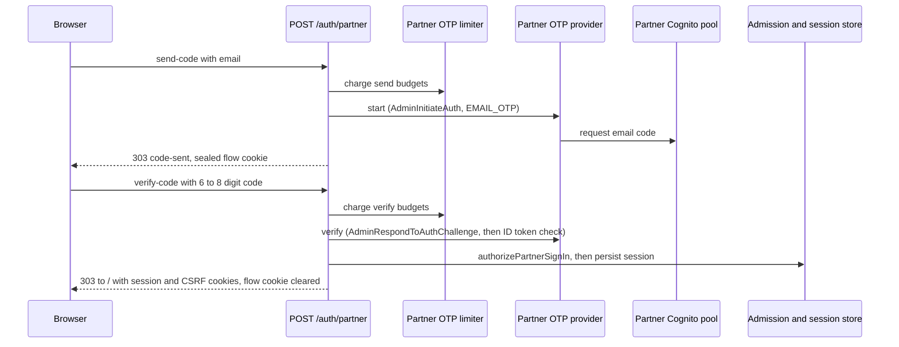
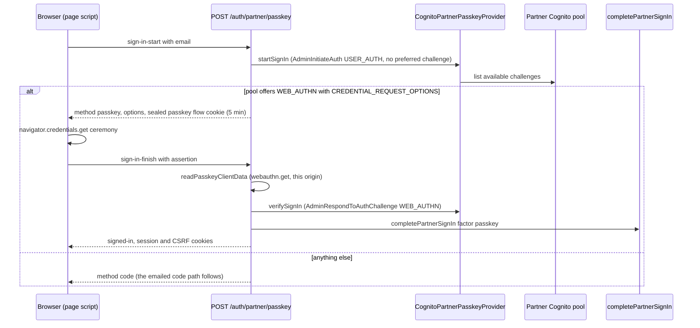
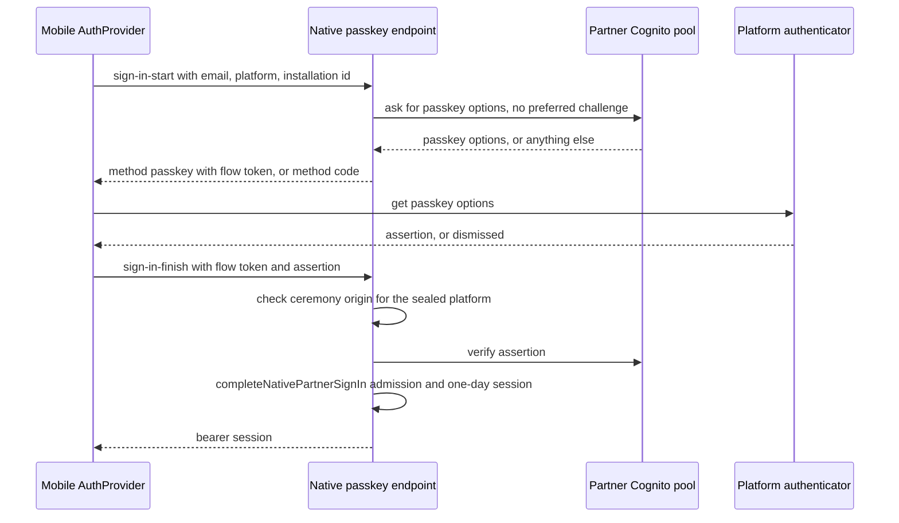
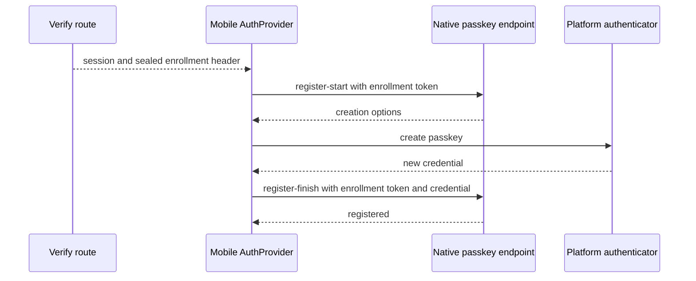

# Partner web sign-in

**Consult this page** when changing how a non-district first responder signs in (in the browser or the native app), the emailed code, the optional passkey, the partner session lifetime, the partner refusal messages, or the list of what a partner session may run.

Partner sign-in is the second of two sign-in paths. District staff sign in with Google ([identity and access](identity-and-access.md)). A partner has no Google account: the partner's own Amazon Cognito user pool proves the partner's first factor, either an emailed one-time code or, once enrolled, a passkey, and the server turns that proof into a session only when an administrator's partner admission is current ([partner access](partner-access.md)). Admission, not the identity token or the factor, decides access. The same sign-in is offered in the browser and in the native app ([mobile app](../integrations/mobile-app.md#partner-agency-sign-in)).

## Two steps, one form per step

The sign-in page (`app/(auth)/partner-sign-in/page.tsx`) is two plain form posts to `/auth/partner` (`PARTNER_SIGN_IN_ACTION`). There is no password, no redirect to a provider page, and no browser code that talks to Cognito.

1. **Send a code** (`step=send-code`, field `email`). The route checks the address shape and charges the send budgets, then calls the provider's `start`. The browser receives only a sealed flow cookie, never the pool's continuation handle in plain form.
2. **Verify the code** (`step=verify-code`, field `code`, 6 to 8 digits). The route opens the flow cookie, charges the verify budgets, calls the provider's `verify`, and then completes the sign-in.

The first step never consults the admission. Whether an address has partner access is decided only after the pool has proven that the person holds the address, so the form cannot be used to ask who has access.



Caption: the browser gets a session only at the last step. Every other outcome is a 303 back to `/partner-sign-in` with one status and the flow cookie cleared.

## The flow cookie and the provider boundary

The transient state between the two steps is `__Host-psd-eoc-partner-flow` (`lib/auth/partner-flow-cookie.ts`). It is AES-256-GCM sealed under a key derived by HKDF from the deployment's transient-cookie secret (`lib/auth/transient-cookie-secret.ts`) with its own label, the same derivation the passkey enrollment hand-off uses, so it cannot be opened as the Google callback cookie or forged. It carries the lower-cased address, the pool's flow session, a random installation id, and an expiry five minutes out (`PARTNER_FLOW_LIFETIME_SECONDS`). `openPartnerSignInFlow` returns null for any tampered, expired, or foreign value, and the route then answers `expired`.

The provider interface (`PartnerOtpProvider` in `lib/auth/partner-otp.ts`) has two implementations:

- `CognitoPartnerOtpProvider` calls `AdminInitiateAuth` with `USER_AUTH` and `PREFERRED_CHALLENGE: EMAIL_OTP`, and `AdminRespondToAuthChallenge` for the code. Both use a `SECRET_HASH` derived from the app-client secret, which is read once per process from the Secrets Manager ARN in `PSD_EOC_PARTNER_USER_POOL_CLIENT_SECRET_ARN`. A failed read is not cached. SDK retries are off. The pool's app client hides user existence, so an unenrolled address normally receives a challenge too; if the pool ever reports `UserNotFoundException`, the route returns a flow whose code is always refused.
- `syntheticPartnerOtpProvider` is the browser-test stand-in. Its code is derived from the address, and it is selectable only when `PSD_EOC_PARTNER_USER_POOL_ID` is `SYNTHETIC`, `PSD_EOC_SYNTHETIC_PARTNER_SIGN_IN` is `allowed`, and the database is loopback (`readPartnerPoolConfiguration` in `lib/auth/identity-providers.ts`). Its issuer is an RFC 2606 `.invalid` name, so a synthetic run cannot reach a real pool.

`verifyPartnerIdToken` accepts only an RS256 identity token whose issuer and audience are the configured pool and app client, whose `token_use` is `id`, and whose `sub` and `email` are present; a claimed email that differs from the flow's address is refused. Every failure, including a wrong code, an expired flow, and a disabled Cognito account, becomes the same `PARTNER_SIGN_IN_REFUSED`.

`resolvePartnerOtpProvider` returns null when the pool parameters are absent or `UNCONFIGURED`. The route then answers `unavailable`, and the login page shows the partner link only when `partnerSignInConfigured()` is true.

## Rate limits

`createPartnerOtpLimiter` (`lib/auth/partner-otp-limit.ts`) is a sliding 15-minute window with two budgets per kind, and an attempt must pass both to be charged:

| Attempt | Per address | Per caller |
| --- | --- | --- |
| Send a code | 5 (`PARTNER_OTP_SENDS_PER_EMAIL`) | 20 (`PARTNER_OTP_SENDS_PER_CLIENT`) |
| Verify a code | 10 (`PARTNER_OTP_VERIFIES_PER_EMAIL`) | 40 (`PARTNER_OTP_VERIFIES_PER_CLIENT`) |

Both budgets are decided before either is charged, so a refusal on one does not spend the other. Keys are SHA-256 digests of the address or caller, because the map lives for the life of the process. An absent caller address still charges the shared bucket. The limiter is a module-level singleton (`getPartnerOtpLimiter`), so its budgets are per server process, not shared across instances. A limited attempt returns the `rate-limited` status, whose message says only that attempts are too frequent.

## Admission decides, the token does not

After the pool proves the code, `completePartnerSignIn` (`lib/auth/partner-sign-in.ts`) calls `authorizePartnerSignIn` (`lib/auth/partner-sign-in-authorization.ts`). That function:

1. refuses any issuer that is not a partner issuer, and any address in the district's staff domain (`STAFF_ADDRESS`);
2. calls `decidePartnerAccess`, which refuses with `NO_PARTNER_ADMISSION`, `PARTNER_ADMISSION_ENDED`, or `PARTNER_ADMISSION_EXPIRED` (see [partner access](partner-access.md#sessions-and-access-decisions));
3. in one transaction, finds the account by issuer and subject, or creates it with a null `googleSubject`. An address that already belongs to a different identity is refused as `IDENTITY_MISMATCH` (partner pool) or `STAFF_ADDRESS` (staff issuer), and an administrator re-invites instead;
4. refuses a disabled account (`ACCOUNT_DISABLED`) even while its admission is active, so one person can be stopped without ending the admission record;
5. copies the admission's display name onto the account at the next sign-in, and returns a `User` whose only role is `partner`.

Every one of those refusals reaches the browser as the same `refused` status. The exact reason is written to the access-gate audit as a denied sign-in (`createDrizzleAccessGateAuditSink`), never shown. The route's failure path records that audit entry before it redirects, and an audit failure does not turn a refusal into a session.

## One-day sessions

`createPartnerSignInHandler` (`lib/auth/partner-session.ts`) registers the same canonical `complete-oidc-sign-in` capability that the staff callback uses, run through `executeRepositoryAuditedOidcCompletion` with a partner-specific authorizer. The partner transports are `partner-email-otp` (a code) and `partner-passkey` (a passkey assertion, whose evidence records no one-time password); a partner identity cannot complete a Google callback, and a Google identity cannot complete either partner step (see `packages/contracts/src/partner-sign-in.test.ts`). The contract accepts a partner passkey only with user verification, so a passkey on a device whose biometric or PIN was not satisfied is not evidence.

- The session expires at the earlier of `now + sessionLifetimeSeconds` and the admission's `expiresAt`. `PARTNER_SESSION_LIFETIME_SECONDS` is 86 400 seconds (one day). `validatePartnerSessionPolicy` refuses any policy above that, so the staff session variable cannot lengthen a partner session.
- The authorizer refuses a new session when the admission has already expired (`MEMBERSHIP_NOT_CURRENT`).
- The cookie is `__Host-psd-eoc-session` (`WEB_SESSION_COOKIE_NAME`), HttpOnly, Secure, `SameSite=lax`, path `/`, with a `maxAge` equal to the computed lifetime. The credential is 48 random bytes, stored only as a digest.
- `createDrizzlePartnerSessionStore` commits the replay evidence, admission confirmation, device enrollment, session, credential digest, connectivity epoch, and access-gate audit entry in one serializable transaction.
- A repeated submission of the same completed exchange is refused by the idempotency reservation (`idempotencyKey` is `oidc:<responseDigest>`, and the request id is kept out of the digest), so one code cannot issue two sessions.

On success the route redirects to `/` with status 303, sets the session and CSRF cookies, and clears the flow cookie. Session reads then re-check the admission on every request, as described in [partner access](partner-access.md#sessions-and-access-decisions).

## Passkey sign-in and enrollment (issue #599)

A partner may add a passkey after an emailed-code sign-in and use it on later sign-ins. The passkey is a second first factor the same pool proves, not a second grant: the verified identity goes through the same `completePartnerSignIn`, admission check, one-day ceiling and audit as a code. Without a passkey, or in a browser that cannot run the ceremony, the emailed code still works unchanged.



Caption: the probe never names a preferred challenge, because asking the pool to issue the email challenge would send a code. Only a pool answer that lists a passkey and returns its options starts the ceremony; every other answer is `code`, so the first step cannot be used to ask who holds a passkey.

- **Endpoint.** `app/(auth)/auth/partner/passkey/route.ts` takes one JSON body with four steps (`sign-in-start`, `sign-in-finish`, `register-start`, `register-finish`, `PartnerPasskeyRequestSchema` in `packages/contracts/src/partner-passkey.ts`). It accepts only a request whose `Origin` is this application's own origin, caps the body at 24 KB, and its handlers live in `steps.ts`. The page script (`app/(auth)/partner-sign-in/passkey-ceremony.ts`) is the only browser code here; it runs the WebAuthn ceremony, which only the page can run.
- **Relying party.** `partnerRelyingPartyIdFromOrigin` derives the passkey's relying-party id from the application origin (`GOOGLE_OIDC_APPLICATION_ORIGIN`) and refuses an origin with a port, path or address literal. The provider refuses pool options for any other relying party (`requestOptionsFor`, `creationOptionsFor`). The same hostname must be the Terraform `passkey_relying_party_id`; see [configuration and readiness](../operations/configuration-and-readiness.md#partner-passkey-relying-party).
- **Client data.** `readPasskeyClientData` is the only part of the authenticator's response the server reads. It requires the expected ceremony type (`webauthn.get` to sign in, `webauthn.create` to enroll), this origin, and no cross-origin or foreign top origin. Everything else is opaque and only the pool can verify it.
- **Flow.** A passkey flow is the same sealed `__Host-psd-eoc-partner-flow` cookie with `factor: 'passkey'`. A flow opened for a code is never answered with an assertion, and the reverse is refused before any budget is spent.
- **Enrollment.** After a code sign-in whose pool returned an access token, `route.ts` (`passkeyEnrollmentOffer`) sets `__Host-psd-eoc-partner-passkey`, a sealed ten-minute cookie holding that token. It is the only authority for `register-start` and `register-finish`: a session cannot change a passkey inside the pool. The hand-off is spent on a successful enrollment, so a second passkey needs a new code sign-in.
- **Budgets.** Passkey starts, passkey verifies and passkey registrations each have their own budget in `partner-otp-limit.ts`, so exhausting one never spends the code's. A passkey-start that makes the pool mail a code is charged to the send budget.
- **Mail-on-probe guard.** A pool observed mailing a code during the probe sets a per-process flag. Once set, a probe for an address with no send budget left is not sent to the pool, and at most one probe per address is in flight. These bounds are per instance, like every limiter here; `docs/INTEGRATIONS.md` records the consequence.
- **Refusals.** Every passkey refusal (no passkey, rejected assertion, ended or expired admission, disabled account) returns the same `{ status: 'refused' }` with HTTP 401, and the exact reason is written to the access-gate audit. Budgets return 429 `rate-limited`; a missing pool or relying party returns 503 `unavailable` and the page falls back to the code.
- **Synthetic stand-in.** `syntheticPartnerPasskeyProvider` checks the ceremony type, origin and issued challenge but not an authenticator signature, which only the pool verifies. `forgetSyntheticPartnerPasskeys` runs when a synthetic partner is disabled, matching `AdminDisableUser`, so a disabled partner's stand-in passkey stops working.
- **Native app.** The native app has its own passkey path, with platform-specific origins and a header-carried hand-off; see [native passkey sign-in and enrollment](#native-passkey-sign-in-and-enrollment-issue-647).

## Native app sign-in (issue #598)

The native app uses two JSON endpoints that mirror the code steps: `POST /api/auth/mobile/partner/start` (`MobilePartnerSignInStartRequestSchema`) and `POST /api/auth/mobile/partner/verify` (`MobilePartnerSignInVerifyRequestSchema`). Both are guarded by `resolvePartnerOtpProvider`, so a deployment without a pool answers `partnerSignInAbsent`.

- The start step never consults the admission. It returns only a sealed flow token, bound to the `platform` and `installationId` the app named (`sealPartnerSignInFlow(..., 'native')`), and the address is never returned.
- The verify step reads the address from the sealed flow, never from the request, and calls `completeNativePartnerSignIn`. Success returns a bearer session (`MobileSessionResponseSchema`) with `Cache-Control` private headers; every refusal is the same `UNAUTHENTICATED` message after a fixed delay (`PARTNER_REJECTION_DELAY_MS`), and the exact reason is recorded as `source: 'mobile'`.
- The contract admits a partner from both the web and the native sources with the same transport, because the evidence is the same and the source only decides how the credential is delivered (`AuthenticationCapabilityEnvelopeSchema` in `packages/contracts/src/capability.ts`). The app-side session rules are in [mobile app](../integrations/mobile-app.md#partner-agency-sign-in).

## Native passkey sign-in and enrollment (issue #647)

The native app has its own passkey path. It is one endpoint, `POST /api/auth/mobile/partner/passkey`, with four `step` values that mirror the browser's ([passkey section](#passkey-sign-in-and-enrollment-issue-599)). Only the transport differs: the sealed flow and enrollment values are returned to the app as opaque tokens, not held in cookies. Sign-in probes and assertions take this shape:



Caption: the device is asked before the server, and any outcome short of a refused assertion ends at the emailed code. Enrollment is offered only after an emailed-code sign-in and runs as a separate exchange:



- **Device first.** `signInPartnerWithPasskey` in `packages/mobile/src/lib/auth/partner-passkey-client.ts` checks `isSupported()` through `nativePasskeyPort` (`native-passkey-port.ts`) before any server call, so a build or phone without passkeys never probes the server. A dismissed sheet, a device with no credential, an unreachable server, a spent passkey budget, and an expired flow all end at `use-code`. `beginPartnerSignIn` in `auth-provider.tsx` then requests the emailed code. Only a server refusing a produced assertion is raised to the partner.
- **Platform-specific ceremony origin.** `nativePasskeyCeremonyOrigins(platform, relyingPartyId)` in `packages/server/lib/auth/partner-passkey.ts` names the origins this deployment accepts: `https://<relying party id>` on iOS, and `android:apk-key-hash:` plus the base64url SHA-256 of each configured Android signing fingerprint on Android (up to four, to cover a signing-key rotation). `readPasskeyClientData` checks the client data against that list and keeps the framed-ceremony refusal. With no Android fingerprint configured, no Android ceremony can complete ([configuration and readiness](../operations/configuration-and-readiness.md#mobile-app-association-documents)).
- **Endpoint.** `app/api/auth/mobile/partner/passkey/route.ts` parses `MobilePartnerPasskeyRequestSchema` (`packages/contracts/src/mobile-partner-passkey.ts`) and dispatches to handlers in `steps.ts`. The first step answers `passkey` or `code` and nothing else. `signInFinish` hands the verified identity to `completeNativePartnerSignIn`, so admission, the one-day ceiling and the audit are the code path's.
- **Enrollment hand-off in a header.** After an emailed-code sign-in, `passkeyEnrollmentOffer` in `app/api/auth/mobile/partner/verify/route.ts` seals the pool's access token with the native `e1` label and returns it in the `X-PSD-EOC-Partner-Passkey-Enrollment` header (`MOBILE_PARTNER_PASSKEY_ENROLLMENT_HEADER`), not in the session body. Installed builds parse the session envelope strictly, so a new body field would break them. The seal records the platform (`PartnerPasskeyEnrollment.platform`), which decides the origin check at registration. `register-finish` spends the hand-off, and a second passkey needs a new code sign-in.
- **Same refusals and budgets.** Every refusal is the one `UNAUTHENTICATED` message, rate limits return `RATE_LIMITED` with `Retry-After`, and passkey budgets are separate from code budgets, as on the web.
- **Probe consequence.** A pool that mails a code on the probe still answers `code`, so the app asks for one and that partner can receive two mails. This costs an inbox, not access ([readiness register](../operations/configuration-and-readiness.md#readiness-register)).
- **Readiness.** Association documents are served only where the tenant configures them, and no native passkey has run against Cognito or the platform validators. The first live proof follows a store build and a human deploy (psd-dev-standards 08). `docs/INTEGRATIONS.md` holds the current status.

## What a partner session may do

A partner session carries `partner: true` in its server-resolved capability scope. The capability engine refuses every capability outside `PARTNER_CAPABILITY_IDS` (`packages/contracts/src/partner-capabilities.ts`) on every human transport, and the interfaces hide the controls it would refuse, using `partnerAllowlistPermits`. The allowlist holds 22 IDs: reading live events, the event room, joining and posting, media attachments, facility and event-type reads, and the partner's own session, devices, push registration, and text-message consent. Starting, ending, correcting, Records, exports, roster and notification work, configuration, audit, and agent keys are outside it. The engine is described in [capability engine](../architecture/capability-engine.md#partner-sessions-and-the-allowlist).

## Configuration and readiness

With all three `PSD_EOC_PARTNER_USER_POOL_*` values set to a real pool, the server offers partner sign-in. The pool id is region-prefixed (`<region>_<suffix>`) and the issuer is derived from it, so the token verifier and the directory client cannot name different pools. A pool id without its app-client id is a configuration error, not a silent staff-only fallback. The stack's three parameters, their `UNCONFIGURED` defaults, and the web task's `AdminInitiateAuth`, `AdminRespondToAuthChallenge`, and WebAuthn grants are described in [infrastructure](../operations/infrastructure.md#partner-first-responder-directory-terraform-stateful-root). The environment readers are listed in [configuration and readiness](../operations/configuration-and-readiness.md).

The `passkey_relying_party_id` Terraform variable and the server's derivation from `psdEoc:applicationOrigin` must name one hostname; if they differ, passkey sign-in and enrollment are unavailable while the emailed code still works. The rule and the change procedure are in [configuration and readiness](../operations/configuration-and-readiness.md#partner-passkey-relying-party).

The pool, the code flow, the passkey flow and the native flow (including native passkeys) have never been exercised against a real Cognito pool or a platform's association validator. `docs/INTEGRATIONS.md` records the readiness: the code and passkey paths are proven only against the synthetic stand-in and Chromium's virtual authenticator, and on the live deployment the parameters are still `UNCONFIGURED`, so no partner account exists and no partner sign-in is offered. Whether the real pool returns `CREDENTIAL_REQUEST_OPTIONS` alongside its selection is the open question the first real pool must answer; without it every partner keeps using the emailed code.

## Change navigation

- **Where to start:** `lib/auth/partner-sign-in.ts` for the orchestration, `lib/auth/partner-sign-in-authorization.ts` for who may enter, and `app/(auth)/auth/partner/route.ts` for the HTTP steps. Provider calls are in `lib/auth/partner-otp.ts`.
- **Invariants to keep:** one refusal text for every refusal; no admission-dependent output in the first step; the flow cookie is the only state between steps, and it is always cleared after an outcome; sessions are at most one day and never past the admission; the provider stub is unreachable from a deployed configuration.
- **Changing the code step or a limit:** the constants in `partner-otp-limit.ts` and `OTP_CODE_PATTERN` in `partner-otp.ts` must match the page's `pattern` attribute in `app/(auth)/partner-sign-in/page.tsx`.
- **Changing a provider call:** `CognitoPartnerOtpProvider` calls (and, for passkeys, `CognitoPartnerPasskeyProvider` in `lib/auth/partner-passkey.ts`), the web task's IAM grant in `infra/src/stack/psd-eoc-stack.ts`, and the pool settings in `infra/terraform/stateful/main.tf` change together. The passkey grants are `StartWebAuthnRegistration` and `CompleteWebAuthnRegistration` beside the sign-in actions.
- **Changing the passkey probe:** keep the probe free of a preferred challenge and keep the mail-on-probe accounting. A change that lets a probe issue a message-sending challenge without charging the send budget reopens the bypass the tests in `partner-passkey.test.ts` pin.
- **Changing the native flow:** the flow token is the only state; the native verify step must keep reading the address from the sealed flow, and the native start response must not gain the address or the pool's continuation.
- **Changing native passkeys:** the native label (`e1`) and the browser label are separate on both the flow and the enrollment seal, so keep them separate. Platform origins come from `nativePasskeyCeremonyOrigins`, built from the same configured fingerprint and hostname that the association documents in `lib/config/app-association.ts` are built from; change both together ([configuration and readiness](../operations/configuration-and-readiness.md#mobile-app-association-documents)). The native contract must add endpoints and never fields to an existing response, which `mobile-partner-compatibility.test.ts` pins.
- **Changing what a partner may run:** edit `PARTNER_CAPABILITY_IDS` and its test, not the navigation. The engine, the navigation, and the event room all read the same list.

## Focused tests

| Behavior to check | Test file | Find by name |
| --- | --- | --- |
| Admitted partner signs in, one-day session, same person on re-sign-in, replay refused | `packages/server/lib/auth/partner-sign-in.database.test.ts` | `an admitted partner signs in and the session lasts one day`, `one completed sign-in cannot be replayed` |
| Each refusal reason: no admission, ended, expired, district address, staff account, other pool subject, disabled account | `packages/server/lib/auth/partner-sign-in.database.test.ts` | `an address with no admission is refused`, `a district address signs in as staff, never as a partner`, `a disabled partner account is refused` |
| Session lifetime ceiling and admission cap | `packages/server/lib/auth/partner-session.test.ts` | `one day is the ceiling and nothing can raise it`, `a session never outlives the admission behind it`, `an expired admission issues nothing` |
| Route: origin check, one status per refusal, sealed flow, expired flow, cache headers | `packages/server/app/(auth)/auth/partner/route.test.ts` | `refuses a submission from another site`, `the first step says the same thing for every address`, `a stale flow cookie has expired`, `every response forbids caching and referrers` |
| Send and verify budgets, recovery as the window slides | `packages/server/lib/auth/partner-otp-limit.test.ts` | `sends and verifies have separate budgets`, `a refused attempt spends neither budget` |
| Flow cookie seal, tamper, expiry, host lock | `packages/server/lib/auth/partner-flow-cookie.test.ts` | `a tampered flow does not open`, `another deployment’s secret does not open it` |
| Pool token verification and provider behavior, synthetic stand-in | `packages/server/lib/auth/partner-otp.test.ts` | `refuses an access token presented as an identity`, `a wrong code, an expired flow, and a disabled account are one refusal`, `the synthetic pool selects the stand-in` |
| Partner and Google issuers never complete each other's path | `packages/contracts/src/partner-sign-in.test.ts` | `a partner token cannot arrive as a Google code callback`, `a Google token cannot arrive as a partner one-time password` |
| Allowlist and interface hiding | `packages/contracts/src/partner-capabilities.test.ts`, `packages/server/lib/capabilities/engine.test.ts` | `interfaces hide exactly what the allowlist refuses a partner`, `refuses every capability off the partner allowlist on every human transport` |
| Browser flow: emailed code, sign-out, generic refusal, wrong code | `packages/server/e2e/partner-sign-in.flow.ts` | `partner signs in with an emailed code, then signs out`, `an address with no admission gets one generic refusal`, `a wrong code is refused and issues no session` |
| Passkey probe: no passkey means code, a pool offering a passkey hands over options, mail-on-probe charges, one probe per address | `packages/server/lib/auth/partner-passkey.test.ts` | `an address with no passkey signs in with a code instead`, `asks the pool what this partner could use, never for a challenge`, `anything but an offered passkey means use a code`, `a pool that mailed a code anyway says so, so it can be charged` |
| Passkey assertion and registration: client data, relying party, hand-off, single-use challenge | `packages/server/lib/auth/partner-passkey.test.ts`, `partner-passkey-enrollment.test.ts` | `refuses another origin, another ceremony, and a framed ceremony`, `a challenge is spent whether or not the assertion is accepted`, `options for another relying party are never handed to a partner`, `a sealed enrollment opens again unchanged`, `the sign-in flow cookie cannot be opened as an enrollment` |
| Passkey route: flow factor, passkey budget, enrollment hand-off, burst of probes | `packages/server/app/(auth)/auth/partner/passkey/route.test.ts` | `a flow opened for a code is never answered with an assertion`, `registration needs the hand-off, never a session`, `once the pool mails on a probe, a spent send budget stops asking it`, `a burst of probes for one address asks the pool once` |
| Passkey sign-in in the database: one-day session, replay refused, revoked admission or disabled account refused | `packages/server/lib/auth/partner-sign-in.database.test.ts` (describe block for passkeys) | `an admitted partner signs in with a passkey, one-day session`, `one completed passkey sign-in cannot be replayed`, `a disabled account’s passkey is refused` |
| Passkey and code are two exchanges; the passkey transport needs user verification | `packages/contracts/src/partner-passkey.test.ts` | `a passkey sign-in completes a partner session`, `a passkey sign-in never records a verified one-time password`, `a passkey sign-in with unverified user is not a transport` |
| Native sign-in: start never consults the admission, verify reads the address from the flow, refusals are one message | `packages/server/app/api/auth/mobile/partner/route.test.ts` | `the first step says the same thing for every address`, `the sealed flow carries the device the first step named`, `a stale or foreign flow has expired, before the pool is asked`, `one address gets a fixed number of codes in the window` |
| Native contract: a native partner completes, a native Google exchange cannot carry a partner, the native flow token is labelled native | `packages/contracts/src/partner-sign-in.test.ts`, `packages/contracts/src/mobile-partner-compatibility.test.ts` | `a partner signs in from the native application`, `a native partner still cannot arrive as a native Google exchange`, `native partner sign-in adds endpoints, never fields` |
| Browser flow: passkey enrollment, then sign-in with it; code fallback without a passkey | `packages/server/e2e/partner-passkey.flow.ts` | `a partner enrolls a passkey, then signs in with it`, `an address with no passkey is asked for a code, never refused`, `a partner signs in with a code and is told no passkey is possible` |
| Native passkey endpoint: four steps on one path, flow opened for a code never answered with an assertion, enrollment needs the hand-off, Android assertion never presented as iOS | `packages/server/app/api/auth/mobile/partner/passkey/route.test.ts` | `a partner enrolls a passkey from the app and then signs in with it`, `an Android ceremony is checked against the signing certificate`, `a ceremony performed for another origin is refused`, `a deployment with no asset-links document completes no Android ceremony`, `registration needs the hand-off, never a session` |
| Native enrollment hand-off: offered after a code sign-in only, a hand-off for another address enrolls nothing | `packages/server/app/api/auth/mobile/partner/verify/route.database.test.ts` | `offers a passkey hand-off for the device that just signed in`, `a refused sign-in offers nothing to enroll against`, `a wrong code offers nothing either` |
| Native passkey sealed labels, platform recorded in the enrollment seal | `packages/server/lib/auth/partner-passkey-enrollment.test.ts`, `packages/server/lib/auth/partner-flow-cookie.test.ts` | `a sealed enrollment opens again unchanged` (native `e1` case), `a native flow names the platform it enrolls` |
| Native passkey contract: the `e1` seal only, the header carries the hand-off, the four steps, the first answer is passkey or code | `packages/contracts/src/mobile-partner-passkey.test.ts`, `packages/contracts/src/mobile-partner-compatibility.test.ts` | `accepts the native seal and refuses every other surface`, `travels under a header name, never a body field`, `the answer is the ceremony or an emailed code, and nothing else`, `native partner passkeys add endpoints, never fields` |
| Association documents: which app is named, configured or absent, malformed values refused | `packages/server/lib/config/app-association.test.ts`, `packages/server/app/.well-known/**/route.test.ts`, `packages/server/lib/config/deployment.test.ts` | `names the signed app once, and only the webcredentials service`, `a deployment with no team identifier serves no document`, `carries the login-credentials relation and nothing else`, `a signing-key rotation may name both certificates` |
| Native passkey client: device asked first, every failure ends at the code, a created passkey handed over in contract shape, offer only when the session took effect | `packages/mobile/src/lib/auth/partner-passkey-client.test.ts`, `packages/mobile/native-tests/partner-passkey-offer.native.tsx` | `a build or device with no passkey support never asks the server`, `a dismissed sheet is not an error, it is the code`, `a session the device refused to store leaves no offer`, `declining it enrolls nothing` |

## Validation

Narrow, no database:

```bash
bun test packages/server/lib/auth/partner-otp.test.ts packages/server/lib/auth/partner-otp-limit.test.ts packages/server/lib/auth/partner-flow-cookie.test.ts packages/server/lib/auth/partner-session.test.ts packages/server/lib/auth/partner-passkey.test.ts packages/server/lib/auth/partner-passkey-enrollment.test.ts packages/contracts/src/partner-sign-in.test.ts packages/contracts/src/partner-passkey.test.ts packages/contracts/src/partner-capabilities.test.ts "packages/server/app/(auth)/auth/partner/route.test.ts" "packages/server/app/(auth)/auth/partner/passkey/route.test.ts" packages/server/app/api/auth/mobile/partner/route.test.ts packages/server/app/api/auth/mobile/partner/passkey/route.test.ts packages/contracts/src/mobile-partner-passkey.test.ts packages/server/lib/config/app-association.test.ts
```

The database-backed sign-in needs the synthetic database (`bun run test:db:start`, see [verification and testing](../testing/verification-and-testing.md)):

```bash
bun test packages/server/lib/auth/partner-sign-in.database.test.ts
```

Escalate to the browser flow (`bun run test:e2e:issue-340`, which runs `packages/server/e2e/run.ts`) only for changes to the sign-in page, the passkey ceremony script or the route's HTML outcomes. It needs a built server and Chromium. The native app's partner screen is checked by `bun run --cwd packages/mobile typecheck`, `bun test packages/mobile/src/lib/auth`, and, for a screen or copy change, both platforms' Maestro flows (see [mobile app](../integrations/mobile-app.md#verification)).

## Scope boundaries

- The synthetic stand-in is a test device. Do not add a deployed path to it.
- No partner data enters staff tables or group sources. A partner sign-in writes a `users` row with a null Google subject and the `partner` role only.
- The page never explains a refusal. Adding detail to a refusal message is a product and security decision, not a copy edit.
- Partner access policy (who is admitted, how long) belongs to [partner access](partner-access.md); this page covers only the sign-in mechanics.

Related: [partner access](partner-access.md) (admissions and the sweep), [identity and access](identity-and-access.md) (the staff path and shared session rules), [capability engine](../architecture/capability-engine.md) (the allowlist gate), [event lifecycle](event-lifecycle-and-activation.md#event-room-and-journal) (what a partner does once signed in).

