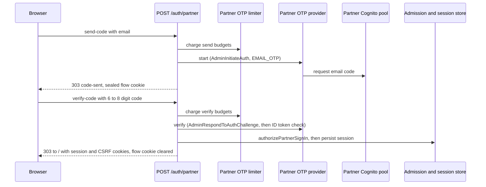

# Partner web sign-in

**Consult this page** when changing how a non-district first responder signs in on the web, the emailed code, the partner session lifetime, the partner refusal messages, or the list of what a partner session may run.

Partner sign-in is the second of two sign-in paths. District staff sign in with Google ([identity and access](identity-and-access.md)). A partner has no Google account: the partner's own Amazon Cognito user pool emails a one-time code, and the server turns a verified code into a browser session only when an administrator's partner admission is current ([partner access](partner-access.md)). Admission, not the identity token, decides access.

## Two steps, one form per step

The sign-in page (`app/(auth)/partner-sign-in/page.tsx`) is two plain form posts to `/auth/partner` (`PARTNER_SIGN_IN_ACTION`). There is no password, no redirect to a provider page, and no browser code that talks to Cognito.

1. **Send a code** (`step=send-code`, field `email`). The route checks the address shape and charges the send budgets, then calls the provider's `start`. The browser receives only a sealed flow cookie, never the pool's continuation handle in plain form.
2. **Verify the code** (`step=verify-code`, field `code`, 6 to 8 digits). The route opens the flow cookie, charges the verify budgets, calls the provider's `verify`, and then completes the sign-in.

The first step never consults the admission. Whether an address has partner access is decided only after the pool has proven that the person holds the address, so the form cannot be used to ask who has access.



Caption: the browser gets a session only at the last step. Every other outcome is a 303 back to `/partner-sign-in` with one status and the flow cookie cleared.

## The flow cookie and the provider boundary

The transient state between the two steps is `__Host-psd-eoc-partner-flow` (`lib/auth/partner-flow-cookie.ts`). It is AES-256-GCM sealed under a key derived by HKDF from the deployment's transient-cookie secret with its own label, so it cannot be opened as the Google callback cookie or forged. It carries the lower-cased address, the pool's flow session, a random installation id, and an expiry five minutes out (`PARTNER_FLOW_LIFETIME_SECONDS`). `openPartnerSignInFlow` returns null for any tampered, expired, or foreign value, and the route then answers `expired`.

The provider interface (`PartnerOtpProvider` in `lib/auth/partner-otp.ts`) has two implementations:

- `CognitoPartnerOtpProvider` calls `AdminInitiateAuth` with `USER_AUTH` and `PREFERRED_CHALLENGE: EMAIL_OTP`, and `AdminRespondToAuthChallenge` for the code. Both use a `SECRET_HASH` derived from the app-client secret, which is read once per process from the Secrets Manager ARN in `PSD_EOC_PARTNER_USER_POOL_CLIENT_SECRET_ARN`. A failed read is not cached. SDK retries are off. The pool's app client hides user existence, so an unenrolled address normally receives a challenge too; if the pool ever reports `UserNotFoundException`, the route returns a flow whose code is always refused.
- `syntheticPartnerOtpProvider` is the browser-test stand-in. Its code is derived from the address, and it is selectable only when `PSD_EOC_PARTNER_USER_POOL_ID` is `SYNTHETIC`, `PSD_EOC_SYNTHETIC_PARTNER_SIGN_IN` is `allowed`, and the database is loopback (`readPartnerPoolConfiguration` in `lib/auth/identity-providers.ts`). Its issuer is an RFC 2606 `.invalid` name, so a synthetic run cannot reach a real pool.

`verifyPartnerIdToken` accepts only an RS256 identity token whose issuer and audience are the configured pool and app client, whose `token_use` is `id`, and whose `sub` and `email` are present; a claimed email that differs from the flow's address is refused. Every failure, including a wrong code, an expired flow, and a disabled Cognito account, becomes the same `PARTNER_SIGN_IN_REFUSED`.

`resolvePartnerOtpProvider` returns null when the pool parameters are absent or `UNCONFIGURED`. The route then answers `unavailable`, and the login page shows the partner link only when `partnerSignInConfigured()` is true.

## Rate limits

`createPartnerOtpLimiter` (`lib/auth/partner-otp-limit.ts`) is a sliding 15-minute window with two budgets per kind, and an attempt must pass both to be charged:

| Attempt | Per address | Per caller |
| --- | --- | --- |
| Send a code | 5 (`PARTNER_OTP_SENDS_PER_EMAIL`) | 20 (`PARTNER_OTP_SENDS_PER_CLIENT`) |
| Verify a code | 10 (`PARTNER_OTP_VERIFIES_PER_EMAIL`) | 40 (`PARTNER_OTP_VERIFIES_PER_CLIENT`) |

Both budgets are decided before either is charged, so a refusal on one does not spend the other. Keys are SHA-256 digests of the address or caller, because the map lives for the life of the process. An absent caller address still charges the shared bucket. The limiter is a module-level singleton (`getPartnerOtpLimiter`), so its budgets are per server process, not shared across instances. A limited attempt returns the `rate-limited` status, whose message says only that attempts are too frequent.

## Admission decides, the token does not

After the pool proves the code, `completePartnerSignIn` (`lib/auth/partner-sign-in.ts`) calls `authorizePartnerSignIn` (`lib/auth/partner-sign-in-authorization.ts`). That function:

1. refuses any issuer that is not a partner issuer, and any address in the district's staff domain (`STAFF_ADDRESS`);
2. calls `decidePartnerAccess`, which refuses with `NO_PARTNER_ADMISSION`, `PARTNER_ADMISSION_ENDED`, or `PARTNER_ADMISSION_EXPIRED` (see [partner access](partner-access.md#sessions-and-access-decisions));
3. in one transaction, finds the account by issuer and subject, or creates it with a null `googleSubject`. An address that already belongs to a different identity is refused as `IDENTITY_MISMATCH` (partner pool) or `STAFF_ADDRESS` (staff issuer), and an administrator re-invites instead;
4. refuses a disabled account (`ACCOUNT_DISABLED`) even while its admission is active, so one person can be stopped without ending the admission record;
5. copies the admission's display name onto the account at the next sign-in, and returns a `User` whose only role is `partner`.

Every one of those refusals reaches the browser as the same `refused` status. The exact reason is written to the access-gate audit as a denied sign-in (`createDrizzleAccessGateAuditSink`), never shown. The route's failure path records that audit entry before it redirects, and an audit failure does not turn a refusal into a session.

## One-day sessions

`createPartnerSignInHandler` (`lib/auth/partner-session.ts`) registers the same canonical `complete-oidc-sign-in` capability that the staff callback uses, run through `executeRepositoryAuditedOidcCompletion` with a partner-specific authorizer. The partner transport is `partner-email-otp`; a partner identity cannot complete a Google callback, and a Google identity cannot complete a partner code step (see `packages/contracts/src/partner-sign-in.test.ts`).

- The session expires at the earlier of `now + sessionLifetimeSeconds` and the admission's `expiresAt`. `PARTNER_SESSION_LIFETIME_SECONDS` is 86 400 seconds (one day). `validatePartnerSessionPolicy` refuses any policy above that, so the staff session variable cannot lengthen a partner session.
- The authorizer refuses a new session when the admission has already expired (`MEMBERSHIP_NOT_CURRENT`).
- The cookie is `__Host-psd-eoc-session` (`WEB_SESSION_COOKIE_NAME`), HttpOnly, Secure, `SameSite=lax`, path `/`, with a `maxAge` equal to the computed lifetime. The credential is 48 random bytes, stored only as a digest.
- `createDrizzlePartnerSessionStore` commits the replay evidence, admission confirmation, device enrollment, session, credential digest, connectivity epoch, and access-gate audit entry in one serializable transaction.
- A repeated submission of the same completed exchange is refused by the idempotency reservation (`idempotencyKey` is `oidc:<responseDigest>`, and the request id is kept out of the digest), so one code cannot issue two sessions.

On success the route redirects to `/` with status 303, sets the session and CSRF cookies, and clears the flow cookie. Session reads then re-check the admission on every request, as described in [partner access](partner-access.md#sessions-and-access-decisions).

## What a partner session may do

A partner session carries `partner: true` in its server-resolved capability scope. The capability engine refuses every capability outside `PARTNER_CAPABILITY_IDS` (`packages/contracts/src/partner-capabilities.ts`) on every human transport, and the interfaces hide the controls it would refuse, using `partnerAllowlistPermits`. The allowlist holds 22 IDs: reading live events, the event room, joining and posting, media attachments, facility and event-type reads, and the partner's own session, devices, push registration, and text-message consent. Starting, ending, correcting, Records, exports, roster and notification work, configuration, audit, and agent keys are outside it. The engine is described in [capability engine](../architecture/capability-engine.md#partner-sessions-and-the-allowlist).

## Configuration and readiness

With all three `PSD_EOC_PARTNER_USER_POOL_*` values set to a real pool, the server offers partner sign-in. The pool id is region-prefixed (`<region>_<suffix>`) and the issuer is derived from it, so the token verifier and the directory client cannot name different pools. A pool id without its app-client id is a configuration error, not a silent staff-only fallback. The stack's three parameters, their `UNCONFIGURED` defaults, and the web task's `AdminInitiateAuth`, `AdminRespondToAuthChallenge`, and WebAuthn grants are described in [infrastructure](../operations/infrastructure.md#partner-first-responder-directory-terraform-stateful-root). The environment readers are listed in [configuration and readiness](../operations/configuration-and-readiness.md).

The pool and this flow have never been exercised against a real Cognito pool. `docs/INTEGRATIONS.md` records the readiness: the code is proven only against the synthetic stand-in in the browser flows, and on the live deployment the parameters are still `UNCONFIGURED`, so no partner account exists and no partner sign-in is offered.

## Change navigation

- **Where to start:** `lib/auth/partner-sign-in.ts` for the orchestration, `lib/auth/partner-sign-in-authorization.ts` for who may enter, and `app/(auth)/auth/partner/route.ts` for the HTTP steps. Provider calls are in `lib/auth/partner-otp.ts`.
- **Invariants to keep:** one refusal text for every refusal; no admission-dependent output in the first step; the flow cookie is the only state between steps, and it is always cleared after an outcome; sessions are at most one day and never past the admission; the provider stub is unreachable from a deployed configuration.
- **Changing the code step or a limit:** the constants in `partner-otp-limit.ts` and `OTP_CODE_PATTERN` in `partner-otp.ts` must match the page's `pattern` attribute in `app/(auth)/partner-sign-in/page.tsx`.
- **Changing a provider call:** `CognitoPartnerOtpProvider` calls, the web task's IAM grant in `infra/src/stack/psd-eoc-stack.ts`, and the pool settings in `infra/terraform/stateful/main.tf` change together.
- **Changing what a partner may run:** edit `PARTNER_CAPABILITY_IDS` and its test, not the navigation. The engine, the navigation, and the event room all read the same list.

## Focused tests

| Behavior to check | Test file | Find by name |
| --- | --- | --- |
| Admitted partner signs in, one-day session, same person on re-sign-in, replay refused | `packages/server/lib/auth/partner-sign-in.database.test.ts` | `an admitted partner signs in and the session lasts one day`, `one completed sign-in cannot be replayed` |
| Each refusal reason: no admission, ended, expired, district address, staff account, other pool subject, disabled account | `packages/server/lib/auth/partner-sign-in.database.test.ts` | `an address with no admission is refused`, `a district address signs in as staff, never as a partner`, `a disabled partner account is refused` |
| Session lifetime ceiling and admission cap | `packages/server/lib/auth/partner-session.test.ts` | `one day is the ceiling and nothing can raise it`, `a session never outlives the admission behind it`, `an expired admission issues nothing` |
| Route: origin check, one status per refusal, sealed flow, expired flow, cache headers | `packages/server/app/(auth)/auth/partner/route.test.ts` | `refuses a submission from another site`, `the first step says the same thing for every address`, `a stale flow cookie has expired`, `every response forbids caching and referrers` |
| Send and verify budgets, recovery as the window slides | `packages/server/lib/auth/partner-otp-limit.test.ts` | `sends and verifies have separate budgets`, `a refused attempt spends neither budget` |
| Flow cookie seal, tamper, expiry, host lock | `packages/server/lib/auth/partner-flow-cookie.test.ts` | `a tampered flow does not open`, `another deployment’s secret does not open it` |
| Pool token verification and provider behavior, synthetic stand-in | `packages/server/lib/auth/partner-otp.test.ts` | `refuses an access token presented as an identity`, `a wrong code, an expired flow, and a disabled account are one refusal`, `the synthetic pool selects the stand-in` |
| Partner and Google issuers never complete each other's path | `packages/contracts/src/partner-sign-in.test.ts` | `a partner token cannot arrive as a Google code callback`, `a Google token cannot arrive as a partner one-time password` |
| Allowlist and interface hiding | `packages/contracts/src/partner-capabilities.test.ts`, `packages/server/lib/capabilities/engine.test.ts` | `interfaces hide exactly what the allowlist refuses a partner`, `refuses every capability off the partner allowlist on every human transport` |
| Browser flow: emailed code, sign-out, generic refusal, wrong code | `packages/server/e2e/partner-sign-in.flow.ts` | `partner signs in with an emailed code, then signs out`, `an address with no admission gets one generic refusal`, `a wrong code is refused and issues no session` |

## Validation

Narrow, no database:

```bash
bun test packages/server/lib/auth/partner-otp.test.ts packages/server/lib/auth/partner-otp-limit.test.ts packages/server/lib/auth/partner-flow-cookie.test.ts packages/server/lib/auth/partner-session.test.ts packages/contracts/src/partner-sign-in.test.ts packages/contracts/src/partner-capabilities.test.ts
```

The route and the database-backed sign-in need the synthetic database (`bun run test:db:start`, see [verification and testing](../testing/verification-and-testing.md)):

```bash
bun test packages/server/lib/auth/partner-sign-in.database.test.ts "packages/server/app/(auth)/auth/partner/route.test.ts"
```

Escalate to the browser flow (`bun run test:e2e:issue-340`, which runs `packages/server/e2e/run.ts`) only for changes to the sign-in page or the route's HTML outcomes. It needs a built server and Chromium.

## Scope boundaries

- The synthetic stand-in is a test device. Do not add a deployed path to it.
- No partner data enters staff tables or group sources. A partner sign-in writes a `users` row with a null Google subject and the `partner` role only.
- The page never explains a refusal. Adding detail to a refusal message is a product and security decision, not a copy edit.
- Partner access policy (who is admitted, how long) belongs to [partner access](partner-access.md); this page covers only the sign-in mechanics.

Related: [partner access](partner-access.md) (admissions and the sweep), [identity and access](identity-and-access.md) (the staff path and shared session rules), [capability engine](../architecture/capability-engine.md) (the allowlist gate), [event lifecycle](event-lifecycle-and-activation.md#event-room-and-journal) (what a partner does once signed in).
