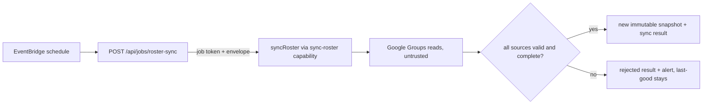

# Roster snapshots, group sources, and audience resolution

**Consult this page** when changing who an event notifies, how Google Groups are imported, the synthetic roster, or roster-health reporting.

## Model

- **Group sources** (`group_sources`, `group_members`; `GroupSourceSchema` in `contracts/src/group.ts`): kinds `google-group`, `manual`, `synthetic`; purposes `access`, `building` (tied to a facility), `others`. Admin pages: `app/(admin)/access`, `facilities`, `integrations`; capabilities `create-group-source`, `update-group-source`, `set-manual-roster-members`.
- **Roster source configurations** (`roster_source_configurations` + facility/group links) are versioned; `rosterSourceConfigurationRevisionDigest` binds a sync to the exact revision.
- **Snapshots** (`roster_snapshots`, `roster_recipients`, `roster_endpoints`, `roster_sync_results`, `roster_sync_group_failures`): immutable, population-tagged (`RosterPopulationSchema`: `staff` | `synthetic`). Endpoints are minimized (email/SMS/push) and public examples contain no contact or token data. `drizzle/roster-immutability.integration.test.ts` guards immutability at the database layer.
- **Facilities and neighborhoods** (`facilities`, `neighborhood_versions`, `neighborhood_facilities`): a neighborhood version groups schools on one campus; an event at one school reaches its campus-mates, but an isolated facility only reaches its own lists.

## Sync flow

Caption: scheduled and administrator-triggered sync share `syncRoster`; promotion only on complete results.

- `app/api/jobs/roster-sync/runtime.ts` accepts an EventBridge event (`ROSTER_SYNC_EVENT_SOURCE`, 16 KiB cap) with a token (`PSD_EOC_ROSTER_SYNC_JOB_TOKEN`, `verifyRosterSyncJobToken`) and runs the `sync-roster` handler through `invokeAuthorizedCapabilityHandler` (an allowlisted lower-tier boundary, see [capability engine](../architecture/capability-engine.md)).
- `groups-sync.ts` also owns the push-provider cutover awareness (`lib/push-provider-cutover.ts`) when composing endpoints, alert sinks (`createStructuredRosterSyncAlertSink`) and per-group count diffs (`diffRosterGroupCounts`).
- `scheduled-publish.ts` (`publishScheduledRosterSnapshot`, idempotency prefix `roster-publish:scheduled:`) publishes on a 2-hour cadence matching the access-membership schedule; SMS consent changes trigger their own publish key (`smsConsentRosterPublishIdempotencyKey`).
- Membership for sign-in comes from a separate sync: [identity and access](identity-and-access.md).

## Audience resolution

`lib/roster/resolve.ts#resolveAudience` takes the pinned `RosterSnapshot` plus the activation selection (facility, neighborhood versions, group sources) and returns recipients/endpoints, failing closed with closed non-PII codes (`MISSING_TARGET_FACILITY`, `MISSING_NEIGHBORHOOD_VERSION`, `ENDPOINT_PROVENANCE_CONFLICT`, ...). The activation preview shows channel coverage and blocks with reason codes such as `NO_RECIPIENTS`, `NO_PUSH_ENDPOINTS` (rendered by `lib/events/blocking-reasons.ts`) — see [lifecycle](event-lifecycle-and-activation.md). The [notification pipeline](notification-pipeline.md) never reconstructs a recipient list; it reads endpoints from the snapshot named in the batch.

`get-stale-roster-report` (also an MCP tool) returns a PII-free `StaleRosterReport`: latest complete snapshot age, failed source groups, and recipients/endpoints lacking usable endpoints, scoped by facility (`lib/roster/stale-report.ts`); alarms and `docs/runbooks/alarm-roster-stale.md` cover operations.

## Change guidance

- Source/population changes start in `contracts/src/roster.ts` / `group.ts`, then `db/schema/roster.ts` (new migration; never edit applied ones), `groups-sync.ts`, `resolve.ts`.
- Synthetic roster fixtures: `db/bootstrap-synthetic-groups.ts` and `psdEoc:syntheticGroups` in CDK context ([configuration](../operations/configuration-and-readiness.md)). Real vs synthetic must never mix in one snapshot.
- Focused checks: `bun test packages/server/lib/roster`; integration variants need the synthetic DB ([verification](../testing/verification-and-testing.md)).
- Runbook: `docs/runbooks/roster-sync.md`.
