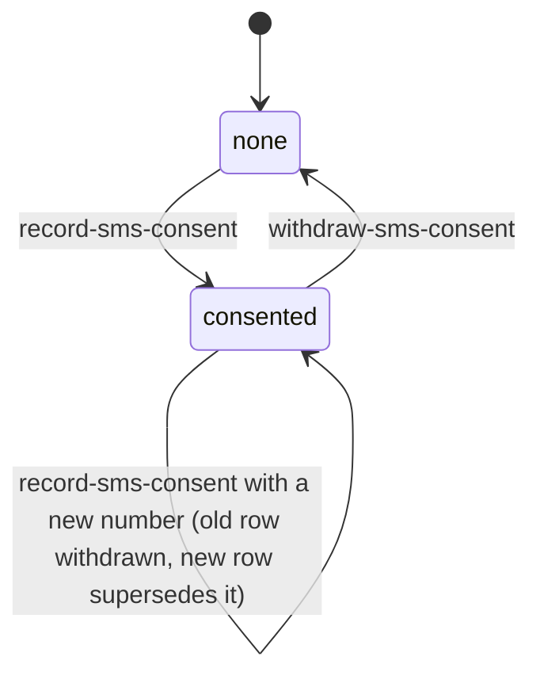

# Staff SMS consent and text alerts

**Consult this page** for anything that asks a staff member to agree to emergency texts, changes the consent disclosure, touches the `/text-alerts` page or the mobile SMS consent screen, or changes how a consented number reaches the roster and delivery. The delivery side of SMS (opt-outs, provider verification, retries) is in [notification pipeline](notification-pipeline.md); this page owns only the staff member's consent.

## Model

Consent is one row per staff member and number in `staff_sms_consents` (`packages/server/db/schema/identity.ts`). The table enforces the rules that the code relies on:

- one live row per user, through the partial unique index `staff_sms_consents_one_live_per_user_uq` (live means `withdrawnAt is null`);
- a supersession chain: a new row points back at the consent it replaced through a unique `supersedes_consent_id` foreign key;
- a `disclosure_version` on every row, so a later carrier question gets the wording that person actually saw.

`SMS_CONSENT_DISCLOSURE_VERSION` (`packages/contracts/src/identity.ts`) is the version shown today. Changing the wording means bumping that constant; earlier rows keep their own version.

Caption: "consented" and "none" describe the user's live state. Withdrawn rows stay in the table as evidence and are never deleted.

## Capabilities and the public surface

`packages/server/lib/capabilities/sms-consent.ts` registers three capabilities on the shared engine ([capability engine](../architecture/capability-engine.md)):

| Capability | Behavior | Notes |
| --- | --- | --- |
| `read-my-sms-consent` | Returns `none` or `consented` with the last four digits, the disclosure version and the consent time, plus the current disclosure | Reads only the caller's own row; the whole number is never returned |
| `record-sms-consent` | Locks the user's row, withdraws any live consent, inserts the new one | Replays by the reference `sms-consent:<id>`; the number is deliberately absent from that reference |
| `withdraw-sms-consent` | Sets `withdrawnAt` on the live row | Replays by `sms-consent-withdrawal:<id>`; an absent live consent is a conflict, not a success |

Every registration calls `requireHuman`, so an agent or a partner session cannot give consent. The contract schemas are in `packages/contracts/src/identity.ts`: `RecordSmsConsentInputSchema` (a `+` E.164 number, a disclosure version and `agreed: z.literal(true)`), `SmsConsentReceiptSchema` (no number), `SmsConsentStateSchema` (last four digits only) and `SmsConsentWithdrawalReceiptSchema`.

Three entry points reach the same capabilities:

- **Web `/text-alerts`**: `app/(app)/text-alerts/page.tsx` and `actions.ts` call `handleRecordSmsConsentAction` and `handleWithdrawSmsConsentAction` (`action-handlers.ts`). The handler treats only a submitted `agreed=yes` as consent, normalizes the typed number with `normalizeNorthAmericanMobileNumber`, and never echoes the submitted number back to the browser.
- **REST**: `app/api/sms-consent/route.ts` (GET reads, POST records) and `app/api/sms-consent/withdraw/route.ts` (POST withdraws) delegate to `_lib/http.ts`. The withdraw body must be a JSON object carrying an idempotency key, so a bare navigation cannot withdraw consent.
- **Mobile**: `packages/mobile/src/features/sms-consent/api.ts` calls `/api/sms-consent` and `/api/sms-consent/withdraw`; the screen and its pure model are in `features/sms-consent/`. The mobile [mobile app](../integrations/mobile-app.md) page covers the screen; this page owns the rules it must satisfy.

## Disclosure

`smsConsentDisclosure` (`packages/contracts/src/identity.ts`) builds the text shown before agreement from the tenant's organization name, privacy URL, support email and support phone. Web and mobile render this one source, so carrier review sees a single text. It names the sender, the purpose (emergency activations, drills and delivery tests, never marketing), frequency, that rates may apply, how to stop (`STOP`) and resume (`START` or `UNSTOP`, carrier-owned), and how to get help. Tenant facts are read from configuration in `packages/server/lib/config/deployment.ts`, not hard-coded.

## Roster and delivery consequences

- **Publish after commit.** `withRosterPublishOnConsentChange` wraps the runtime. After a successful `record-sms-consent` or `withdraw-sms-consent`, it calls `publishScheduledRosterSnapshot` with `smsConsentRosterPublishIdempotencyKey` (`packages/server/lib/roster/scheduled-publish.ts`). The publication opens its own transaction, so it cannot share the consent transaction. A failed or refused publication is logged (`sms-consent-roster-publish-failed` or `-not-published`) and the consent stands; the scheduled two-hourly publish still picks the change up.
- **Snapshots copy only live consents.** `packages/server/lib/roster/groups-sync.ts` selects `staffSmsConsents` rows where `withdrawnAt` is null and the user is not disabled when it builds a contact's SMS endpoints. An activation reads the published snapshot, so a number that has not been published is not reachable by that activation ([roster and audience](roster-and-audience.md)).
- **Partner endpoints reuse consent.** A partner's SMS endpoint references a staff consent through `smsConsentId` (`packages/server/lib/notify/sms-policy.ts`), and withdrawing the user's consents also cuts partner access ([partner access](partner-access.md)).
- **Opt-outs are separate.** A carrier STOP is a number-keyed opt-out fact in `sms-policy.ts`, not a consent withdrawal. A STOP does not withdraw the staff row, and a live consent does not clear a STOP ([notification pipeline](notification-pipeline.md#stages-and-owners)).

## Invariants and change guidance

- Keep the number out of every log field, receipt, result reference and error message; `SmsConsentReceiptSchema` and the replay references are the guardrails.
- Keep consent per person and per number. A second live row for the same user is a schema violation, not a feature.
- Change the disclosure by bumping `SMS_CONSENT_DISCLOSURE_VERSION` and the wording together; never edit the wording of a recorded version.
- A change to what counts as consent, or to the roster filter that excludes withdrawn rows, is an escalation point: it changes who a real activation can text.
- Narrow checks: `bun test packages/server/lib/capabilities/sms-consent.test.ts` (publish-after-consent cases, named `SMS consent publishes the roster`), `bun test packages/contracts/src/sms-consent.test.ts`, `bun test "packages/server/app/(app)/text-alerts/action-handlers.test.ts"` (web form rules and idempotency), and `bun test packages/mobile/src/features/sms-consent/model.test.ts`.
- Database-backed checks need `TEST_DATABASE_URL` (see [verification and testing](../testing/verification-and-testing.md)): `packages/server/lib/roster/groups-sync.integration.test.ts` for the live-consent filter and `packages/server/lib/notify/sms-runtime-store.integration.test.ts` for the send-side store.
- Scope boundary: the device-level check is `packages/mobile/native-tests/sms-consent.native.tsx`, which is conditional on a native change to the screen.
