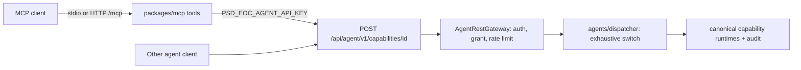

# Agent REST API, API keys, and the MCP server

**Consult this page** for anything an AI agent or automation can call: granting a capability to agent keys, adding an MCP tool, changing rate limits, or key issuance. Background: agents are `system`/`agent` principals that can never perform [human-only actions](../architecture/capability-engine.md#human-only-actions-and-confirmation).

Caption: the MCP package is a thin client of the same REST gateway; it never touches the database or a provider.

## REST gateway (`packages/server`)

The gateway authenticates the key, then dispatches into the same [capability engine](../architecture/capability-engine.md) as web and mobile; key rows live in the identity tables described in [identity and access](../domain/identity-and-access.md), and the draft and activation-preparation capabilities it exposes are explained in [event types and templates](../domain/event-types-and-templates.md) and [event lifecycle and activation](../domain/event-lifecycle-and-activation.md).

- Route: `app/api/agent/v1/capabilities/[capabilityId]/route.ts` → `handleAgentCapability` in `app/api/agent/v1/_lib/http.ts` (route tests: `app/api/agent/v1/routes.test.ts`). OpenAPI document: `app/api/agent/v1/openapi/route.ts` built by `lib/agents/openapi.ts` from the contracts (`AGENT_REST_CAPABILITY_IDS`).
- `lib/agents/gateway.ts` authenticates the key (`keys.ts`, credential marker `psd_eoc_agent_v1_`, stored as digest; one indexed read per request), checks the capability is in the key's effective grants, applies the limiter, parses input/output with the canonical Zod schemas, and audits every outcome (`gateway-audit.test.ts`). `protectedActionCapability` maps each human-only action to the grantable capability that would reach it, so aliases are rejected as `HUMAN_ONLY_REQUIRED`.
- `lib/agents/dispatcher.ts` dispatches an allowlisted ID to the same capability runtimes the web uses (events, journal, records, event-types, start-flow, prepared-activation, audit); it is an exhaustive switch, so adding an allowlisted ID without a handler fails typecheck. `auditOwnership` says whether the canonical handler or the gateway appended the audit fact.
- `lib/agents/runtime.ts` wires default instances (`getDefaultAgentRestGateway`, etc.).

### Grant allowlist

`AGENT_KEY_GRANTABLE_CAPABILITY_IDS` (`contracts/src/agent-key-grants.ts`) is the only grant vocabulary and must be a subset of the catalog's agent-invocable set (persisted `agent_api_key_grants` enum); contracts assert at load. Enforced in: issuance schema, admin form, key persistence (`drizzle-key-repository.ts`), authentication (out-of-allowlist stored grants are dropped), gateway (`CAPABILITY_NOT_GRANTED`), dispatcher, OpenAPI. Deliberately absent: `publish-event-type-version`, journal writes, joining/reactivating/reopening events, configuration writes. `grant-groups.ts` presents grants in three risk groups: `reads-and-reports`, `drafts`, `synthetic-event-lifecycle` (start/all-clear/close accepted from an agent only against the synthetic roster).

### Drafts, human publish

An agent may create/update an unpublished event-type template draft; only a human administrator publishes (Responses admin page `app/(admin)/event-types/manage`). Only the actor who last saved a draft can publish it, so "Approve and publish" re-saves the reviewed wording under the reviewer then publishes; `discard-event-type-draft` closes a draft (updates then return 409). `list-event-type-drafts` and `discard-event-type-draft` are human-only on web/mobile. See `lib/capabilities/event-types.ts` and tests `event-types.test.ts` / `event-types.integration.test.ts` under `lib/agents`.

### Keys and limits

- Issue/revoke/list: `issue-agent-api-key`, `revoke-agent-api-key`, `list-agent-api-keys` (admin page `app/(admin)/agents`, `lib/agents/admin-capabilities.ts`). `IssueAgentApiKeyInputSchema` requires a bounded `expiresInSeconds` (max 366 days); the form handler refuses an empty expiry. Rotation: `docs/runbooks/rotation-api-keys.md`.
- `lib/agents/rate-limit.ts`: 60 requests/key/minute (charged at authorization) and 20/key/hour across `export-drill-records`, `export-event-summary`, `create-activation-preview` (charged at dispatch). Exceeded → `429 RATE_LIMITED` + `Retry-After`; only the first refusal per lockout is audited (`access-denial`, reason `RATE_LIMITED`; protected aliases audit as `human-only-rejection`). In-memory per process: with up to four App Runner instances the effective ceiling is up to 4×. Changing a constant means updating `docs/ARCHITECTURE.md`, `packages/mcp/README.md` and the rate-limit tests together.
- Agent surface readiness is `configured-unverified` in `docs/INTEGRATIONS.md`.

## MCP server (`packages/mcp`)

- Transports: `src/stdio.ts` (newline-delimited JSON-RPC; stdout carries only protocol messages) and `src/http.ts` (loopback-only `/mcp`, stateless Streamable HTTP, JSON responses, origin allowlist via `PSD_EOC_MCP_ALLOWED_ORIGINS`). `src/protocol.ts` implements MCP (`2026-07-28` plus older initialization-based versions); `src/agent-client.ts` calls REST with `PSD_EOC_AGENT_API_KEY` / `PSD_EOC_AGENT_API_BASE_URL` (remote must be HTTPS; redirects rejected).
- `src/manifest.ts` defines `MCP_TOOLS`: direct tools for allowlisted IDs (events, journal search, drill records, exports, stale roster report, facilities/threats/event types, activation preview and `prepare-activation`) plus the facade `draft-message-template-revision`, which composes four scoped grants (`get-event-type-version`, `get-event-type-draft`, `create-event-type-draft`, `update-event-type-draft`). A schema guard rejects any human-only action ID. `src/resources.ts` serves `psd-eoc://docs/architecture` and `psd-eoc://docs/readiness` (from `docs/`).
- Untrusted text: results for tools in `MCP_UNTRUSTED_CONTENT_TOOL_NAMES` get a fixed data-notice prefix on text content (not on `structuredContent`). Mutation calls send a content-derived `Idempotency-Key`. `429` surfaces as a retryable tool error; the server never retries itself.

## Change recipes

**Make a capability agent-grantable / add an MCP tool**: (1) contracts: catalog entry's invocation policy, add to `AGENT_KEY_GRANTABLE_CAPABILITY_IDS` and the DB grant enum migration if new (`agentGrantOrderAfter`); (2) `lib/agents/dispatcher.ts` case + `openapi.ts`; (3) `grant-groups.ts` group; (4) `packages/mcp/src/manifest.ts` tool (+ untrusted list if it carries free text); (5) update `packages/mcp/README.md` and `docs/ARCHITECTURE.md`; (6) tests above plus `human-only-agent-surface.test.ts`. Verify as a consumer: `bun test packages/mcp` and the OpenAPI test. Escalate if the capability can mutate a real event — that is the product owner's decision.

**Checks**: `bun test packages/server/lib/agents packages/mcp packages/contracts/src/agent-key-grants.test.ts`; `bun run --cwd packages/mcp typecheck`. Server DB-backed (`*.integration.test.ts`) need the synthetic DB ([verification](../testing/verification-and-testing.md)).
