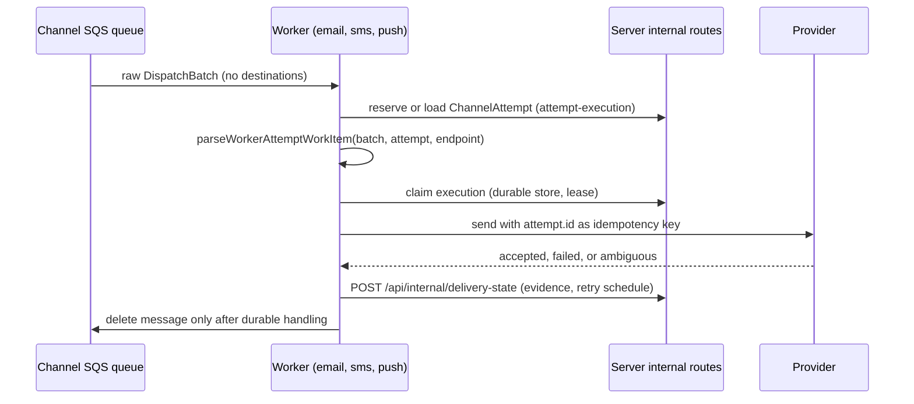

# Channel workers (`workers/`)

Workers are the at-least-once boundary after authorization. They may record delivery attempts and hand rendered copy to one provider; they cannot start, reactivate, all-clear, close, or otherwise mutate an event. The package-level rules are in `workers/README.md` (authoritative prose; this page maps it to code). The upstream half of the flow, the batch contract, and delivery truth states live in the [notification pipeline](../domain/notification-pipeline.md); the AWS wiring (queues, ECS services, secrets) is in [infrastructure](../operations/infrastructure.md).

Caption: per-attempt worker flow; a retry creates a new attempt with the next attempt number and a new ID.

## Shared core (`workers/shared`)

- `batch-message.ts` `parseWorkerBatchMessage`: the SQS body is the raw canonical `DispatchBatchSchema` (no wrapper). Real/drill classification is repeated across the queue boundary.
- `attempt.ts` `parseWorkerAttemptWorkItem`: proves channel, event ID/kind, template mode, purpose, event-type version, roster snapshot, population, endpoint and attempt IDs agree; synthetic endpoints must be unroutable; `workerAttemptFingerprint` is the PII-safe work fingerprint.
- `processor.ts` `WorkerAttemptProcessor` with `AttemptIdempotentProviderAdapter` and `AttemptExecutionStore`: binds `ChannelAttempt.id` to the fingerprint, rejects conflicting reuse, handles lease recovery (`ProviderRecoveryResult`), and returns a decision (`retry` | `dlq` | complete). Production stores are server-backed through `attempt-execution-client.ts` → `app/api/internal/attempt-execution/route.ts`; a Lambda-local map is not a production store.
- `retry.ts`: `DEFAULT_RETRY_POLICY` (5 attempts, 1 s base, 30 s max, ×2, 20% jitter); `ProviderDispatchError`/`normalizeProviderFailure` map untrusted provider errors to bounded uppercase codes plus an optional SHA-256 digest (`failure-detail.ts`, `terminal-failure.ts`).
- `delivery-state-client.ts` `DeliveryStateWritebackClient`: the only writer of delivery evidence; its credential is valid only for `POST /api/internal/delivery-state`.

## Channels

| Channel | Entry and services | Provider path | Notes |
| --- | --- | --- | --- |
| Email | `email/service.ts` (`runEmailService`, SQS long-poll ECS service, `EMAIL_WORKER_CONCURRENCY` poll loops), `runtime.ts` (`SesEmailRuntime`, modes `dark`/`enabled`), `ses-adapter.ts`, `email-message.ts`, `email-logo.ts` | SES v2 via `aws-client.ts`; send ledger prevents duplicate sends | SES events arrive via SNS → SQS callback queue consumed by `callback-service.ts` (verifies SNS signatures in `sns-signature.ts`) and `ses-events.ts`, then POSTed to the server's SES webhook route which ingests through the lower-tier capability boundary. `mock-ses-adapter.ts` for synthetic work. |
| SMS | `sms/service.ts`, `runtime.ts` (`AwsEumSmsRuntime`, queue and scheduled invocations), `aws-eum-adapter.ts`, `opt-out.ts`, `delivery-events.ts` | AWS End User Messaging SMS (pool, configuration set, opt-out list) | Delivery status comes from EventBridge `Text Message Delivery Status Updated` events validated in `delivery-events.ts` (age and skew limits); STOP/opt-out handling in `opt-out.ts` calls `record-sms-opt-out`. Policy: server `lib/notify/sms-policy.ts`. |
| Push | `push/service.ts` (`runExpoPushService`), `worker.ts` (Expo, `LedgeredExpoPushAdapter`), `direct-worker.ts` (`DirectPushWorker`, APNs `apns-transport.ts` / FCM `fcm-transport.ts`), `PushProviderRouter`, `receipt-lifecycle.ts` (Expo receipt polling) | Expo Push, or direct APNs/FCM chosen per platform by the protected `PSD_EOC_PUSH_PROVIDER_CUTOVER` setting (`packages/server/lib/push-provider-cutover.ts`) | Before provider I/O the worker checks endpoint eligibility through `POST /api/devices/internal/push-endpoint-eligibility` (`eligibility.ts`); a not-registered device is invalidated via `invalidation.ts` → `push-token-invalidation` route. Credentials loaded by `apns-credentials.ts` / `fcm-credentials.ts` from secrets. |

Partner alert batches (#597) use these same workers. The push adapters (`push/adapter.ts`, `push/direct-adapter.ts`, `push/transport.ts`) refuse only the `synthetic` population, and `ses-adapter.ts` sends a partner batch under the partner configuration set. The server resolves a partner batch's endpoints before a worker sees it ([partner audience](../domain/partner-audience.md#delivery-reaching-the-pinned-partners-at-send-time)).

Provider activation is dark-launched and gated by protected CDK parameters, documented in `docs/CONFIGURATION.md` (Expo push, direct APNs/FCM cutover, SES, SMS sections). Readiness today (from `docs/INTEGRATIONS.md`): Expo Push, SES, and SMS `live-verified`; direct APNs/FCM `mocked`.

### Email worker polling

`runEmailService` in `workers/email/service.ts` runs `EMAIL_WORKER_CONCURRENCY` (4) independent poll loops inside one task. Each loop calls `pollOnce` (one SQS receive, then one batch or retry processed with a visibility heartbeat) until `shouldContinue` returns false. The loops are concurrent because one serial loop let the queue fall minutes behind during the 2026-10-15 ShakeOut drill. A loop that throws stops its siblings, and the service rejects only after every loop has returned, so the ECS task restarts whole rather than running partly. Batch currency for each email item is checked on the server, not in the worker (see [send-time currency](../domain/notification-pipeline.md#send-time-currency)).

## Invariants to preserve

- Redelivery recovers the same `attempt.id`; a crash after a provider side effect must resolve to the original logical send via provider idempotency or a durable send ledger. An adapter without that capability stays blocked.
- A provider failure proven safe to retry completes the current attempt with truthful `failed` evidence and persists the retry schedule with the completion; the retry is a new attempt. Ambiguity appends `unknown`.
- Use the exact rendered message from the batch; never re-render or strip `[INCIDENT]`/`[DRILL]` markers. Adapter channel and integration ID must exactly match the batch. A channel's enabled flag is rechecked immediately before provider I/O.
- Never log a token, address or phone number; never persist raw provider responses.
- Email poll loops run side by side: separate queue messages never share an attempt, and each attempt is claimed under a lease. A receive failure in one loop fails the whole email task.

## Change guidance

- New or changed provider adapter: implement `AttemptIdempotentProviderAdapter`, keep SDK use inside the channel directory, add a mock, and satisfy the "Minimum channel-worker tests" list in `workers/README.md` (duplicate delivery, crash replay, retry cap → DLQ, `unknown`, drill marker retention).
- Changing batch or evidence shape: contracts first (`notification.ts`, `email-runtime.ts`, `sms-runtime.ts`, `push-runtime.ts`), then server stores in `packages/server/lib/notify/*-runtime-store.ts` and internal routes under `app/api/internal/`, then workers.
- A provider-live validation is an external, human-run integration (see `docs/runbooks/provider-*.md`); automated tests must stay synthetic. Never point a write-capable flow at a live provider without the product owner's explicit instruction in-session.
- Email polling changes: `workers/email/service.test.ts`, describe `email service loop`. Test "works on several queued batches at once" asserts that `EMAIL_WORKER_CONCURRENCY` batches are in flight together and fails after 2 s if they are not; test "stops every loop and fails when one receive fails" asserts the sibling loops stop and the rejection reaches the caller.
- Narrow checks: `bun test workers/<channel>`; DB-backed worker tests (`*.integration.test.ts`) need the synthetic DB ([verification](../testing/verification-and-testing.md)). `bun run --cwd workers typecheck`.
