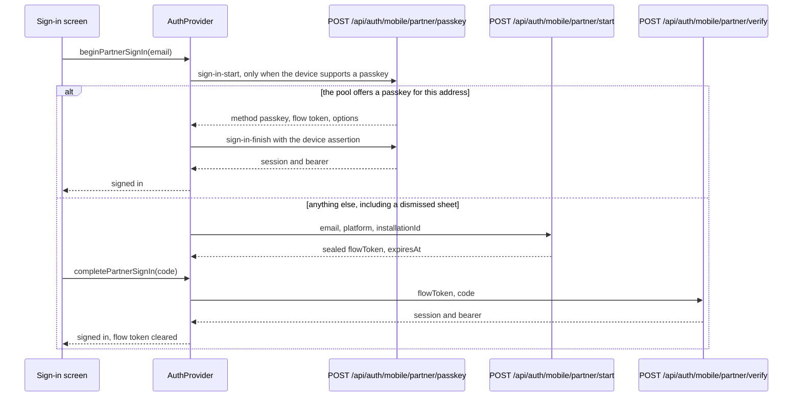

# Mobile app (`packages/mobile`)

One Expo SDK 57 managed app for both stores (README: `packages/mobile/README.md`). It owns presentation, local session handling, and calls to canonical server APIs; domain types come from `@psd-eoc/contracts` and the server stays the only authority ([overview](../architecture/overview.md)).

## Structure

| Area | Where | Notes |
| --- | --- | --- |
| Navigation | `src/app` (Expo Router): `(auth)/sign-in`, `(auth)/unlock`, `auth/callback`, `(app)/events/*`, `(app)/text-alerts`, `start`, `preview/real`, `preview/drill` | Real and drill previews are separate routes so classification never blurs. |
| Auth | `src/lib/auth` (`AuthController`, `oidc-client`, `secure-session-store`, `local-authenticator`, `pending-oidc-flow`) | Server-driven native OIDC (`/api/auth/mobile/oidc/start` and `/exchange`, see [identity](../domain/identity-and-access.md)), authorization-code + PKCE via the `psdeoc` scheme. Session in SecureStore with device authentication (Face ID/passcode via OS; no custom PIN). Sign-out is online-only. Partner agency responders sign in with an emailed code through `/api/auth/mobile/partner/{start,verify}` ([partner agency sign-in](#partner-agency-sign-in)). |
| API | `src/lib/api` | `authenticated-request`, `forward-compatible-parse`, `client-diagnostics` (reports to `POST /api/diagnostics`; shipped connected from 1.0.10 per the readiness register). |
| Start flow | `src/lib/start`, `src/components/start` | Preview binding (`activation-preview-binding`), mutation coordinator/store, navigation and hardware-back guards that protect an in-flight activation. Calls `/api/mobile/start/{facilities,threats,preview,activate}` ([lifecycle](../domain/event-lifecycle-and-activation.md)). |
| Event room | `src/features/event-room` (`EventRoomSyncController`, `api.ts`, `model.ts`, `native-photo.ts`, `photo-draft.ts`) | Polls `sync-event-room`, posts journal entries and photos (EXIF stripping is server-side; see [media](../domain/media-records-and-audit.md)). |
| SMS consent | `src/features/sms-consent`, `src/app/(app)/text-alerts.tsx` | Calls `/api/sms-consent*`; see [notifications](../domain/notification-pipeline.md). |
| Push | `src/lib/push`, `src/notifications/alert-channel.ts` | See below. |
| Release diagnostics | `src/lib/release/update-diagnostic.ts`, `src/app/release-diagnostic.tsx` | EAS Update is `blocked` in the readiness register; builds ship embedded-only. |

## Push registration (fail-closed)

- Build opt-in switch `EXPO_PUBLIC_PSD_EOC_PUSH_REGISTRATION_ENABLED`; `eas.json` forces `false` for `development` and `preview`, `true` only in `production`. Missing/malformed value = off: no permission prompt, no provider contact, and server endpoints are removed when authenticated.
- Production also needs the `GOOGLE_SERVICES_JSON` EAS file variable (read by `app.config.ts`); never commit it.
- On launch the app writes Expo's persisted auto-registration state to `{ isEnabled: false }` and avoids the `expo-notifications` barrel (Expo 57 evaluates auto-registration at import). The token flow (`expo-token.ts`, `registration-controller.ts`) runs only after opt-in, authenticated-online, permission and native-identity gates; one eight-second request to Expo's token endpoint, then one canonical `register-push-token` call that stores the native+Expo pair in one transaction.
- The app submits its build identity (platform, app ID, version, build number, EAS project UUID, update mode) and the server records it per registration (`devicePushTokenRegistrations`; rotation on a changed build in `lib/capabilities/devices.ts`). The per-build allowlist that `packages/mobile/README.md` still describes was removed (commit `e418b42`; `docs/CONFIGURATION.md` states it is deliberately absent), so do not reintroduce a per-release manual step. Activation is described in `docs/CONFIGURATION.md#expo-push-activation-boundary`. Expo vs direct APNs/FCM is chosen server-side per platform ([channel workers](channel-workers.md)); no mobile change is needed to cut over.
- Notification taps (running/background/terminated) are de-duplicated and routed only by canonical event ID (`response-controller.ts`); foreground display needs matching real/drill markers. Android channel `eoc-alerts`; iOS time-sensitive entitlement. Disabled permission/channel appends unregistration truth.
- Failed registration retries on its own (recent history); iOS adopts the UIScene life cycle.

## Partner agency sign-in

Invited partner agency responders (non-district first responders, issue #598) sign in inside the app, from a "Partner agency sign-in" disclosure below the Google button on `src/app/(auth)/sign-in.tsx`. The server rules are in [partner web sign-in](../domain/partner-sign-in.md#native-app-sign-in-issue-598); this section covers what the app holds and how it behaves.

Caption: the passkey is tried first and the emailed code is the fallback (see [native passkey sign-in](../domain/partner-sign-in.md#native-passkey-sign-in-and-enrollment-issue-647)). The flow token lives only in `AuthProvider`'s ref (`partnerFlowRef`) and is never persisted. The screen returns to its first step after success, after "Use a different address", and after sign-out (`resetPartnerSignIn`). A refused code throws and leaves the flow in place so the partner can retype it.

- **Session identity.** `isPartnerSession` (`src/lib/auth/partner-session.ts`) reads the `partner` role the server issued in the stored session, not the sign-in surface, so a partner restored from SecureStore on the next launch is still a partner. The home header then reads "PARTNER AGENCY OPERATIONS" (`src/app/index.tsx`). The app only hides controls; the server still refuses every capability outside the partner allowlist.
- **Session deadline.** A partner session's cached authorization ends at its own one-day deadline, not at the admission's, as `auth-controller.test.ts` pins (`a partner session ends at its own one-day expiry`).
- **Contract compatibility.** Native partner sign-in adds endpoints and never adds fields to an existing response; `packages/contracts/src/mobile-partner-compatibility.test.ts` holds installed builds to that.
- **Device passkey first.** `signInPartnerWithPasskey` (`src/lib/auth/partner-passkey-client.ts`) asks the platform authenticator before the server, through `nativePasskeyPort` (`src/lib/auth/native-passkey-port.ts`). That port loads `react-native-passkeys` optionally, so a build or device without it simply reports no passkey support and never calls the server. Every outcome other than a refused assertion ends at the emailed code.
- **Enrollment offer.** After a code sign-in that took effect on a passkey-capable device, `partner-passkey-offer.tsx` offers to add a passkey. `partnerPasskeyOfferFrom` makes the offer only then, and the hand-off token stays in `AuthProvider` memory. Accepting runs `enrollPartnerPasskey`: `register-start`, the platform create, then `register-finish`. Declining enrolls nothing. The server side is described in [native passkey sign-in](../domain/partner-sign-in.md#native-passkey-sign-in-and-enrollment-issue-647).
- **Association declared at build time.** `app.config.ts` (`withPartnerPasskeyAssociation`) adds a `webcredentials:<host>` associated domain on iOS and an Android asset statement that points at the deployment's `assetlinks.json`. Both derive from `EXPO_PUBLIC_PSD_EOC_API_BASE_URL`, so the app names the same hostname the server derives its relying-party id from. A build pointed at a non-HTTPS or loopback host declares neither. The documents themselves are served by the deployment ([configuration and readiness](../operations/configuration-and-readiness.md#mobile-app-association-documents)).
- **Synthetic stand-in.** `src/lib/auth/synthetic-simulator-authenticator.ts` stands in for this journey only on loopback, and never for a release build (its own tests pin both).

## Verification

- Bun unit tests colocated in `src`; native Jest tests in `native-tests/*.native.tsx` (run through `bun scripts/test-mobile-native.ts` at the repo root and in the full gate; see [verification](../testing/verification-and-testing.md)).
- Config guards: `native-config:check` (event-room and push native config), `expo:check`, `react:check`.
- **Partner journey e2e** (conditional): `bun packages/mobile/e2e/partner-run.ts ios` or `android` drives the partner sign-in, passkey offer and decline, and join-and-post Maestro flows (`e2e/flows/partner-sign-in.yaml`, `partner-passkey-offer.yaml`, `partner-passkey-decline.yaml`, `partner-join-and-post.yaml`) against a loopback development server and a disposable database from `packages/server/e2e/mobile-partner-fixture.ts`. Run it only for changes to the partner screen, the partner endpoints, or the partner session.
- **Native tests for the partner screens:** `native-tests/partner-sign-in.native.tsx`, `native-tests/partner-passkey-offer.native.tsx` and `native-tests/partner-home.native.tsx`, run with `bun run --cwd packages/mobile test:native -- --testPathPattern partner`.
- **Dual-platform e2e** (Maestro, synthetic only): `bun packages/mobile/e2e/run.ts ios` and `... android`, requires `PSD_EOC_E2E_SYNTHETIC_ONLY=true` plus synthetic fixture variables; mock push never gets a token. Run both for any behavior, copy, or flow change (AGENTS.md rule). CI: `.github/workflows/mobile-e2e.yml`. These are conditional/expensive checks.
- Release procedure: `docs/runbooks/release.md`, `appstore-setup.md`, `app-store-review.md`; install guides in `docs/guides/install-{ios,android}.md`. The bundle identifier and keychain service names are deliberate literals (renaming signs out installed devices).

## Change guidance

- New server-facing call: add the contract in `packages/contracts` first, parse with the shared schema (forward-compatible parsing for lists), then client in `src/lib/api` or a feature `api.ts`.
- Do not add platform-conditional behavior without a stated reason (keyboard insets/system fonts qualify); the path-scoped agent rule `.claude/rules/mobile.md` (committed, applies to `packages/mobile/**`) requires that reason in the PR body. Running one platform's e2e and calling it done is the drift it guards against, so verify both platforms.
- Accessibility for activation, timeline and all-clear is required in the same PR.
- Narrow checks: `bun run --cwd packages/mobile typecheck`, `bun test packages/mobile/src/<feature>`, and `bun run --cwd packages/mobile test:native -- --testPathPattern <name>`.
- Native passkey changes span this app, the server endpoint and the association documents. The platform authenticator is reached only through `native-passkey-port.ts`; keep the client's decisions in `partner-passkey-client.ts` testable without a device. Check the server contract with `bun test packages/contracts/src/mobile-partner-passkey.test.ts`, the Android and iOS ceremony origins with `bun test packages/server/lib/auth/partner-passkey.test.ts`, and the association documents with `bun test packages/server/lib/config/app-association.test.ts`. A change to the app's associated domain also needs `bun test packages/mobile/scripts/distribution-config.test.ts`.
