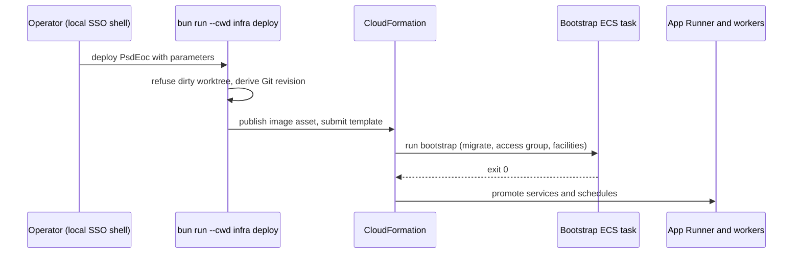
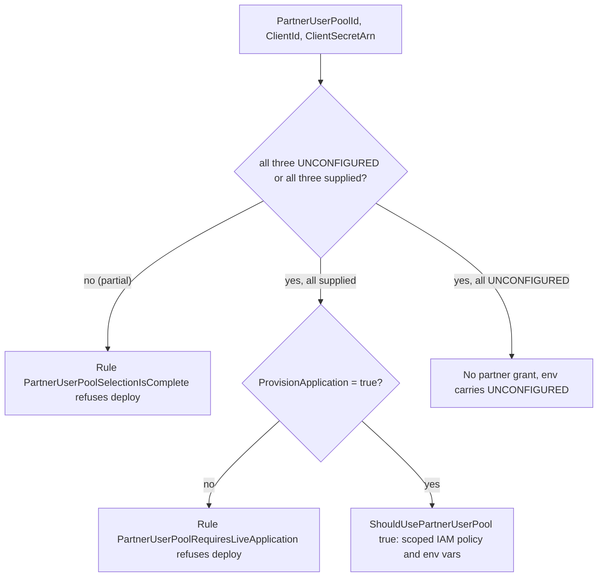
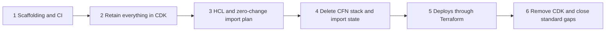

# AWS CDK infrastructure, deployment, and monitoring

Read this before changing `infra/`, queue/worker wiring, alarms, or deploy behavior. Value-level parameter catalog: [configuration and readiness](configuration-and-readiness.md). Runtime consumers: [notification pipeline](../domain/notification-pipeline.md), [channel workers](../integrations/channel-workers.md), [architecture overview](../architecture/overview.md).

## Stack contents (`infra/src/stack/psd-eoc-stack.ts`, one `PsdEocStack`, ~3,900 lines)

- **Web:** AWS App Runner service from a content-addressed CDK image asset (resolved to an immutable ECR digest) through a VPC connector; two warm instances (min 2, max 4), per-key agent limits therefore multiply ×4 at most ([agent API](../integrations/agent-api-and-mcp.md)). Next.js is served on Node.
- **Data:** Aurora PostgreSQL (private, DB and application secrets in Secrets Manager); security groups for the app connector, database and workers.
- **Queues:** a single delivery queue + DLQ, per-channel queues (email, push, SMS) with DLQs, a health queue, and a separate SES callback queue + DLQ. The `delivery-router` Lambda fans the delivery queue to channel queues ([pipeline](../domain/notification-pipeline.md)).
- **Workers (ECS):** push worker service, SMS worker service, email worker service, email callback worker service, plus a scheduled access-membership-sync ECS task (`accessSyncSchedule`) and a bootstrap task. Per-worker secrets (`deliveryStateWorkerSecret`, `attemptExecutionWorkerSecret`, `pushEndpointWorkerSecret`, `expoPushRuntimeWorkerSecret`, `emailRuntimeWorkerSecret`, `smsRuntimeWorkerSecret`) are the scoped credentials for the internal routes. Provider-live behavior is gated by CloudFormation parameters/conditions (protected activation boundaries in `docs/CONFIGURATION.md`).
- **SES/SMS:** SES configuration set, event destination, SNS topic → callback queue; AWS End User Messaging pool, opt-out list, protect configuration and an EventBridge rule for delivery events; an SMS opt-out schedule.
- **Storage:** private media bucket with an optional GuardDuty Malware Protection plan (role has a CFN condition because plan creation validates bucket ownership).
- **Operations:** KMS-encrypted operations/critical/recovery alarm topics, `alarm-mailer` Lambda (sends alarm email via SES instead of SNS email subscriptions, which can silently deactivate), `bootstrap-deployment` custom-resource Lambdas (start/check bootstrap, rollback image validation and quiescence), `failover-metric`, `metrics-collector`, `canary`.
- **Partner access (optional):** three `PartnerUserPool*` parameters (pool id, app-client id, client-secret ARN) default to `UNCONFIGURED`. Supplying all three sets the `ShouldUsePartnerUserPool` condition, which enables the `AppRunnerPartnerUserPoolAccess` policy (scoped Cognito actions on the one named pool, and `secretsmanager:GetSecretValue` on the one ARN) and the three `PSD_EOC_PARTNER_USER_POOL_*` runtime variables. The pool itself is not in this stack; see [partner first-responder directory](#partner-first-responder-directory-terraform-stateful-root).
- Other resources: ECR repository, optional custom domain, Google OIDC/cookie/API-salt secrets, Expo token and direct APNs/FCM credential secrets.

## Deploy model and ordering

Caption: promotion is gated on bootstrap success (`bootstrap-deployment` Lambda + `scripts/operations/bootstrap.ts`).

- **Two deployment paths, one per tool** (psd-dev-standards 08, recorded in [AGENTS.md](../../AGENTS.md) §5–6 and [docs/CONFIGURATION.md](../../docs/CONFIGURATION.md) "Direct CDK deployment boundary"):
  - **CDK** deploys only when a human runs `infra/package.json` `deploy` from a locally authenticated, short-lived AWS session. No workflow deploys the stack. Agents prepare the pinned worktree and `cdk diff`, then hand the command to a human.
  - **Terraform** applies only from CI, after a pull request shows the plan and the GitHub `production` environment approval gates the apply. The OIDC role is pinned to that environment, and nobody applies Terraform from a laptop. This pipeline is phase 1 of the [migration plan](../../docs/terraform-migration-plan.md) and is not built, so no Terraform root is applied today.
- `infra/package.json` `deploy` sets `PSD_EOC_ENFORCE_DEPLOYMENT_TARGET=true`; `readDeploymentTarget` (`infra/src/stack/config.ts`) verifies account, region and origin; `source-revision.ts` embeds the exact commit and refuses dirty trees. There is **no** build/push/migrate/promote command. `.github/workflows` only verifies and synthesizes, and it does not deploy the stack.
- Rollback and bootstrap images are deliberately separate (`docs/learnings/workflow/2026-08-22-separate-rollback-and-bootstrap-images.md`); rollback procedure: `docs/runbooks/rollback.md`, release: `docs/runbooks/release.md`.
- Tenant context: committed `infra/cdk.json` (feature flags, threats, synthetic groups) plus git-ignored `infra/cdk.local.json` (shape `cdk.local.example.json`); `tenant-context.ts` `readTenantContext` merges them. `bin/synthesize-example.ts` builds a second reserved district to prove portability without credentials.

## Monitoring (`infra/src/monitoring.ts`)

Two entry points: `configureInfrastructureMonitoring` (live; alarms on AWS-published metrics for App Runner, Aurora, each queue/DLQ, plus conditional log-derived worker metrics) and `configureMonitoring` (adds the one-minute canary, metrics collector and alarms on what they publish; not wired live until the canary credential and `psd_eoc_monitoring` DB login exist). Missing-data-as-breaching alarms must never be deployed without their publisher. Alarm descriptions append runbook anchors to `psdEoc:monitoringRunbookBaseUrl`; `infra/README.md` headings are those anchors, so preserve them. Runbooks: `docs/runbooks/alarm-*.md`.

## Google Cloud identity (`infra/gcp`)

Terraform defines the Google project/APIs, the read-only Groups reader service account and least-privilege bindings; `scripts/run-guarded.sh` is the only supported launcher (pins operator env, validates project and AWS caller). `firebase/` is an isolated Terraform root for Android FCM, tested offline in `infra/test/gcp`. Credentials never enter Terraform state or the repo. See [identity](../domain/identity-and-access.md) for how the Groups reader is used. The migration plan below leaves these roots unchanged.

## Partner first-responder directory (Terraform stateful root)

Non-district first responders (fire districts, police departments) are not in the district's Google directory, so they cannot be admitted through staff sign-in without weakening the staff boundary ([identity and access](../domain/identity-and-access.md)). Their identities live in a separate Amazon Cognito user pool, defined in the first AWS Terraform root, `infra/terraform/stateful` ([its README](../../infra/terraform/stateful/README.md)). Under psd-dev-standards 08 this root applies only from CI, behind the GitHub `production` environment approval; that pipeline is phase 1 of the [migration plan](#proposed-terraform-migration-not-started) and is not built, so the root is not applied yet. `scripts/verify-terraform.ts` (`bun run verify:terraform`) checks it credential-free.

What the root declares (`main.tf`):

- `aws_cognito_user_pool.partner`: Essentials tier, email as the only identity, `EMAIL_OTP` and `WEB_AUTHN` as the only first factors, `mfa_configuration = "OFF"`, admin-invite only, passkeys bound to a relying-party id with `user_verification = "required"`, admin-only recovery, `COGNITO_DEFAULT` mail, and no hosted-UI domain or federation. Deletion protection and `prevent_destroy` are set.
- `aws_cognito_user_pool_client.server`: one confidential client (`generate_secret = true`), `ALLOW_USER_AUTH` and `ALLOW_REFRESH_TOKEN_AUTH` only, so no password flow exists.
- `aws_secretsmanager_secret.partner_client` at the fixed path `/psd-eoc/partner-user-pool-client`, and `aws_secretsmanager_secret_version.partner_client`, which stores the client id, the client secret, and the pool id as JSON.
- Input `owner` (the `psd:owner` tag) must be an email address whose domain has at least one dot (`variables.tf`). A dotless address such as `technology@example` is refused at validation; the mocked run `owner_requires_a_dotted_domain` pins this.

The root's `outputs.tf` has one output, `stack_parameters`, keyed by the stack's own parameter names: `PartnerUserPoolId`, `PartnerUserPoolClientId`, and `PartnerUserPoolClientSecretArn`. It is the only handoff; the earlier standalone outputs and the unused pool ARN output were removed, so nothing downstream reads them. No output carries the secret value.

### How the stack gates it

The stack's three parameters default to `UNCONFIGURED`, the same sentinel convention as the SMS inputs ([configuration and readiness](configuration-and-readiness.md)). Validation rules, not the runtime, enforce the combinations:

Caption: partner access is on only when every identifier is supplied and a live App Runner application exists.

Runtime invariants the stack tests pin (`describe('partner user pool boundary')` in `infra/test/stack/psd-eoc-stack.test.ts`):

- The `PartnerUserPoolClientSecretArn` allowed pattern accepts only the `/psd-eoc/partner-user-pool-client` path with the six-character generated suffix. A name without that suffix can never match the read grant. The test `pins the secret path the Terraform root creates` reads `main.tf`, so renaming one side alone fails the suite.
- The Cognito grant names one pool through `PartnerUserPoolId`, with the actions `AdminCreateUser`, `AdminDisableUser`, `AdminInitiateAuth`, `AdminRespondToAuthChallenge`, `StartWebAuthnRegistration`, and `CompleteWebAuthnRegistration`. No delete and no wildcard pool.
- The client secret reaches the service only as an ARN reference, and no output republishes the pool, client, or secret ARN.

Current state, which matters for every change here:

- No server code reads `PSD_EOC_PARTNER_USER_POOL_*` (a search of `packages/` finds nothing). Partner sign-in is configuration only; the server-side path is tracked as issue #593. Today the only sign-in is Google OIDC for staff.
- The stateful root writes the client secret into a Secrets Manager version and therefore into Terraform state. This deliberately departs from the migration plan's rule that no secret version enters state; the stateful README records why (Cognito generates the secret, so Terraform reads it back regardless). The state bucket must therefore be treated as secret-bearing.
- The readiness status `configured-unverified` for partner sign-in is recorded only in [docs/INTEGRATIONS.md](../../docs/INTEGRATIONS.md). Nothing was applied to any account as of 2026-10-23.

Change navigation:

- Consult this section before changing a partner parameter pattern, the Cognito pool or client settings, the secret path, or the stack's partner IAM policy. A change to the secret path must change `main.tf`, the stack's allowed pattern, and the stack test together.
- Renaming a `stack_parameters` key must also rename the matching `PartnerUserPool*` parameter in `infra/src/stack/psd-eoc-stack.ts`. The `partner_pool_plan` run asserts the exact key set, and the stack test pins the parameter side, so a one-sided rename fails one of them.
- Narrow checks: `bun run verify:terraform` (fmt, validate, mocked `terraform test` on `partner_user_pool.tftest.hcl`) and `bun test infra/test/stack/psd-eoc-stack.test.ts`. Run `bun run --cwd infra synth:example` for stack wiring.
- Scope boundary: agents never run `apply`, `deploy`, or `import` against a real account (AGENTS.md §5). `cdk deploy` stays a human's local action. Terraform applies belong to the CI pipeline behind the `production` approval, not to agent or ad-hoc local runs, and `terraform init` against a real backend is human-run. The checked-in backend bucket is a deliberately unusable placeholder.
- Guard: `scripts/verify-documentation.test.ts` (`forbids workflows that deploy the CDK stack or its images`) fails if a workflow deploys CDK, CloudFormation, App Runner, or an image, and it fails if source documents restate the pre-standard "no GitHub deployment environment or OIDC role" rule.
- Documentation drift: the stateful README states the handoff as one contract with the stack, so keep [configuration and readiness](configuration-and-readiness.md) and this section consistent with it.

## Proposed Terraform migration (not started)

`docs/terraform-migration-plan.md` is a proposal, status "no phase has started", with every open question answered on 2026-10-23 and each phase awaiting product-owner approval. It would replace the `PsdEoc` CloudFormation stack (`infra/src/stack/psd-eoc-stack.ts`, `infra/src/monitoring.ts`) with AWS Terraform roots under `infra/terraform/`. Only the `stateful/` root exists, and it holds just the partner pool described [above](#partner-first-responder-directory-terraform-stateful-root); the `app/`, `scripts/`, and `state-bootstrap/` roots from the plan do not exist. The CDK code and the deploy model above remain the source of truth for everything else. Do not implement any phase from this page; read the plan itself first.

Key decisions the plan records:

- **Two roots, split by data risk:** `stateful/` (Aurora, KMS, S3, secret containers, SQS, SES config set, SMS resources, ECR, log groups, the responder Cognito pool) and `app/` (IAM, App Runner, ECS, Lambdas, EventBridge, alarms, dashboard, canary, Route 53). Every `stateful/` resource carries `prevent_destroy`; `app/` reads `stateful/` outputs and never the reverse.
- **Tenant values and switches leave CFN parameters:** switches become tfvars variables with no default, so a missing file fails the plan instead of turning channels off. `infra/cdk.local.json` stays the tenant file during the transition. CI reads values from the GitHub `production` environment, as the plan decided. The Terraform side of that is already the standard (CI-only apply behind `production`); the `PsdEoc` CDK stack keeps its local `cdk deploy` path until phase 5 ([working conventions](../quickstart.md#working-conventions)).
- **Secrets stay out of state:** no `aws_secretsmanager_secret_version`; Aurora `master_password` is `ignore_changes`. The partner stateful root is the one existing exception, documented [above](#partner-first-responder-directory-terraform-stateful-root).
- **Phase gates:** each phase has an exit condition, and the zero-change import plan (0 add, 0 change, 0 destroy) is the critical gate before the CloudFormation stack is deleted.

Caption: phase order from the plan. Phase 4 is the irreversible step (after it, the path back is fix-forward in Terraform); phase 5 is when the stack's deploys move from local `cdk deploy` to Terraform applied through CI.

Change navigation for this proposal:

- Consult the plan's Phases and Risks sections before any infra change that might collide with migration (the plan asks to freeze CDK infrastructure changes between phase 2 and phase 4).
- Current validation: `bun run --cwd infra typecheck` and `bun run --cwd infra synth:example` for CDK, plus `bun run verify:terraform` (`terraform fmt -check`, `validate`, and mocked `terraform test` for each AWS root, run inside `bun run check`). `tflint` and the planned `terraform.yml` workflow do not exist yet.
- Related docs the plan says will need updates in phase 5: `docs/CONFIGURATION.md`, `infra/README.md`, the runbooks that name `cdk deploy`, and the readiness register ([configuration and readiness](configuration-and-readiness.md)).

## Change recipes

- **New AWS resource/parameter:** add in `psd-eoc-stack.ts`, add the parameter to the `docs-contract:cdk-context`/parameter lists in `docs/CONFIGURATION.md` (otherwise `bun run verify:docs` fails), extend `psd-eoc-stack.test.ts`, run `bun run --cwd infra synth:example`.
- **New worker/queue:** also add its scoped secret, alarms in `monitoring.ts` (with DLQ runbook) and the server internal route; follow [channel workers](../integrations/channel-workers.md).
- **Lambda change:** Lambdas are plain `.mjs` under `infra/lambda/*` with matching `infra/test/*-runtime.test.ts`; keep `index.d.mts` in step.
- **Partner pool or handoff change:** update `infra/terraform/stateful` and the matching `PartnerUserPool*` parameter pattern together, then run `bun run verify:terraform` and `bun test infra/test/stack/psd-eoc-stack.test.ts`; update [configuration and readiness](configuration-and-readiness.md) if a parameter or its meaning changes.
- **Conditional:** `bun run --cwd infra typecheck` (includes synth) when touching stack code; never run `deploy`, `cdk deploy`, or Terraform apply from automation.
eter or its meaning changes.
- **Conditional:** `bun run --cwd infra typecheck` (includes synth) when touching stack code; never run `deploy`, `cdk deploy`, or Terraform apply from automation.
figuration-and-readiness.md) if a parameter or its meaning changes.
- **Conditional:** `bun run --cwd infra typecheck` (includes synth) when touching stack code; never run `deploy`, `cdk deploy`, or Terraform apply from automation.
eter or its meaning changes.
- **Conditional:** `bun run --cwd infra typecheck` (includes synth) when touching stack code; never run `deploy`, `cdk deploy`, or Terraform apply from automation.
run --cwd infra typecheck` (includes synth) when touching stack code; never run `deploy`, `cdk deploy`, or Terraform apply from automation.
