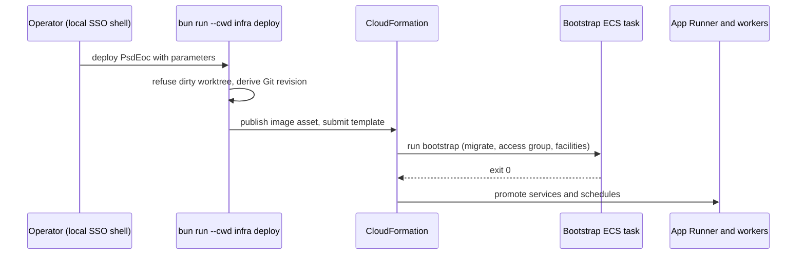

# AWS CDK infrastructure, deployment, and monitoring

Read this before changing `infra/`, queue/worker wiring, alarms, or deploy behavior. Value-level parameter catalog: [configuration and readiness](configuration-and-readiness.md). Runtime consumers: [notification pipeline](../domain/notification-pipeline.md), [channel workers](../integrations/channel-workers.md), [architecture overview](../architecture/overview.md).

## Stack contents (`infra/src/stack/psd-eoc-stack.ts`, one `PsdEocStack`, ~3,900 lines)

- **Web:** AWS App Runner service from a content-addressed CDK image asset (resolved to an immutable ECR digest) through a VPC connector; two warm instances (min 2, max 4), per-key agent limits therefore multiply ×4 at most ([agent API](../integrations/agent-api-and-mcp.md)). Next.js is served on Node.
- **Data:** Aurora PostgreSQL (private, DB and application secrets in Secrets Manager); security groups for the app connector, database and workers.
- **Queues:** a single delivery queue + DLQ, per-channel queues (email, push, SMS) with DLQs, a health queue, and a separate SES callback queue + DLQ. The `delivery-router` Lambda fans the delivery queue to channel queues ([pipeline](../domain/notification-pipeline.md)).
- **Workers (ECS):** push worker service, SMS worker service, email worker service, email callback worker service, plus a scheduled access-membership-sync ECS task (`accessSyncSchedule`) and a bootstrap task. Per-worker secrets (`deliveryStateWorkerSecret`, `attemptExecutionWorkerSecret`, `pushEndpointWorkerSecret`, `expoPushRuntimeWorkerSecret`, `emailRuntimeWorkerSecret`, `smsRuntimeWorkerSecret`) are the scoped credentials for the internal routes. Provider-live behavior is gated by CloudFormation parameters/conditions (protected activation boundaries in `docs/CONFIGURATION.md`).
- **SES/SMS:** SES configuration set, event destination, SNS topic → callback queue; AWS End User Messaging pool, opt-out list, protect configuration and an EventBridge rule for delivery events; an SMS opt-out schedule.
- **Storage:** private media bucket with an optional GuardDuty Malware Protection plan (role has a CFN condition because plan creation validates bucket ownership).
- **Operations:** KMS-encrypted operations/critical/recovery alarm topics, `alarm-mailer` Lambda (sends alarm email via SES instead of SNS email subscriptions, which can silently deactivate), `bootstrap-deployment` custom-resource Lambdas (start/check bootstrap, rollback image validation and quiescence), `failover-metric`, `metrics-collector`, `canary`.
- Other resources: ECR repository, optional custom domain, Google OIDC/cookie/API-salt secrets, Expo token and direct APNs/FCM credential secrets.

## Deploy model and ordering

Caption: promotion is gated on bootstrap success (`bootstrap-deployment` Lambda + `scripts/operations/bootstrap.ts`).

- `infra/package.json` `deploy` sets `PSD_EOC_ENFORCE_DEPLOYMENT_TARGET=true`; `readDeploymentTarget` (`infra/src/stack/config.ts`) verifies account, region and origin; `source-revision.ts` embeds the exact commit and refuses dirty trees. There is **no** build/push/migrate/promote command and **no** GitHub deployment workflow (AGENTS.md §5–6; `.github/workflows` only verify/synthesize). Note `docs/ARCHITECTURE.md` still mentions protected GitHub environment variables/OIDC in its "Configuration boundaries" paragraph; this contradicts `docs/CONFIGURATION.md` and AGENTS.md. Trust the latter.
- Rollback and bootstrap images are deliberately separate (`docs/learnings/workflow/2026-08-22-separate-rollback-and-bootstrap-images.md`); rollback procedure: `docs/runbooks/rollback.md`, release: `docs/runbooks/release.md`.
- Tenant context: committed `infra/cdk.json` (feature flags, threats, synthetic groups) plus git-ignored `infra/cdk.local.json` (shape `cdk.local.example.json`); `tenant-context.ts` `readTenantContext` merges them. `bin/synthesize-example.ts` builds a second reserved district to prove portability without credentials.

## Monitoring (`infra/src/monitoring.ts`)

Two entry points: `configureInfrastructureMonitoring` (live; alarms on AWS-published metrics for App Runner, Aurora, each queue/DLQ, plus conditional log-derived worker metrics) and `configureMonitoring` (adds the one-minute canary, metrics collector and alarms on what they publish; not wired live until the canary credential and `psd_eoc_monitoring` DB login exist). Missing-data-as-breaching alarms must never be deployed without their publisher. Alarm descriptions append runbook anchors to `psdEoc:monitoringRunbookBaseUrl`; `infra/README.md` headings are those anchors, so preserve them. Runbooks: `docs/runbooks/alarm-*.md`.

## Google Cloud identity (`infra/gcp`)

Terraform defines the Google project/APIs, the read-only Groups reader service account and least-privilege bindings; `scripts/run-guarded.sh` is the only supported launcher (pins operator env, validates project and AWS caller). `firebase/` is an isolated Terraform root for Android FCM, tested offline in `infra/test/gcp`. Credentials never enter Terraform state or the repo. See [identity](../domain/identity-and-access.md) for how the Groups reader is used.

## Change recipes

- **New AWS resource/parameter:** add in `psd-eoc-stack.ts`, add the parameter to the `docs-contract:cdk-context`/parameter lists in `docs/CONFIGURATION.md` (otherwise `bun run verify:docs` fails), extend `psd-eoc-stack.test.ts`, run `bun run --cwd infra synth:example`.
- **New worker/queue:** also add its scoped secret, alarms in `monitoring.ts` (with DLQ runbook) and the server internal route; follow [channel workers](../integrations/channel-workers.md).
- **Lambda change:** Lambdas are plain `.mjs` under `infra/lambda/*` with matching `infra/test/*-runtime.test.ts`; keep `index.d.mts` in step.
- **Conditional:** `bun run --cwd infra typecheck` (includes synth) when touching stack code; never run `deploy`, `cdk deploy`, or Terraform apply from automation.
eploy`, or Terraform apply from automation.
