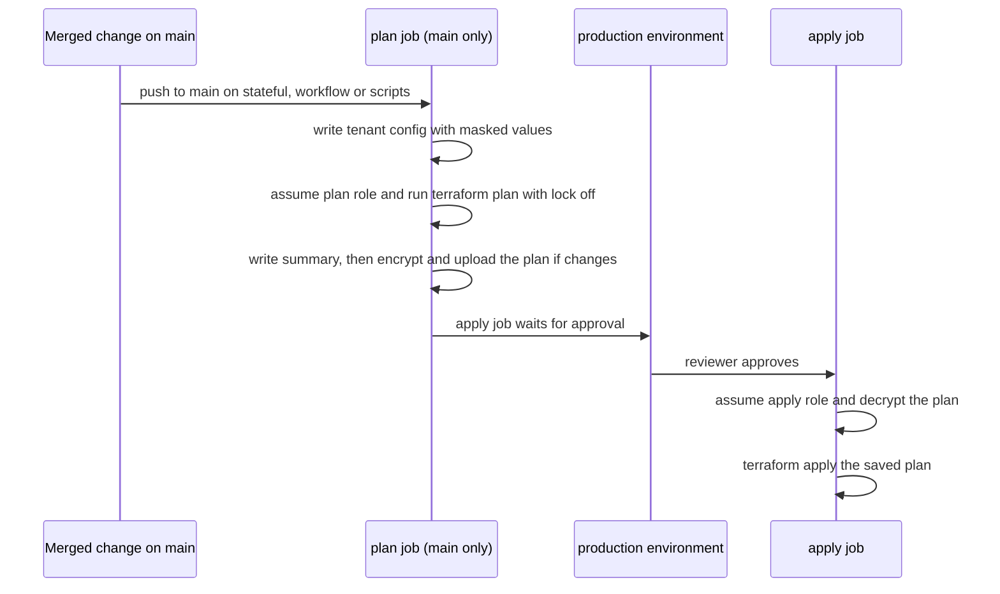

# Terraform state bootstrap and CI apply pipeline

Read this before changing `infra/terraform/state-bootstrap`, `.github/workflows/terraform.yml`, or the two helper scripts in `.github/scripts/`. The partner responder pool that this pipeline applies is described in [infrastructure](infrastructure.md#partner-first-responder-directory-terraform-stateful-root); the migration that gives the pipeline its purpose is in [infrastructure](infrastructure.md#terraform-migration-plan-phase-1-built-not-applied).

## What is built and what is not applied

The pipeline is phase 1 of the [migration plan](../../docs/terraform-migration-plan.md). Its code exists and the readiness register records two live steps: a product-owner `state-bootstrap` apply, a 2026-10-24 `production` run of the workflow that partly applied the stateful root and then failed, and a 2026-11-01 approved apply that failed at `CreateUserPool` because the pool's first-factor list lacked `PASSWORD` (see [infrastructure](infrastructure.md#partner-first-responder-directory-terraform-stateful-root)). The stateful README and the state-bootstrap README still describe the roles, state bucket and `production` environment as not yet created, and the register's older "never run" sentences conflict with the dated run, so treat the live state as unconfirmed until the owner checks it.

## State bootstrap root (`infra/terraform/state-bootstrap`)

This root creates what CI needs before it can plan or apply `infra/terraform/stateful`. Its state is local (`backend "local"` in `versions.tf`) and is meant to stay outside the repository; it holds no secret. A person with an administrator session applies it once. No agent runs it (psd-dev-standards 08 PR flow 5).

| File | Owns |
| --- | --- |
| `state.tf` | The state bucket `psd-eoc-tfstate-<account>`, the KMS key with alias `alias/psd-eoc-tfstate` (rotation on, `prevent_destroy`), versioning, SSE-KMS, public access block, `BucketOwnerEnforced`, a TLS-only deny, a bucket policy, and a 365-day noncurrent-version expiry. |
| `roles.tf` | `aws_iam_role.plan` and `aws_iam_role.apply`, both assumed through the account's existing GitHub OIDC provider, which this root reads and never changes. |
| `permissions.tf` | `aws_iam_policy.read` (attached to both roles) and `aws_iam_policy.apply` (attached only to the apply role). |
| `boundary.tf` | `aws_iam_policy.boundary`, the permissions boundary on both roles. |
| `outputs.tf` | `state_bucket`, `state_kms_key_arn`, `plan_role_arn`, `apply_role_arn`. None is secret. |

### Trust and who may write state

- **Plan role** (`psd-eoc-<env>-github-terraform-plan`): trusts only the subject `<github_subject_prefix>:ref:refs/heads/main`. Pull requests never get it, because a pull request can rewrite the workflow it runs and the stateful state holds the partner app-client secret.
- **Apply role** (`psd-eoc-<env>-github-terraform-apply`): trusts only `<github_subject_prefix>:environment:production`. The trust uses GitHub's immutable subject form (`repo:<owner>@<id>/<repo>@<id>`, PR flow 4).
- The bucket policy denies `s3:PutObject`, `s3:DeleteObject` and `s3:DeleteObjectVersion` on `psd-eoc/terraform/stateful.tfstate` and its `.tflock` unless the caller is the apply role or a `break_glass_role_arns` entry. The plan role plans with `-lock=false`, so it needs no write.
- Both roles set `max_session_duration = 3600`.

### Permissions

- The read policy is what a plan calls: `s3:GetObject` and `s3:ListBucket` on the state, `kms:Decrypt` on the state key by alias, Cognito `Describe*` and `ListTagsForResource` on the pool, SES identity and configuration-set reads, SNS reads on `psd-eoc-*` topics, and KMS reads limited to keys tagged `psd:application = psd-eoc`, and `secretsmanager:GetSecretValue` on `/psd-eoc/partner-user-pool-client*`. The plan role reads the secret because a refresh reads back the secret version the stateful root writes (see [infrastructure](infrastructure.md#partner-first-responder-directory-terraform-stateful-root)).
- The apply policy adds writes, scoped by name prefix (`psd-eoc-*` configuration sets and topics) or by the `psd:application = psd-eoc` tag (KMS keys). The one role CI may create is Cognito's email service-linked role, limited by `iam:AWSServiceName = email.cognito-idp.amazonaws.com`.
- The boundary is a ceiling. It denies IAM users and access keys, role and policy creation or attachment, changes to the two CI roles and their policies, audit and config stops, organization and account actions, changes to the state alias, key policy and bucket, and any regional request outside `aws_region` and `ses_region` (IAM, STS and Support are exempt).

## GitHub Terraform workflow (`.github/workflows/terraform.yml`)

Caption: a plan is produced and reviewed on `main`, then the exact saved plan is applied after approval.

- **Triggers:** `push` to `main` filtered to `infra/terraform/stateful/**`, the workflow file and `.github/scripts/terraform-*.sh`, plus `workflow_dispatch` (used for the first apply, which needs no code change). There is no `pull_request` trigger; pull requests get only the credential-free `bun run verify:terraform` in the gate.
- **Concurrency:** group `terraform-stateful` with `cancel-in-progress: false`, so runs queue and each saved plan is never stale.
- **Plan job:** runs only on `refs/heads/main`. `terraform-tenant.sh` writes `backend.hcl` and `stateful.tfvars` from the `TERRAFORM_STATEFUL_BACKEND_HCL` and `TERRAFORM_STATEFUL_TFVARS` secrets into `$RUNNER_TEMP`, masks each quoted value and 12-digit account id with `::add-mask::` before anything prints, and exports `STATE_REGION` from the backend's `region` line. The plan exits 0 for no changes and 2 for changes (`-detailed-exitcode`); other codes fail.
- **Summary:** `terraform-plan-summary.sh` writes a Markdown table of each changed resource's address and actions from `plan.json`, never values. It warns when any resource would be deleted or replaced, which needs explicit human approval under psd-dev-standards 08.
- **Saved plan:** encrypted with symmetric `gpg` (AES256) using `TERRAFORM_PLAN_PASSPHRASE`, uploaded as artifact `tfplan-stateful` with one-day retention. The apply job decrypts it with the same passphrase and runs `terraform apply` on that file.
- **Apply job:** `needs: plan`, runs only when the plan reported changes, and waits on `environment: production`. The environment must allow deployments from `main` only, or a branch could name it and reach the apply role.

Caveat: the artifact and logs are public, because the repository is public. Tenant values are masked only as far as the masking script can see them, and plan output that contains an AWS-assigned identifier (pool id, client id, ARN) does print. The encryption is what protects the plan itself.

## Wiring and first apply

Repository secrets: `AWS_TERRAFORM_PLAN_ROLE_ARN` (`plan_role_arn` output), `AWS_TERRAFORM_APPLY_ROLE_ARN` (`apply_role_arn`), `TERRAFORM_STATEFUL_BACKEND_HCL`, `TERRAFORM_STATEFUL_TFVARS`, and `TERRAFORM_PLAN_PASSPHRASE`. Create the `production` environment with a required reviewer and deployment branches limited to `main`. The first apply needs no code change: run the workflow from `main` with **Run workflow**. The full procedure is in [infra/terraform/state-bootstrap/README.md](../../infra/terraform/state-bootstrap/README.md).

## Change navigation

- **Where to start:** the trust policy and subject in `roles.tf`, the state write deny in `state.tf`, the grant lists in `permissions.tf`, the ceiling in `boundary.tf`, and the job graph in `.github/workflows/terraform.yml`.
- **Invariants to keep:** plan trusts only `main`; apply trusts only `production`; only apply and break-glass write state; the boundary still covers both CI roles and the state key; the workflow never prints values; the saved plan is encrypted before upload.
- **Growing the stateful root:** when the migration imports more resources into `infra/terraform/stateful`, `permissions.tf` grows in the same pull request, and the `psd-eoc-*` name or tag scopes must still cover them.
- **Focused checks:** `bun run verify:terraform` (runs `fmt`, `validate` and `terraform test` for both roots with mocked providers; the bootstrap runs are listed in [verification and testing](../testing/verification-and-testing.md#repository-level-contracts)). Test runs in `infra/terraform/state-bootstrap/tests/bootstrap.tftest.hcl`: `apply_role_trusts_only_the_production_environment`, `plan_role_trusts_main_only`, `both_roles_carry_the_boundary_and_short_sessions`, `plan_role_only_reads`, `boundary_denies_what_no_ci_role_may_do`, `apply_role_may_create_only_the_cognito_email_service_role`, `state_bucket_is_versioned_encrypted_private_and_retained`, and `only_ci_apply_and_break_glass_write_state`.
- **Scope boundary:** agents never run `apply`, `import`, or `terraform init` against a real backend, and never apply `state-bootstrap` (AGENTS.md §5). No unit test exercises the workflow's job logic or the two helper scripts. Its guards are actionlint, which the CI `workflows` job runs when workflow files change, and the `forbids workflows that deploy the CDK stack or its images` test in `scripts/verify-documentation.test.ts`, which the file must pass.
- **Watch out:** `ci.yml`'s `changes` filter lists `.github/*` as non-code, so a pull request that touches only `.github/scripts/terraform-*.sh` skips the code gate, including `verify:terraform`. Check such a change by running the script's logic by hand, or add a path to the filter in the same change.
- **Expensive or conditional:** a real `plan` or `apply` needs AWS credentials, GitHub secrets and the `production` environment, so it is never a local validation step.
