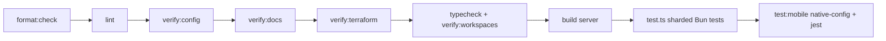

# Verification gate, test layout, and narrow validation

The repository has one authoritative gate and many narrow checks. Use the narrow check while iterating and the gate once before a PR (`CONTRIBUTING.md`, README).

## The gate: `bun run check`

Runs, in order: `format:check` (Prettier over package.json, configs, `.github`, packages, workers, infra, scripts, docs, root md) → `lint` (`eslint . --max-warnings 0`) → `verify:config` → `verify:docs` → `verify:terraform` → `typecheck` (`verify:workspaces` then every workspace's `typecheck`; infra's also synthesizes the example district) → `build` (Next.js production build of `packages/server`) → `test:full` (`scripts/test.ts` then `test:mobile`). It needs Docker (synthetic PostgreSQL), Bun 1.4.2 and Poppler's `pdftotext`; the `verify:terraform` stage uses a local Terraform or Docker (see below). No `@ts-ignore` or lint-suppression comments are allowed.

Caption: order of `bun run check`; the first failing stage stops the chain.

## Test runner (`scripts/test.ts`)

- **Discovery**: `discoverTestFiles` walks `packages`, `workers`, `infra`, `scripts` for `*.test.ts(x)`, skipping `node_modules`, `.next`, `ios`, `android`, `cdk.out`. `scripts` is included on purpose (a colocated test once went unexecuted).
- **Sharding**: `balanceShards` splits files across up to 6 `bun test` processes (override with `--shards N`, 1–16), largest files first. **Each shard gets a freshly created and later dropped database** from the synthetic server, so suites asserting fresh-migration/seed state are deterministic. Cluster roles from migrations are created once up front (`createClusterRoles`) because `pg_roles` is cluster-wide and parallel migrations raced.
- **Modes**: `--unit-only` (`bun run test:unit`) excludes files that read `TEST_DATABASE_URL` (`isDatabaseDependentTest`); the full mode calls `requireFullGateDatabase` and requires a safe synthetic `TEST_DATABASE_URL`. Skipped tests are counted (`countSkippedTests`) and fail the gate — hence Poppler is mandatory (`records/pdf.test.ts` skips without `pdftotext`).
- **Synthetic district**: `bunfig.toml` preloads `scripts/test-preload.ts`, setting `.invalid` origin/domain/bundle defaults (`??=`, so explicit env wins); `packages/server/bunfig.toml` repeats the preload for runs from that directory.

## Synthetic database (`scripts/test-database.ts`)

`bun run test:db:start | test:db:migrate | test:db:seed | test:web | test:db:stop`. `start` launches `compose.test.yml` under a project name derived from the worktree path (`testDatabaseProjectName`), writes git-ignored `.env.local` files with a marker line (`isGeneratedLocalEnvironment`) and refuses ambient `DATABASE_*`/`TEST_DATABASE_URL` conflicts or files it did not generate. `migrate`/`seed`/`web` pin child processes to that database. `requireSyntheticTestDatabaseUrl` (`packages/server/lib/testing/database.ts`) blocks non-loopback/non-synthetic URLs; `createDisposableDatabase` backs per-test databases. See `docs/learnings/security/…pin-synthetic-commands…`.

## Naming conventions → what they need

| Suffix / location | Meaning | Needs |
| --- | --- | --- |
| `*.test.ts` | Unit/contract test, usually in-memory stores | nothing |
| `*.database.test.ts`, `*.integration.test.ts` | Real PostgreSQL via `TEST_DATABASE_URL` | `bun run test:db:start` |
| `packages/server/drizzle/*.integration.test.ts`, `migration-chain.test.ts` | Migration chain, roster immutability, driver reconnect/close behavior | database |
| `*.test.tsx`, `packages/mobile/native-tests/*.native.tsx` | React / Jest native tests | `bun run test:mobile` |
| `packages/server/e2e/*.flow.ts` + `run.ts` | Playwright operator browser flows against a built server, synthetic only; `PSD_EOC_E2E_UPDATE_EVIDENCE=true` rewrites retained evidence under `.verification` | database, Chromium |
| `packages/mobile/e2e/` | Maestro iOS/Android synthetic journey (`bun packages/mobile/e2e/run.ts ios` or `… android`) | simulator/emulator, Maestro; label-gated in CI |
| `test:e2e:issue-NN` scripts | Retained per-issue acceptance evidence runs (`.verification`, `scripts/verify-issue-*.ts`) | varies; conditional |

Structural guard tests worth knowing: `capabilities/execution-boundary.test.ts` (lower-tier invocation allowlists), `contracts/human-only-agent-surface.test.ts`, `schema-enums.test.ts`/`schema-exports.test.ts`, `capability-derived-views.test.ts` (see [capability engine](../architecture/capability-engine.md)), `agent-key-grants.test.ts` and `mcp` manifest tests ([agent API and MCP](../integrations/agent-api-and-mcp.md)).

## Repository-level contracts

- `verify:workspaces` (`scripts/verify-workspaces.ts`): every TypeScript source has an owning workspace package, every package with TypeScript is in the root `workspaces`, has a `typecheck` script and a `tsconfig.json` (tests in `verify-workspaces.test.ts`). Adding a new package or script directory means updating root `package.json` workspaces.
- `verify:docs` (`scripts/verify-documentation.ts`): documentation contract over the repository's Markdown, excluding the generated `openwiki/` tree — see [configuration and readiness](../operations/configuration-and-readiness.md#documentation-contracts-why-docs-edits-can-fail-the-gate).
- `verify:terraform` (`scripts/verify-terraform.ts`): for each AWS Terraform root (currently only `infra/terraform/stateful`), runs `init -backend=false`, `fmt -check`, `validate`, and `test`. The Terraform line comes from that root's `versions.tf` (`~> 1.16.0`); it uses a local `terraform` only when its major.minor matches, otherwise the matching `hashicorp/terraform` Docker image. Providers are mocked, so no cloud credential is read or used. The partner pool's mocked plan is described in [infrastructure](../operations/infrastructure.md#partner-first-responder-directory-terraform-stateful-root); its runs in `partner_user_pool.tftest.hcl` include `partner_pool_plan` (pool, client and secret-path settings, and the exact `stack_parameters` key set) and `owner_requires_a_dotted_domain` (an `expect_failures` check on the `owner` validation). The Firebase root under `infra/gcp/firebase` is tested separately in `infra/test/gcp`.
- `scripts/check-applied-migrations.ts <base> <head>`: CI refuses edits/deletes of migrations or journal entries already on the base branch ([data model](../domain/data-model.md)).

## CI (`.github/workflows/ci.yml`)

`changes` classifies the PR diff (docs/workflow-only changes skip the expensive jobs; push to `main` runs everything). Jobs: `gate` (installs Terraform 1.16.5 through `hashicorp/setup-terraform` for the credential-free plan tests; fresh-clone README path: start DB, migrate, seed, start the documented web app, run `bun run check` (which includes `verify:terraform`), issue-278 lifecycle and issue-43 direct-push cutover verifications, synthesize a second-district config); `migrations`; `workflows` (actionlint); `browser` (operator browser flows on a production build); `mobile` (Expo compatibility, React runtime, native project generation with safety-config greps); `native-e2e` (reusable `mobile-e2e.yml`, only with the `mobile-e2e` or `direct-push-cutover` label or manual dispatch — macOS runners are costly). `psd-ci.yml` (org-standard) runs the static half plus `bun run test:unit`. Every third-party `uses:` reference is pinned to a full commit SHA with a version comment (the one unpinned reference is the local `./.github/workflows/mobile-e2e.yml` call in `ci.yml`), and the OpenWiki reusable workflow in `openwiki-update.yml` is pinned to a tagged release rather than `@main`. Nothing in this repository's scripts or tests enforces the pins; when adding or bumping an action, pin it to a SHA yourself and keep the version comment. The `workflows` job runs actionlint only when workflow files change. No workflow deploys the CDK stack, and the `forbids workflows that deploy the CDK stack or its images` test in `scripts/verify-documentation.test.ts` pins that ([infrastructure](../operations/infrastructure.md#deploy-model-and-ordering)). The planned Terraform apply workflow is not present in `.github/workflows` yet.

## Narrowest validation by change area

| Changed | Run first | Escalate when |
| --- | --- | --- |
| A single server lib module | `bun test <path>.test.ts` (add `--bail` while iterating) | it has a `.database.test.ts` sibling → start the synthetic DB |
| Contracts schema | `bun test packages/contracts/src` then `bun run --cwd packages/server typecheck` | consumers in mobile/mcp/workers change → typecheck those workspaces (`bun run typecheck`) |
| Worker | `bun test workers/<channel>` | durable store/route involved → matching server `*.integration.test.ts` (send-time currency: `packages/server/lib/notify/batch-lifecycle.integration.test.ts`, `email-runtime-store.integration.test.ts`) |
| Mobile logic | `bun test packages/mobile/src/<area>`; native screens `bun run --cwd packages/mobile test:native -- --testPathPattern <name>` | behavior change → both `bun packages/mobile/e2e/run.ts ios` and `android` |
| Infra | `bun test infra/test/<file>`; `bun run --cwd infra synth:example` | whole stack asserts → `bun test infra/test/stack` |
| AWS Terraform (`infra/terraform/**`) | `bun run verify:terraform` | the stack's partner parameters or secret path change → also `bun test infra/test/stack/psd-eoc-stack.test.ts` |
| Docs | `bun run verify:docs` | — |
| Formatting | `bun run format:check` (or `bun run format` to fix) | — |

Do not run the full gate or e2e suites by default; run them when a change crosses package boundaries, touches migrations/seed data, the Next.js build output (the production build is exercised by `browser` and `build`), or a public contract used by several runtimes. Write tests for real/drill separation and for the human-only boundary whenever a change could blur them ([event lifecycle](../domain/event-lifecycle-and-activation.md)).
